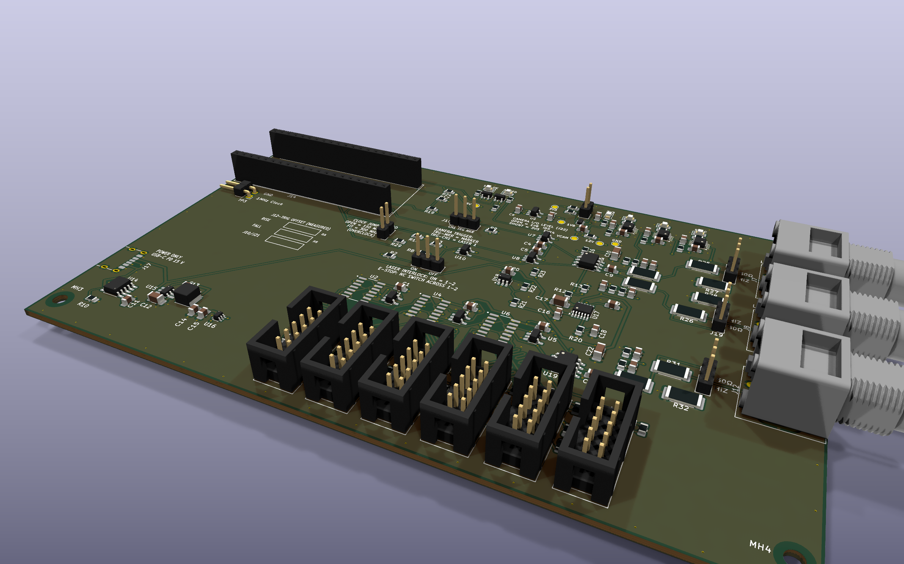
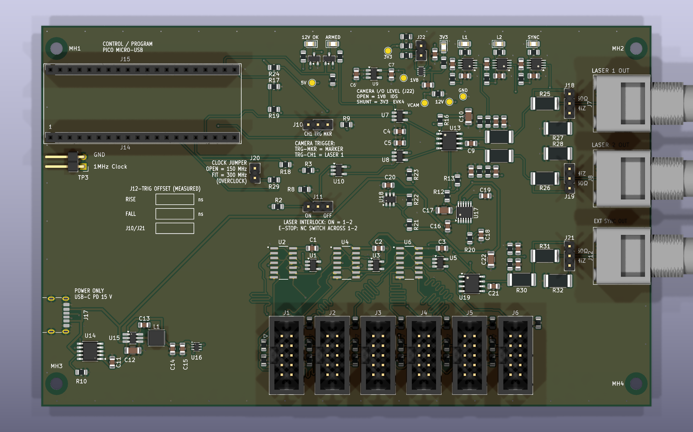
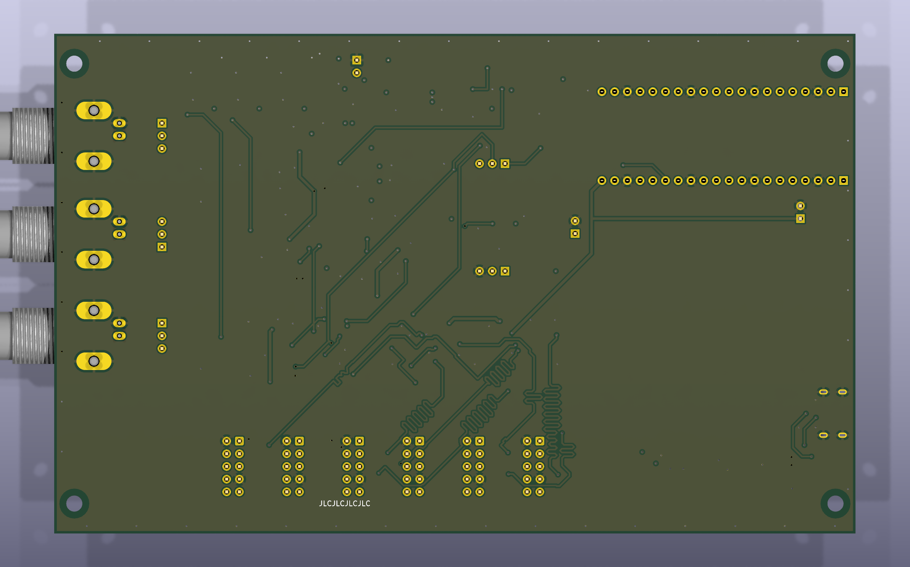
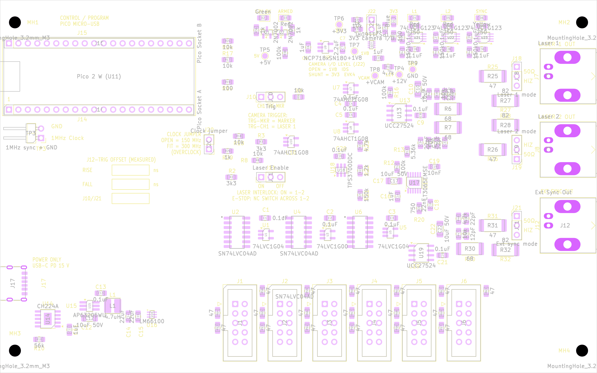
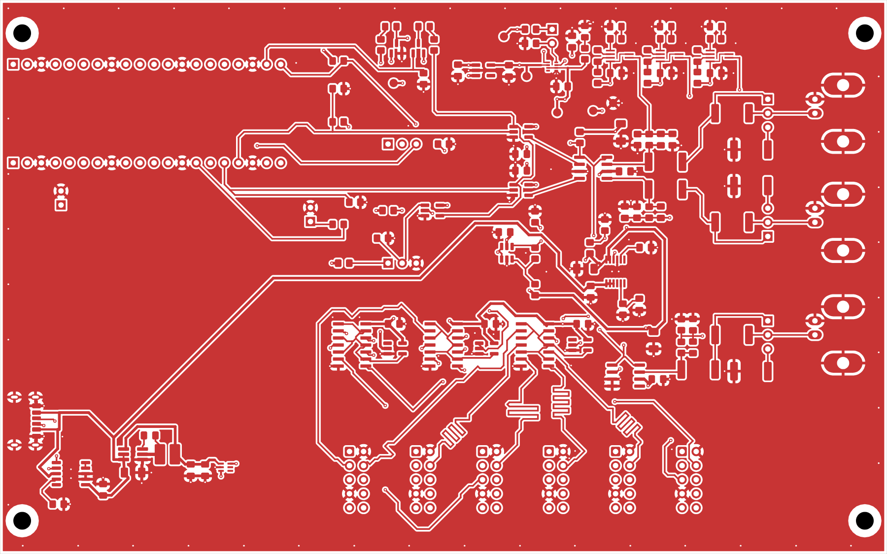
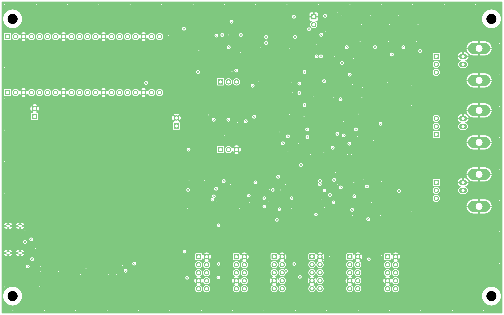
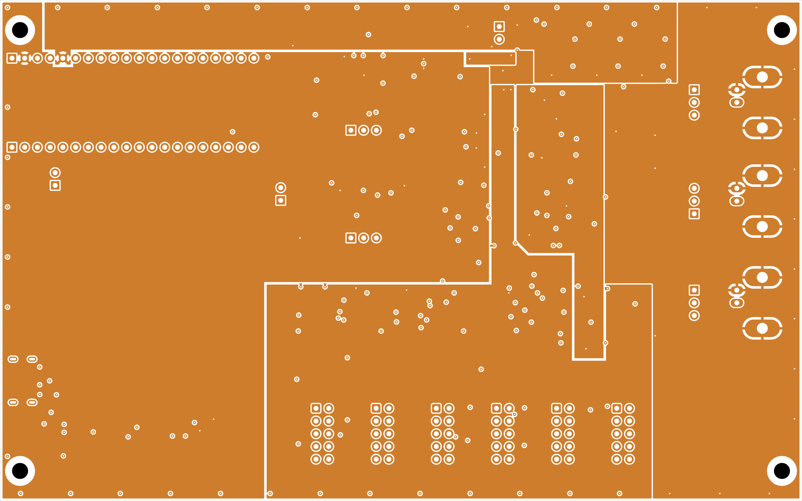
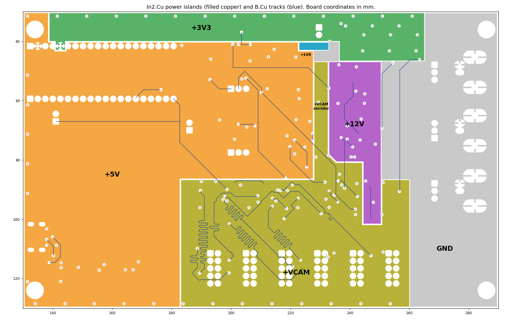
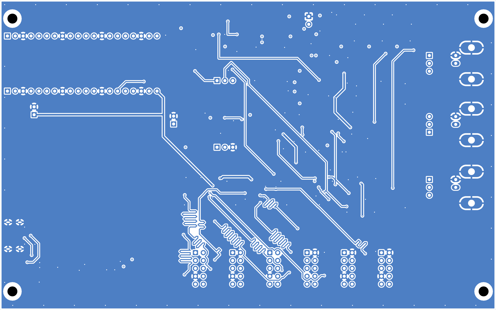

# PiEBV hardware reference (Pico 2 W, 4-layer board)

This is the design reference for the PiEBV board: what each part of the circuit does and what to check on the first boards. It is for anyone building, checking or
changing the hardware. To *use* the board, see the [README](README.md).

The board is built around a socketed Raspberry Pi Pico 2 W, on 4 copper layers.

**Board revision 2** (2026-11-12). Rev 2 adds a selectable camera I/O level (1.8 V for IDS cameras,
3.3 V for Prophesee EVK4 cameras), a 47 Ω series resistor in each camera line, status LEDs, rail
test pads, and power islands on the third copper layer. [Rev 2 changes](#rev-2-changes) lists the
differences from Rev 1. The EVK4 wire harness is in [docs/EVK4_HARNESS.md](docs/EVK4_HARNESS.md).

**Status:** passes KiCad's design-rule check (DRC) and electrical-rule check (ERC) with 0
violations. Not yet built: work through the [first-board checks](#first-board-checks) on the first
boards.

**Contents:** [Rev 2 changes](#rev-2-changes) · [Board views](#board-views) · [How the board works](#how-the-board-works) · [At a glance](#at-a-glance) ·
[Socket pin mapping](#socket-pin-mapping--read-this-first) · [Firmware pin map](#firmware-pin-map) ·
[Power](#power) · [Signal chains](#signal-chains) · [Laser interlock](#laser-interlock) · [Status LEDs](#status-leds) ·
[Connectors](#connectors) · [First-board checks](#first-board-checks) ·
[Manufacturing notes](#manufacturing-notes) · [Files](#files)

---

## Rev 2 changes

| Item | Rev 1 | Rev 2 |
|---|---|---|
| Camera I/O level | 1.8 V only (U9) | `+VCAM`: 1.8 V with J22 open (default), 3.3 V with J22 fitted. U20 (TPS2116 power mux) selects the rail: VIN1 = +1V8, VIN2 = +3V3. R34 pulls the select pin PR1 up to +3V3 (1.8 V); a shunt on J22 pulls it low through R35 (3.3 V). R51 discharges `+VCAM`. D1 (blue) shows 3.3 V. See [+VCAM](#vcam-the-camera-signal-supply). |
| Cameras | IDS uEye EVS | IDS uEye EVS (1.8 V), or Prophesee EVK4 (3.3 V) with the harness of [docs/EVK4_HARNESS.md](docs/EVK4_HARNESS.md) |
| Series resistors in the camera lines | none | R52–R69, 47 Ω 1 %, 0805: one in each Sync, Trigger and TDRSTN line, between the buffer output and the camera header pin. They are the source termination of the camera cable. See [+VCAM](#vcam-the-camera-signal-supply). |
| Status LEDs | none | D2 12 V good, D3 ARMED, D4/D5/D6 output activity of Laser 1 / Laser 2 / External Sync Out. See [Status LEDs](#status-leds). |
| Firmware pin | – | GP17 = `ARMED_LED` (output, high while ARMED) |
| Third copper layer (In2.Cu) | one +5 V plane | islands: +5V, +3V3, +1V8, +VCAM, +12V, in a GND fill. See [Power islands](#power-islands-in2cu). |
| Test pads | TP3 only | TP4–TP9: +12V, +5V, +3V3, +1V8, +VCAM, GND |
| U9, C6, C7 | beside the camera buffers | in the supply block at the top centre, beside U20 |
| Parts | 84 placed | 148 placed, plus 6 test pads |
| Finest pitch | 0.65 mm | 0.5 mm (U20, SOT-583) |
| Camera line lengths (buffer pad to resistor pad in Rev 2) | group spreads 1.18 / 2.47 / 1.37 mm (Sync / Trigger / TDRSTN, buffer pin to header pin) | `Sync1`–`Sync6` 78.142–78.168 mm (spread 0.025 mm), `Trigger1`–`Trigger6` 45.144 mm (spread 0.000 mm), `TDRSTN1`–`TDRSTN6` 53.924 mm (spread 0.000 mm). The stubs from the resistors to the header pins are equal in each group. |
| Routing | – | The Rev 1 camera copper is removed. The camera lines are routed again, from the buffer to the series resistor. See [Routing](#routing). |

Rev 2 is made from the Rev 1 board by `tools/rev2` (see its README). The laser pulse lanes and the
output block keep their Rev 1 copper. The camera lines do not: `tools/rev2/build.sh` removes the
Rev 1 camera copper and routes these lines again.

---

## Board views

Images of the Rev 2 board, made by `tools/rev2/images.sh` from `PiEBV_Pico.kicad_pcb`.

**3-D render**



**Top view and bottom view (3-D render)**





**Top side: silkscreen, pads and part outlines**



**Layer 1, F.Cu (top): parts, signals, GND fill**



**Layer 2, In1.Cu: GND plane**



**Layer 3, In2.Cu: power islands in a GND fill**



**In2.Cu power islands (colour map) with the B.Cu tracks**



**Layer 4, B.Cu (bottom): signals, GND fill**



---

## How the board works

```
 USB-C charger ──► J17 ──► power section ──┬─► +5 V  (logic, Pico) ◄── also from the Pico's USB
   (15 V)                                   ├─► +VCAM (camera signals): 1.8 V, or 3.3 V with J22 fitted
                                            └─► +12 V (laser driver), checked by a voltage window (U18)
                                                (+3.3 V comes from the Pico itself)

 PC ──USB──► Pico 2 W ──┬─ CH1, CH2 ──► interlock ──► 12 V driver ──► output resistors ──► J7, J8
                        │             (ARM, J11)      (U13, on only    and mode jumpers      Laser 1, 2
                        │                              if 12 V is OK)  (R6/R7, J18/J19)
                        ├─ marker ────► J10 selector ─┬─► +VCAM buffers ──► camera trigger (J1–J6)
                        │                             └─► 12 V driver (U19) ──► R30, J21 ──► J12
                        │                                                       External Sync Out
                        ├─ 1 MHz sync ───────────────► +VCAM buffers ──► camera sync    (J1–J6)
                        └─ pixel gate ───────────────► +VCAM buffers ──► camera pixel reset
```

- **The Pico makes all the timing.** Its PIO blocks (small timing engines beside the processor)
  produce the two laser pulses, the camera marker, the 1 MHz sync clock and the pixel-reset gate,
  all from one 150 MHz clock (300 MHz with a shunt on the
  [clock jumper](#clock-jumper-j20-300-mhz-overclock) J20).
- **The laser path** has three gates in series: the firmware's ARM state, the hardware interlock
  (J11) and a 12 V power-good check (U18) that switches the driver chip on. The driver chip (U13)
  swings its output to 12 V; resistors after it bring that down to about 5 V at the laser driver's
  input. Jumpers J18/J19 match each output to a 50 Ω or a high-impedance load: the wrong setting
  gives the wrong voltage.
- **The camera path** converts every signal to the camera I/O level `+VCAM`, and each camera
  cable has its own driver gate. `+VCAM` is 1.8 V (IDS cameras) with J22 open and 3.3 V (Prophesee
  EVK4) with J22 fitted. The pixel reset comes only from the Pico (`PIXGATE`); the EVK4 has no
  pixel-reset input.
- **Status LEDs** show 12 V good (D2), ARMED (D3), a pulse at each output (D4–D6) and a 3.3 V camera
  level (D1).
- **External Sync Out (J12)** copies the camera trigger to a BNC through a third channel built like
  the laser outputs (U19, R30, J21), with the same 50 Ω / Hi-Z choice and the same ~5 V level.
- **Power** comes from a USB-C charger on J17, which the board asks for 15 V. The Pico's own USB can
  run everything except the laser outputs.

### Reading this document

- **Reference designators** (U13, R6, J7 …) are the part labels on the board and in the schematic.
  Pin numbers are written `U13.7` (U13, pin 7).
- **Net names** (the names of connections in the schematic) are in `code`, e.g. `CH1_DRIVE`.
- **Rail:** a supply voltage shared across the board (+5V, +12V …).
- **Pull-up / pull-down:** a resistor that holds a line high or low when nothing else drives it.
- **Open-drain:** an output that can only pull low; a pull-up provides the high level.
- **VIH / VIL:** the voltage an input needs to read high / low. **VOH / VOL:** what an output
  delivers when high / low. "Margin" is how far the level an output delivers is beyond what the
  input needs (e.g. 3.76 V delivered against a VIH of 2.0 V is 1.76 V of margin).
- **Schmitt trigger:** an input with two thresholds (hysteresis), so a slow or noisy edge switches
  once instead of chattering.
- **LDO, buck:** two kinds of voltage regulator: a linear one (simple, quiet, burns the excess as
  heat) and a switching one (efficient).
- **Shunt** means the plastic jumper cap. The resistors to ground in the output-mode circuit are
  called resistors to ground, not shunts.

---

## At a glance

| | |
|---|---|
| Board | 160 × 100 mm (EuroCard), 4 copper layers, 1.6 mm FR4 |
| Processor | Raspberry Pi Pico 2 W, in sockets (not soldered) |
| Power | **USB-C PD input (J17, 15 V)** for the laser driver and the whole board; the Pico's own USB still powers the logic when J17 is unplugged |
| Rails | **+VCAM** (camera signals: 1.8 V, or 3.3 V with J22 fitted) · 1.8 V (U9, to U20) · 3.3 V (Pico 3V3_OUT: R24, R34, U20, U21–U23) · 5 V (logic, Pico VSYS) · **12 V** (11.8 V, output drivers U13 and U19, from J17 only) |
| Design rules | 0.2 mm clearance, 0.2 mm track, 0.6/0.3 mm via, 0.5 mm copper-to-edge |
| Parts | 148 placed parts (128 SMD, 20 through-hole), 6 bare test pads, 4 unplated mounting holes (158 footprints) |

**Layers**

| Layer | Use |
|---|---|
| F.Cu (top) | signals + ground fill |
| In1.Cu | solid ground plane |
| In2.Cu | power islands (+5V, +3V3, +1V8, +VCAM, +12V) in a GND fill |
| B.Cu (bottom) | signals + ground fill |

In1.Cu and In2.Cu carry no tracks. Each rail has an island on In2.Cu, and the parts connect to
their island through vias (taps) beside their pads on the top layer; see
[Power islands](#power-islands-in2cu). The camera buffers also keep their Rev 1 supply tracks
(now `+VCAM`), in parallel with the +VCAM island.

**Stackup** (symmetric 1.6 mm, matching JLCPCB's standard 4-layer `JLC04161H-7628`):

| | Type | Thickness |
|---|---|---|
| F.Mask | solder mask | 0.010 mm |
| **F.Cu** | copper, 1 oz | 0.035 mm |
| dielectric 1 | prepreg, FR4 εr 4.5 | 0.2104 mm |
| **In1.Cu** | copper, ½ oz | 0.0152 mm |
| dielectric 2 | core, FR4 εr 4.5 | 1.065 mm |
| **In2.Cu** | copper, ½ oz | 0.0152 mm |
| dielectric 3 | prepreg, FR4 εr 4.5 | 0.2104 mm |
| **B.Cu** | copper, 1 oz | 0.035 mm |
| B.Mask | solder mask | 0.010 mm |

Total 1.586 mm of copper and dielectric, 1.606 mm with the mask: a nominal 1.6 mm board. Confirm
these numbers against what your fabricator actually presses.

**Finish: lead-free HASL** (`HAL lead-free`). It is RoHS compliant and the cheapest compliant finish
at most quick-turn fabs, only slightly dearer than leaded HASL and far cheaper than ENIG. It arrives
pre-tinned, tolerates rework better than OSP (whose coating degrades with repeated heating), and
solders with either leaded or lead-free solder.

The finest pitch is U20 (TPS2116, SOT-583-8): 0.5 mm, pads 0.3 mm wide. U16 (SC-70-6), U17
(LT3065, MSOP-12 with an exposed pad) and U21–U23 (SSOP-8) have 0.65 mm.
J17 is a 6-pin power-only USB-C receptacle: pads 0.7–0.9 mm wide with gaps of 0.27–0.38 mm (the two
smallest, 0.27 mm, are B9–A5 and B5–A9). There
is no BGA and no leadless part: every IC has gull-wing leads, so the board can also be assembled by
hand. Only the exposed pads of U14 and U17 need hot air or a hot plate (see
[Hot-plate assembly](#hot-plate-assembly)): their GND vias are tented
like all the others, so solder cannot be fed through them from the back. The HASL surface is
uneven enough that J17 is worth inspecting for solder bridges
(see [first-board check 5](#first-board-checks)). All 0805, 1206 and 2512 passives and the
SOT-23-5/TSOT-23-6 parts (U1, U3, U5, U7–U10, U15) and the LEDs D1–D6 use `_HandSolder`/`_HandSoldering` footprints.
The other SMD parts use standard footprints: U18 (SOT-23-6), U16 (SC-70-6), U17 (MSOP-12), U14
(SSOP-10), the SOICs (U2, U4, U6, U13, U19), L1 and J17.

**Board size:** the gerber job file reports 160.1 × 100.1 mm because the outline's extents include
its 0.1 mm line width. The fabricated board is **160.0 × 100.0 mm**, a EuroCard. (Before the
EuroCard re-layout it was 126 × 126 mm, with the same stackup, design rules, parts, footprints and
netlist.)

### EuroCard mechanics

Positions are as seen from the top side, with the board landscape (160 mm wide, 100 mm tall).

- **Long edges (160 mm):** no parts within 2.5 mm, the card-guide border of IEC 60297-3. This
  also suits extruded enclosures whose slots take the 160 mm edges, such as the Hammond
  1455N1601. Zone copper still goes to 0.5 mm from these edges, under solder mask.
- **All external connectors are on the two short (100 mm) edges:**
  - left edge: the Pico 2 W's micro-USB (`CONTROL / PROGRAM`) at the top, its receptacle face
    0.285 mm past the edge (x 129.715; the module and receptacle outlines are on F.Fab), TP3 (1 MHz
    scope header, right-angle) below the Pico, its pins pointing at the left edge and ending 0.96 mm
    inside it (reach it from above), and J17 (USB-C PD power input) at the bottom, face flush with
    the edge;
  - right edge: only the BNCs J7 (Laser 1), J8 (Laser 2) and J12 (External Sync Out), top to
    bottom.
- **Camera headers J1–J6:** one row along the bottom of the board, 12 mm pitch, vertical 2×5 IDC
  with the ribbons going up. They are not on an edge.
- **Cable exits:** in an enclosure closed along the long edges, the camera harnesses and the J11
  E-stop wires must leave through an end panel. Two strips of the short edges have no connector
  (measured between courtyards): on the left edge, 31.8 mm between TP3 and J17 (38.8–70.6 mm below
  the top edge); on the right edge, the lowest 31.7 mm, below J12 (MH4 is in its bottom corner).
  J11 (47.5 mm below the top edge) is level with the left strip: run the E-stop pair straight left
  and mount the normally-closed switch in the left panel there, or pass its cable through a
  grommet. The camera ribbons rise from J1–J6 and go to a slot in either strip: J1 is 58 mm from the
  left edge, J6 31 mm from the right edge. A 10-way ribbon (1.27 mm pitch) is 12.7 mm wide, so the
  slot is one ribbon wide with the ribbons stacked flat; a harness with only the five used wires
  (pins 2, 3, 4, 5 and 7) makes a smaller bundle.
- **MH1–MH4:** M3, unplated, in the corners, 4 mm in from the 100 mm edges and 6 mm in from the
  160 mm edges: centres 152 × 88 mm apart. The output block (BNCs, jumpers, resistors, U7/U8/U13/U19) sits low enough that an M3
  washer (7 mm) at MH2 clears the J7 BNC body. In card guides or the 1455N1601 slots, leave the
  holes empty (no screw, nut, washer or standoff): a 7 mm washer reaches the 2.5 mm guide border.
- **Hammond 1455N1601** (values from the Hammond drawing; confirm them on a sample): 11 board slots
  (2.0 mm wide, 3.5 mm pitch), slot span 100.00 ± 0.51 mm, length 160.00 ± 0.50 mm, so the nominal
  clearance to the board is zero: measure the extrusion before ordering, and dress the long edges
  by no more than 0.2 mm (the plane edges are 0.5 mm in). Use the lowest or the second
  slot: about 41.8 or 38.3 mm above the board top. Below the board, the corner rails reach about
  6.4 mm in from each long edge; only MH1–MH4 are in that strip, and the bottom side has no parts.
  The end-bezel window is 97.1 × 48.7 mm; all the cut-outs below are inside it.
- **End-panel cut-outs** (distances from the top 160 mm edge, y = 30; heights above the board top):

  | Edge | Item | Centre from top edge | Notes |
  |---|---|---|---|
  | left | Pico micro-USB | 20.50 mm | about 13 mm up (on its sockets); face 0.285 mm past the edge |
  | left | TP3 (1 MHz + GND) | 34.46 / 37.00 mm (GND / 1 MHz pin) | pins end 0.96 mm inside the edge; no cut-out needed, reach it from above |
  | left | J17 USB-C | 76.00 mm | flush with the edge |
  | right | J7 / J8 / J12 BNC | 20.445 / 40.130 / 60.450 mm | axis about 6.6 mm up; barrels about 20.6 mm past the edge |

  Size each USB cut-out for the cable plug's overmould, not for the receptacle: J17 is flush and the
  Pico receptacle is only 0.285 mm proud, so a panel of normal thickness otherwise stops the plug
  before it seats (USB-C overmould up to 12.35 × 6.5 mm; measure the micro-USB cable). The right
  panel is seen from outside: mirror the drawing if it is drawn from the inside.

### Routing

- **Tracks on F.Cu and B.Cu only.** In1.Cu is a solid GND plane and In2.Cu holds the power islands.
  The Rev 1 board was
  autorouted with KiCadRoutingTools (github.com/drandyhaas/KiCadRoutingTools, commit 8759686,
  v0.23.8): 0.3 mm signals, 0.5 mm power, 0.6 mm buck switch node, 0.3 mm USB-C CC lines, 0.2 mm
  clearance. The Rev 2 build uses the same tool (same commit) for the camera lines only; all
  other copper is locked during that step.
- **Carried copper.** The hand-routed copper of the laser and External Sync Out output block (nets
  `CH1/2_GATED`, `CH1/2_DRIVE_RAW`, `CH1/2_DRIVE`, `CH1/2_OUT`, `CH1/2_TERM`,
  `EXT_SYNC_DRIVE_RAW`, `EXT_SYNC_DRIVE`, `EXT_SYNC_OUT` and `EXT_SYNC_TERM`, with their GND vias) and the exposed-pad thermal vias of U14 and U17 were kept unchanged. So were the hand-routed local paths of the parts that keep their original relative positions: the buck's input (C12 to U15 VIN and GND, 2.35 mm each), its SW node (U15 to L1 3.1 mm, with C13) and BST, and each decoupling capacitor of the camera buffers to its two ICs' supply pins (for example C2 to U3, 4.2 mm, no via). C11 sits beside U14's VHV pin (pin 1), 2.5 mm of track.
- **Laser pulse lanes, equal length.** A script drew `_PULSE_OUT_CH1` and `_PULSE_OUT_CH2`
  (0.3 mm, F.Cu) before routing and locked them. From the GPIO pin to U13's input, both channels are
  **66.16 mm** (CH1: 55.75 mm to U7, then 10.41 mm; CH2: 56.49 mm to U8, then 9.67 mm). The
  shorter lane has a small 45° bump. On the 126 mm board they were 86.32 and 81.74 mm, 4.6 mm
  apart. CH2's lane also has a 22.78 mm branch to R18.1 (its 10 kΩ pull-down), drawn as a balance
  stub: its length trims the CH1-minus-CH2 skew at U7/U8 for the R19/J10 load on CH1, whose
  R19/R17 branch is 7.8 mm. R19.2 continues CH1's pulse as `CH1_J10` (behind 100 Ω) to J10.1.
  Gaps, edge to edge on one layer (tracks and vias; pads where stated; zone fills not counted;
  `tools/eurocard/netgap.py`): the two lanes are at least 2.24 mm apart; lane copper is at least
  21.70 mm from `PWM_1MHz` and `SYNC_N` (the nearest part is the R18 branch); to all other nets it
  is at least 0.45 mm: 0.45 mm to the `CH1_J10` via at (192.9, 52.9) (CH1's own pulse behind
  R19), 0.54 mm to `CLK_SEL` (a 0.9 mm parallel run of the CH2 lane at x 171.5–172.4, y
  64.3–65.2), 0.60 mm to the GND track from U7.3 (the pin next to the lane's pin U7.2), 0.63 mm
  to `LASER_EN` at U8.1, 0.95 mm to a
  `PIXRST_GATE` via, and 1.9 mm or more to every other net. At the pins the pin pitch sets the gap:
  0.22 mm from the U7.2 pad to a `LASER_EN` track, 0.30 mm between the U7/U8 pads, 0.84 mm
  between the J14 socket pads, and 3.91 mm from the CH2 lane to the J14.20 (`PWM_1MHz`) pad.
- **Camera lines, length-matched** (Rev 2). Each camera line has two parts: the routed line from
  the buffer output pad (U2, U6 or U4) to the pad of its series resistor (R52–R69), and a short
  F.Cu stub from the resistor to the header pin. The Rev 1 camera copper does not exist any more.
  Lengths from the buffer pad to the resistor pad, as KiCad's length tool measures (via length
  included):

  | Group | Buffer pad to resistor pad | Spread | Rev 1 spread | Stub, resistor to header pin |
  |---|---|---|---|---|
  | `Sync1..6` | 78.142–78.168 mm | 0.025 mm | 1.18 mm | 4.43 mm |
  | `Trigger1..6` | 45.144 mm | 0.000 mm | 2.47 mm | 9.77 mm |
  | `TDRSTN1..6` | 53.924 mm | 0.000 mm | 1.37 mm | 5.09 mm |

  0.025 mm is about 0.2 ps. The stubs are the same for all six headers. The match starts at the
  buffer output, not at its input: the input fan-outs (`SYNC_N` from U1.4, `TRIG_N` from U5.4 and
  `PIXRST_N` from U3.4, each to the six gate inputs of its hex buffer U2, U6 or U4) are not matched,
  and their branch lengths differ by 6–11 mm. On the 126 mm board the camera lines were not matched
  (Sync 28–71 mm, Trigger 21–56 mm, TDRSTN 20–41 mm). The build checks that the spread in each
  group is 0.1 mm or less, and that two parts of one camera line are at least 0.3 mm apart
  (`tools/eurocard/meander_check.js`). The item "Rev 2 build of the copper" below gives the
  steps. The gaps between the three groups were not measured again after the new routing.
- **Plane taps.** Each SMD GND and +5V pad that the carried hand copper does not already touch has
  its own short tap track to a via into In1 or In2, placed outward from the part body
  first. Rev 2 adds the taps of the new parts and of the other rails (table under
  [Power islands](#power-islands-in2cu)). The buck's GND link (C12.2 to U15.4) keeps its two hand vias, 1.74 and 1.90 mm from
  C12.2. +5V has only 19.26 mm of surface copper (14 segments); the In2 plane carries it.
- **Reference planes (F9).** F.Cu signals run over In1 GND and B.Cu signals over the In2 islands, both
  0.21 mm away. In Rev 2 every B.Cu camera track is over the +VCAM island,
  and `PWM_1MHz` and `PWM_TRIG_TAP` each cross one island gap (+5V to +VCAM); see
  [Power islands](#power-islands-in2cu). The rest of this item is the Rev 1 analysis (In2 = one +5 V plane, Rev 1 camera copper). On B.Cu: Sync 413.9 mm, Trigger 15.9 mm (Trigger6), TDRSTN 249.8 mm, `PWM_1MHz`
  79.6 mm, `PWM_TRIG_TAP` 70.2 mm, `PIXRST_GATE` 39.2 mm. Their return current flows in the +5 V
  plane; at a layer change it crosses to GND through the B.Cu GND pour over In2 (about 18.9 pF/cm²)
  and the In1–In2 core (about 3.7 pF/cm²). The discrete +5 V-to-GND capacitors are C4 and C5
  (224, 57.8 / 60.8) and C6 (214.5, 78.7). Decision: no extra GND return vias. The review's option
  (`route_planes.py --add-gnd-vias --gnd-via-distance 1.5` in the stitching step) would add 50 GND
  vias beside the signal vias on this routing, with no track change; the finding is low severity
  for these 1.8 V LVC lines (edges about 1–3 ns), so the verified copper is kept. Add the option
  if EMI measurements call for it, then run the build checks again.
- **R9 / J10 area.** `PIXRST_GATE` on B.Cu, from its via at (205, 52.4) to its via at (218.3, 86.1),
  runs 45°, vertical at x 209.1, 45° (`simplify.py`). The router's 1.8 mm 45° jog between two
  verticals (x 208.2 and x 210) is removed. The length is the same (39.21 mm on B.Cu) and the vias
  do not change. The vertical is 0.65 mm from the `PWM_TRIG_TAP` via at (210.2, 57.2) and from the
  `LASER_EN_TAP` via at (208.0, 68.5), and 1.13 mm from the +5V tap via at (210.68, 67.05) (was
  0.23 mm). The other shapes there are necessary. `PWM_TRIG_TAP` leaves J10.2 up and over the
  `PIXRST_GATE` via, then comes down to its via at R9.1. The two nets must cross, and they can
  cross only above the CH1 pulse lane (F.Cu, y 53.8), where `PIXRST_GATE` is still on F.Cu. Its
  via (210.2, 57.2) is R9.1's only connection (R9 is a front SMD part), so it is not a plane jump
  on the J10-to-U5 path. `CH1_J10` needs its via to cross the lane (no via in the R19.2 pad), and
  `PWM_Trig` leaves J10.3 with one 45° run.
- **Totals (Rev 2):** 1496 track segments, 2998.5 mm of track (F.Cu 2108.0 mm, B.Cu 890.6 mm), 223 vias
  (`tools/rev2/stats.py`). No two segments are identical. Rev 1: 1015 segments, 2489 mm, 173 vias.
- **Rev 2 build of the copper** (`tools/rev2/build.sh`). The steps, in order:
  1. `pcb_edit.py` removes the Rev 1 camera copper. It places R52–R69 with their stubs. It draws
     `Trigger3` itself (F.Cu, four teeth, 45.8 mm as drawn): the resistor of this line is about
     12 mm from its buffer pin, and the router cannot make the line longer.
  2. `uuidfix.py` gives the board file a fixed item order. pcbnew writes random item IDs, and the
     router result depends on the item order.
  3. KiCadRoutingTools (commit 8759686, the tool of the Rev 1 EuroCard build) routes the other 17
     camera lines from the buffer to the resistor. All other copper is locked. The lines are
     length-matched in each group. The net order was found by a search of about 200 trials.
  4. A check confirms that the router changed no other copper (91 other nets).
  5. `jogs.py` merges 59 router staircases on 14 nets: two steps in one direction become one
     step, so the track length is the same. The choice for each staircase is in
     `jog_choices.json`; `jogfit.py` fits that file to a new routing.
  6. `tidy.py` makes 3 hand edits: the `Sync1` pad entry at U2, a kink on `+5V_PD`, and `+12V` at
     U19.
  7. `trim.py` makes the lines of each group equal by KiCad's own length reading. It moves
     meander caps. A line with no meander gets one square bump.
  8. `spokes.py` adds 4 small pour cut-outs at header GND pins where a camera track leaves only
     one thermal spoke on F.Cu or B.Cu. These pins keep their full connection to the In1 GND
     plane.
  9. `uuidfix.py` runs again. Then the checks run: the DRC gate, the length check (limit 0.1 mm
     spread in each group), the meander check (0.3 mm) and the plane check.

  The build is repeatable: two runs gave the same router output.
- **Known residuals** (none is a DRC error):
  - Seven staircases on camera lines stay as the router made them (`"skip"` in
    `jog_choices.json`: four on `Sync5`, two on `TDRSTN3`, one on `TDRSTN4`). A merge at these
    places makes a DRC violation.
  - The segment density and the number of short segments were not measured again after the new
    camera routing.
  - Two GND vias carried from Rev 1 have their ring 0.20 mm from their own pad: U13.3 via
    (236.0, 60.935) and U19.3 via (241.9, 98.435) (hole edge 0.35 mm from the pad). The tap vias
    of the Rev 1 build are at least 0.25 mm from their pad; that 0.25 mm is the rule of the Rev 1
    tool `taps.py`, not a DRC rule. No DRC rule applies
    here: the board's clearance rules (netclass `Default` clearance 0.20 mm, `min_hole_clearance`
    0.20 mm) are checked only between different nets, and KiCad 10 checks no clearance between a
    via and a pad of the same net (test on a copy: the U13.3 via moved until its hole touched the
    pad, DRC still clean). Both vias are tented on both sides (board setup `tenting front / back`,
    no per-via override), so no via copper is open to solder next to the pad.

---

## Socket pin mapping — read this first

The Pico plugs into two 1×20 sockets, **J15** (top row) and **J14** (bottom row), 17.78 mm apart.
The sockets are horizontal, top-left on the board, with the module's USB end at the left edge and
pad 1 of both sockets at the left. The two rows do **not** number in the same direction:

```
J14 pad n  =  Pico pin n          (pads 1..20 -> pins 1..20)
J15 pad m  =  Pico pin (41 - m)   (pads 1..20 -> pins 40..21)
```

The Pico numbers its pins like a chip: along one row from 1 to 20 (from the USB end), then **back**
along the other row from 21 to 40, so pin 40 (VBUS) sits opposite pin 1. Both socket footprints on the board number
their pads 1 → 20 in the same direction, so the reversal lands entirely on J15.

**Sanity check for any change here:** the Pico's ground pins pair up to a constant sum (3↔38, 8↔33,
13↔28, 18↔23, each summing to 41), so grounds land on pads 3, 8, 13 and 18 of *both* sockets,
directly opposite each other. A mapping that doesn't line the grounds up across the two rows is
wrong.

> **Neither ERC nor DRC can catch a mistake here.** The Pico symbol is self-consistent, and U11 (the
> Pico) deliberately has no PCB footprint, so DRC has nothing to compare. Check every pad
> against the Pico's pinout by hand after any change.

### Connected socket pins

| Signal | Pico pin | Socket pad | Board net |
|---|---|---|---|
| GP11 | 15 | J14.15 | `PWM_Trig` |
| GP12 | 16 | J14.16 | `_PULSE_OUT_CH2` |
| GP13 | 17 | J14.17 | `_PULSE_OUT_CH1` |
| GP15 | 20 | J14.20 | `PWM_1MHz` |
| GP16 | 21 | J15.20 | `PIXRST_GATE` |
| GP10 | 14 | J14.14 | `CLK_SEL` → R29 (1 kΩ) → J20.1 ([clock jumper](#clock-jumper-j20-300-mhz-overclock)) |
| GND | 3, 8, 13, 18 | J14.3, .8, .13, .18 | `GND` |
| GND | 38, 33 (AGND), 28, 23 | J15.3, .8, .13, .18 | `GND` |
| 3V3_OUT | 36 | J15.5 | `+3V3` |
| VSYS | 39 | J15.2 | `+5V` |
| VBUS | 40 | J15.1 | **not connected** (see [Power](#power)) |

All eight module grounds are connected. Every other socket pad is unconnected and, once the module
is seated, out of reach. There is no GPIO breakout header.

**Keep-out:** the module body lies over the two sockets, top-left on the board, with its micro-USB
at the left board edge, so the port can be reached through an enclosure wall. Nothing may be placed
there. The silkscreen labels the Pico port `CONTROL / PROGRAM — PICO MICRO-USB` (above the Pico,
near the left edge) and J17 `POWER ONLY — USB-C PD 15 V` (just right of J17's top, at the bottom of
the left edge).

---

## Firmware pin map

The firmware (`src/`) drives CH1, CH2, MARKER and PIXGATE from PIO state machines (pio0: SM0 CH1,
SM1 CH2, SM2 MARKER, SM3 PIXGATE), so any GPIO can be used for them; they are started on the same
clock cycle, so they stay exactly in step. SYNC comes from the RP2350 clock generator (clk_gpout1),
which reaches only GP13, GP15 and GP21 on the Pico header (GP23–25 are used inside the Pico 2 W);
GP13 is CH1, so SYNC is on GP15. CH1/CH2 reach their pins only while
ARMED; otherwise `src/laser_gate.cpp` holds them LOW.

| Constant | GPIO | Board net | Drives |
|---|---|---|---|
| `kPinMarker` | 11 | `PWM_Trig` | J10.3 → (jumper) → U5 → U6 → Trigger1–6, and U19 → J12 (External Sync Out) |
| `kPinCh2` | 12 | `_PULSE_OUT_CH2` | U8 → U13 → J8 (Laser 2); R18 10 k to GND |
| `kPinCh1` | 13 | `_PULSE_OUT_CH1` | U7 → U13 → J7 (Laser 1); R17 10 k to GND; R19 100 Ω → J10.1 |
| `kPinSync` | 15 (J14 pad 20) | `PWM_1MHz` | U1 → U2 → Sync1–6, and TP3. Clock generator, not PIO. |
| `kPinPixGate` | 16 (J15 pad 20) | `PIXRST_GATE` | U3.1 and U3.2 (NAND with both inputs joined: an inverter) → U4 → TDRSTN1–6; R24 10 k to +3V3. Output inverted in the GPIO block. |
| `kPinClockSel` | 10 (J14 pad 14) | `CLK_SEL` | R29 (1 kΩ) → J20.1; a shunt to J20.2 (GND) selects 300 MHz, read once at boot ([clock jumper](#clock-jumper-j20-300-mhz-overclock)). Input with the internal pull-up; no shunt reads as 150 MHz. |
| `kPinArmedLed` | 17 (J15 pad 19) | `ARMED_LED` | Q2 gate (R38 100 kΩ to GND) → D3 ([Status LEDs](#status-leds)). Plain GPIO output, high while ARMED. Status only: it gates nothing. Not connected on a Rev 1 board. |

**CH1 is the higher GPIO (GP13) and CH2 the lower (GP12).** The order is deliberate; don't "tidy"
them into ascending order.

`src/board.h` repeats this table as a comment. Keep the two in step: when the constants and the
schematic once drifted apart, the whole board looked dead.

### Timing limits

The firmware (`realizeTiming()` in `src/pulse_timing.h`) re-checks the whole set of settings on
every command, using the **realized** values (after rounding to whole PIO cycles: 6.667 ns, or
3.333 ns with the [clock jumper](#clock-jumper-j20-300-mhz-overclock)). It sets
**no laser-driver ratings**: pulse width, duty and spacing depend on the attached driver (the
PicoLas LDP-V datasheets were used only for the electrical interface), so set values within your
driver's ratings. The checks only keep the waveform correct:

- **Pulse pairs stay separate:** `DELAY ≤ 1/FREQ − 2 × WIDTH`, so CH2 ends at least one WIDTH
  before the next pair's CH1 starts. That also limits WIDTH to half the period.
- **Shortest pulse:** WIDTH and MARKERWIDTH must realize to ≥ 3 cycles (20.000 ns; 10.000 ns at
  300 MHz); 16 ns or less (at 150 MHz) is **rejected**, not rounded up. The PIO program itself needs `DELAY ≤ 1/FREQ − WIDTH − 5 cycles`,
  which only matters at 3–4-cycle widths.
- **The marker is at most 50 % duty:** `2 × MARKERWIDTH ≤ 1/FREQ`. This is the one limit set for the
  hardware, not the waveform: the marker also drives J12, and the limit keeps R30's average power
  inside its rating with J12 shorted (see [Board output rating](#board-output-rating)). The PIO
  program also needs MARKERWIDTH ≤ 1/FREQ − 5 cycles, which is the tighter limit only for periods
  under 10 cycles.

### Board output rating

**No firmware setting can overload the laser outputs.** R6/R7, R30 and R25–R28, R31, R32 are
**2 W 2512** resistors, and U17 is a 500 mA regulator with a 400 mA current limit. The laser outputs
carry any duty the firmware accepts (up to 50 % per output, 67 % with `COMBINE 1`):

| Situation (50 Ω mode) | Current | Dissipation |
|---|---|---|
| Output high into 50 Ω | ~96 mA per output (at most 103 mA), ~200 mA for both | at most 0.71 W in R6/R7 while high |
| Output into a shorted BNC, at the highest duty the firmware allows | at most 358 mA while high with both shorted (ROH 0 Ω, 12.05 V), just under U17's 360 mA minimum limit | at most 1.45 W |
| Output **stuck** high into a short (a fault; the firmware never holds an output high) | | 1.5–2.16 W in R6/R7: at the 2 W rating, and up to 8 % over it only if ROH is near 0 Ω (D-package ROH has no specified minimum) |

Hi-Z mode loads everything less (see [Output mode](#output-mode)).

**External Sync Out (J12) follows the camera trigger,** so its duty is the marker's, at most 50 %
(`2 × MARKERWIDTH ≤ 1/FREQ`), or with J10 on 1-2 the CH1 duty (50 %, 67 % with `COMBINE 1`, as
for the laser outputs). Into 50 Ω that is the same ~96 mA (at most 103 mA) and at most 0.71 W in R30
while high. Into a shorted BNC at those duties R30 averages at most 1.08 W (marker) or 1.45 W
(`COMBINE 1`, J10 on 1-2), the same as the laser outputs. The firmware never holds the marker high,
so 1.5–2.16 W (the stuck-high fault case of R6/R7) needs a firmware or GP11 fault as well as a
short. Still, don't short J12. All three outputs high into 50 Ω draw
at most ~310 mA, under U17's 360 mA minimum limit. Shorts on several outputs at once can exceed it:
U17 then limits, +12V sags below U18's undervoltage threshold and `LASER_PWR_OK` turns all three
drivers off, which can repeat while the short lasts.

### Combined mode (`COMBINE 1`)

Both pulses of every pair go to **both** laser outputs, for one light source making both PIV pulses
or two sources fired together with the same double pulse. The CH1 and CH2 state machines then each
run a two-pin copy of the pulse program (`SET PINS, 3` on GP12–GP13, identical cycle timing). The
PIO's shared output latch makes each laser pin carry CH1's pulse and then CH2's, exactly DELAY later
(checked cycle by cycle in `tools/timing_check/check_combined.py`). Each driver then sees two pulses
per period, so check its ratings; the firmware imposes none.

The one extra rule is that the pulses stay separate on the shared pins: `DELAY ≥ WIDTH + 1 PIO
cycle` (6.667 ns). At `DELAY = WIDTH`, CH2 rises on the cycle CH1 falls, the higher-numbered state
machine wins the latch, and the two pulses merge into one of 2 × WIDTH. COMBINE can only be changed
while DISARMED.

**Don't use a BNC tee instead.** Joining J7 and J8, or splitting one output to two drivers, gives
3–3.4 V pulses in 50 Ω mode, or 6.9 V where the pulses overlap (see [Laser outputs](#laser-outputs)).

### Pixel-reset gate (`PIXGATE`)

pio0 SM3 runs the same pulse program on GP16, with the pin's output inverted in the GPIO block
(`GPIO_OVERRIDE_INVERT`), so the program's pulse becomes the pixel reset. It pulls TDRSTN low
`PIXLAG` after the last laser pulse ends (CH1 rise + DELAY + WIDTH + PIXLAG) and releases it
`PIXLEAD` before the next CH1 rise, cycle-exact and locked to CH1 (checked in
`tools/timing_check/check_pixgate.py`). `PIXGATE 1` runs it only while the laser pins carry pulses,
`PIXGATE 2` always. This gate is the only source of the camera pixel reset: the board has no
pixel-reset input, so with `PIXGATE 0` the pixels are never held in reset.

A stopped gate leaves its output latch LOW, which (inverted) leaves the pin HIGH, so DISARM, a
restart hold-off and a reset all leave the pixels free. Rules: PIXLEAD ≥ 5 cycles, and
PIXLEAD + DELAY + WIDTH + PIXLAG ≤ 1/FREQ − 3 cycles. The first pair after a start has no reset
before it. SYNC uses no state machine (it is the clock generator), and it is independent of the
laser timing.

### Timing: what you set is what you get

- **Every reply shows the realized value,** e.g. `DELAY 1003` → `OK DELAY=1003 (actual
  1000.000 ns, 150 cyc)`, and `STATUS` lists them all. The user never has to correct a setting for
  rounding or for fixed instruction overheads.
- **CH2 rises exactly DELAY after CH1,** to the nearest 6.667 ns cycle. This is exact in a
  cycle-accurate model of the PIO; see `tools/timing_check/`.
- **MARKER fires with every pulse pair** and is locked to CH1: it runs the same program at exactly
  the laser period in cycles, started on the same cycle, so it rises with every CH1 pulse and can't
  drift. Each camera timestamps the marker into its event stream, which gives every PIV pair its own
  reference time.
- **SYNC** is fixed at 1 MHz, generated by the RP2350 clock generator (clk_gpout1), whose 16.16
  divider takes clk_sys straight to the pin with 50 % duty correction. At the 150 MHz system clock
  the divider is exactly 150 (300 at 300 MHz), so SYNC is exact and jitter-free; pulse-setting
  changes do not affect it.

### Boot and arming

- **The firmware starts DISARMED.** An early start-up hook (`src/laser_gate.cpp`, `.preinit_array`
  priority 00110) drives GP12/GP13 LOW right after the chip's peripheral reset, before clock setup,
  USB, the Pico 2 W's radio-chip initialisation and `setup()`. They stay LOW until the host sends
  `ARM` over USB. SYNC and MARKER start as soon as `setup()` applies the defaults, and keep running
  while DISARMED. A second hook (`src/clock_mode.cpp`, priority 00700, after the clock setup) reads
  the [clock jumper](#clock-jumper-j20-300-mhz-overclock); the laser pins are already LOW then.
- **`ARM`** (exactly that word, no argument) restarts CH1, CH2 and MARKER together, so the first
  laser pulse is full width and in step. It replies at once; the pulses begin after a **restart
  hold-off** of one pulse period (the longer of the old and new periods, ≤ 1 s), counted from when
  the laser pins last carried pulses. Changing pulse settings while armed goes through the same
  restart. The hold-off keeps the laser pulse spacing ≥ the set period under any sequence of
  commands, so a host looping ARM/DISARM can't fire faster than FREQ. MARKER pauses during it.
- **`DISARM` can never be refused and acts at once.** The six characters `DISARM` (any case)
  anywhere in the input disarm immediately (mid-line, inside an over-long line, after backspace
  edits) and cancel a pending start. Lines may end with CR, LF or CRLF, so PuTTY, Tera Term, screen
  and minicom all work.
- **J7/J8 pulse only when all three are true:** firmware ARMED, J11 on 1-2 (hardware interlock), and
  `LASER_PWR_OK` (12 V rail in its window).
- **Watchdog.** A 3 s hardware watchdog, fed only from the main loop, restarts the chip if the
  firmware hangs. It comes back DISARMED, and `STATUS` shows `RESET=WATCHDOG` and a `WDT_RESETS`
  count. No command can hang the firmware; to test the watchdog, write `0x80000000` (TRIGGER) to
  `WATCHDOG_CTRL` (`0x400d8000`) over SWD with the core running (a halted core pauses the
  watchdog).
- **Replies never block the firmware.** Each reply line is written whole within a 250 ms budget, and
  once a host stops reading, later replies stop waiting until it catches up. So a host that stops
  reading delays a queued DISARM by at most about 250 ms in total and can't trip the watchdog.
  Replies that couldn't be sent are dropped a whole line at a time, and their bytes are counted in
  `STATUS` as `TX_DROPPED`.
- **Host scripts** must send `ARM` after every reset, and should check `RESET=` in `STATUS` first
  (require an operator action after `RESET=WATCHDOG`). Parse `STATUS` by key, not by line count.
- **Losing the USB link does not disarm.** The firmware doesn't watch the USB connection, and J17
  alone keeps the board powered, so a pulled cable, a sleeping PC or a killed host script leaves an
  ARMED board pulsing with no serial path for `DISARM`. The hardware stops are J11 (off 1-2) or
  unplugging J17.

**Remaining hazards the firmware can't remove.** Both need a reset to land during a laser pulse, so
the chance per reset is at most the duty.

- *A reset mid-pulse* (watchdog, or the 1200-baud restart that `pio run -t upload` uses) releases
  the pin instead of driving it LOW. R17/R18 and the pin's own pull-down then discharge it in an
  estimated 70–150 ns, so that one pulse can end up to that much later than WIDTH. Measure it (scope
  GP13 while forcing a watchdog reset). If it matters, fit R17/R18 = 2.2 k (τ ≈ 30 ns; 1.5 mA while
  high, well within the GPIO's drive).
- *A debugger warm reset (SYSRESETREQ)* leaves the PIO running while the boot ROM latches the pins,
  so a pin caught HIGH can stay HIGH until the start-up hook runs: milliseconds. **Before any SWD
  session or debugger reset: DISARM and open J11 (or unplug J17).** The one deliberate exception is
  the watchdog test in [first-board check 1](#first-board-checks), done into a 50 Ω scope input with
  no laser driver connected.

### Clock jumper (J20): 300 MHz overclock

**J20** is a vertical 2-pin header right of the Pico's GPIO end, below the J14 row, with R29 just
right of it (silkscreen `CLOCK JUMPER`, `OPEN = 150 MHz`, `FIT = 300 MHz (OVERCLOCK)`). Pin 1
(square pad, the lower pin) is `CLK_SEL_JMP`, which reaches `CLK_SEL` = GP10 (J14 pad 14) through
**R29 (1 kΩ)**; pin 2 is GND.

- **R29 protects GP10.** Firmware older than the clock jumper (before commit 5dfedd5) drove GP10
  push-pull as the SYNC output, and any other program may drive it too. With the shunt fitted, R29
  limits that current to about 3.3 mA. The internal pull-up is tens of kΩ, so a fitted shunt still
  reads about 0.1 V, far below the 0.8 V LOW threshold.
- **No external pull-up and no capacitor on `CLK_SEL`.** The internal pull-up is enough for the
  short trace, and a capacitor would slow the rise so that an open jumper could read as fitted.
- On a bare Pico, a wire from GP10 (pin 14) to GND (pin 13) acts as a fitted shunt (add a 1 kΩ
  resistor in series for the same protection).

| Clock jumper (GP10 to GND) | clk_sys | Step | Shortest `WIDTH` / `MARKERWIDTH` |
|---|---|---|---|
| Open, no shunt (default, fail-safe) | 150 MHz, the RP2350's rated speed | 6.667 ns | 20.000 ns |
| Shunt fitted | 300 MHz, twice the rated speed | 3.333 ns | 10.000 ns |

- **Read once at boot**, by a start-up hook (`src/clock_mode.cpp`, `.preinit_array` priority 00700).
  It runs after the SDK's clock setup and before the Pico 2 W's radio-chip initialisation, USB and
  `setup()`, so everything after it sees the final clock. Moving the shunt has no effect until the
  next reset. GP10 has the internal pull-up, and the jumper pulls it to GND; a lost shunt gives the
  rated clock.
- **With the shunt fitted, the hook:**
  1. raises the core voltage from 1.10 V to 1.30 V (the highest the SDK allows without unlocking
     the limit) and waits 1 ms, as the SDK does after a voltage change;
  2. doubles the flash-interface (QMI) timing fields that count clk_sys cycles, so the flash keeps
     its 50 MHz clock, sample point and chip-select times (clock divider 3 → 6, sample delay 2 → 4
     half-cycles, deselect time 7 → 14 cycles; COOLDOWN, which only trades power for speed, stays).
     It writes them from RAM while the interface is idle;
  3. sets clk_sys to 300 MHz (pll_sys 1500 MHz / 5 / 1) through the SDK, which also moves clk_peri
     to 48 MHz (UART and SPI are unused);
  4. stops the unused HSTX clock, which would otherwise follow clk_sys to 300 MHz.

  USB, the timer and the watchdog run from their own clocks and do not change.
- **Everything timed follows the clock.** All settings realize in 3.333 ns steps, the SYNC divider is
  exactly 300 (SYNC stays an exact 1 MHz), and every reply shows the realized values. `STATUS` shows
  `CLK=300000000`, `CLKMODE=OVERCLOCK (jumper fitted)` and `VREG_MV=1300`, and the start-up line
  says `clock 300 MHz overclock`. `tools/timing_check` runs every clock-dependent check at 300 MHz too.
- **No overclock after a watchdog restart.** If the watchdog has fired since the last power-up or
  RUN reset (`WDT_RESETS` > 0), the hook keeps 150 MHz with the shunt fitted, and `STATUS` shows
  `CLKMODE=STANDARD (jumper fitted, overclock off: watchdog reset since power-up; power-cycle to
  retry)`. An unstable chip therefore can't crash in a loop at 300 MHz. To try 300 MHz again,
  power-cycle both J17 and the Pico's USB.
- **Back to 1.10 V at 150 MHz.** The voltage regulator keeps its setting through a watchdog or soft
  reset, so on every start that stays at 150 MHz the hook sets the default 1.10 V again
  (`VREG_MV=1100`).
- **300 MHz is outside the RP2350's specification.** Each chip is different, and the higher voltage
  makes the chip hotter. Once running, the watchdog catches a hang (the chip restarts DISARMED, then
  at 150 MHz). It starts only at the end of `setup()`, about 1.5 s after a reset: a chip that hangs
  before then shows no serial port and stays hung. Then remove the shunt and power-cycle. The laser
  pins are LOW from the first start-up hook on, so they stay LOW. Nothing detects a chip that keeps
  running and makes wrong timing. J11 and the 12 V power-good gate stay the hardware stops.

**Before you rely on 300 MHz with a given Pico** (again for every replacement Pico):

1. Fit the heat sink on the RP2350. Fit the shunt, power-cycle, and check `CLK=300000000` and
   `CLKMODE=OVERCLOCK …` in `STATUS`.
2. With J11 open (lasers off) and the outputs into 50 Ω scope inputs, repeat the timing points of
   [first-board check 1](#first-board-checks) at the finer step, e.g. `DELAY 13` → 13.333 ns and
   `WIDTH 10` → 10.000 ns.
3. Soak test: run at the highest `FREQ` and the shortest settings you will use, in the enclosure, at
   the highest room temperature you expect, for several hours (overnight is better). Use the scope's
   pulse-width trigger to catch any pulse of the wrong width. Then `STATUS` must show
   `WDT_RESETS=0` and `HW=OK`.
4. Optional: to make less heat, lower the voltage (`kOverclockVreg` in `src/clock_mode.cpp`) to the
   lowest value that still passes step 3 with margin. `VREG_MV` in `STATUS` shows the setting.

---

## Power

Two inputs. **J17 (USB-C, power only)** is the main supply. The **Pico's own USB** carries data,
and on its own runs everything *except the laser outputs*.

```
J17 USB-C ─ U14 CH224A (asks the charger for 15 V) ─ VBUS_PD (5 V until negotiated, then 15 V)
   ├─ U15 AP63205WU buck ─ +5V_PD ─ U16 LM66100 ideal diode ─┐
   │                                                        ├─ +5V island = Pico VSYS ─ U9 (1.8 V) ─┐
   │               Pico USB VBUS ─ Pico's own Schottky (D1 on the Pico module, not the board's LED D1) ───┘
   └─ U17 LT3065 (adj., 500 mA, 400 mA limit) ─ +12V (11.8 V) ─ U13 VDD (C9, C10, C17), U19 VDD (C21, C22)
        U18 TPS3700 window on +12V (10.6–13.3 V) ─ LASER_PWR_OK ─ U13 and U19 ENA/ENB  (R16 100k pull-up)

     U9 ─ +1V8 ──────── U20 VIN1 ─┐
                                  U20 TPS2116 ─ +VCAM ─ U1–U6 (camera buffers), D1, R51
Pico 3V3_OUT ─ +3V3 ─┬─ U20 VIN2 ─┘   J22 open: +VCAM = +1V8.  J22 fitted: +VCAM = +3V3.
                     └─ U20 MODE, R34 (pull-up of U20 PR1), R24, U21–U23 (activity LED monostables)
```

**VBUS_PD.** U14 is a WCH **CH224A** PD sink (chapter 7 of the CH224 datasheet V2.x
covers the CH224K-to-CH224A differences). R10 =
56 kΩ on CFG1 requests **15 V** (CH224A table 5-1: 6k8 = 9 V, 24k = 12 V, 56k = 15 V, 120k = 20 V,
210k = 28 V — never leave R10 off: an open CFG1 is outside the table). CFG2/CFG3 are grounded
(WCH allows this in single-resistor mode; the CH224A's internal 7–15 kΩ pull-ups then draw well
under 1 mA), DP/DM are shorted at the chip (PD-only connection; J17's
J17 has no D+/D− contacts, so no QC/BC1.2 request can reach the charger), and PG is unused. The VHV supply
pin (pin 1) and the VBUS sense pin (pin 8) connect **directly to VBUS_PD** by copper, as WCH's
guide (§7.2.1) requires for the CH224A. Do not fit a CH224K: its pin 1 is a 3.6 V
VDD pin and would be destroyed. VHV, VBUS, CC1 and CC2 are rated to
32 V (the CH224K's CC pins: 8 V). Until the PD contract completes VBUS_PD sits at 5 V; after
it, 15 V. The CH224A has no output switch, so everything downstream must tolerate both, and
does. Any charger rated **above 27 W** must offer 15 V under the USB-PD rules; a smaller one may
not, and the laser outputs then stay disabled (see below). C12 (10 µF) is the only large
capacitor on VBUS_PD (C11 at U14 and C16 at U17 are 1 µF each), which keeps the board near the
USB-C 10 µF sink limit.
### +5 V

U15 (Diodes AP63205WU buck, fixed 5.00 V ±1 %, 3.8–32 V in) makes +5V_PD. With VBUS_PD still at
5 V it runs at 100 % duty and passes ~4.9 V. U16 (TI LM66100 ideal diode) feeds +5V_PD into the
**+5V island (In2.Cu), which is the Pico's VSYS pin** (J15.2). U16's CE is tied to its own VOUT, TI's
always-on reverse-blocking connection, so nothing can push current back into +5V_PD.

**Pico VBUS (pin 40, J15.1) is deliberately not connected.** Tying VBUS to VSYS (to save the
Schottky drop) is only safe when USB is the sole source; with J17 also feeding VSYS it would push
current back into the USB host. So the Pico's USB reaches VSYS only through the Pico's own Schottky
D1 (MBR120VLSFT1G, ~0.28 V at 0.1 A). With both inputs present, U16's ~5.0 V beats D1's ~4.7 V and
J17 carries the load, while D1 blocks any flow back into the host. With the Pico's USB alone, +5V
sits at ~4.7 V typical: U9 and the 74AHCT gates run happily (AHCT is specified from 4.5 V, so a host
whose USB sags below ~4.8 V puts them just outside their rated range), and the lasers are off
because there is no 12 V.

Loads on +5V: the Pico (VSYS), U7, U8, U10 (74AHCT1G08), **U9 (the 1.8 V regulator's input)**,
the R2/R3 pull-ups and the LED D2 (R36). Decoupling: C4, C5 (0.1 µF), C6 (1 µF, U9's input).

### +12 V (the laser driver supply)

* with J17 unplugged — +12V = 0 V, U13 in UVLO (and U18 below its own UVLO holds OUTA low);
* before the PD contract (VBUS_PD = 5 V) and with a 5 V-only charger — U17 in dropout, +12V ≈ 4.7 V;
* **if the charger only offers 9 V** — +12V ≈ 8.7 V, far below the undervoltage threshold. The
  CH224A datasheet (like the CH224K's) does not say what it does when 15 V is unavailable, which is
  why the rail sits well above 9 V;
* in dropout or current limit, e.g. on a 12 V PDO or under an overload — +12V below ~11 V;
* **if U17 fails short** — +12V would follow VBUS_PD to 15 V and put ~6.3 V into the LDP-V
  trigger input; the overvoltage side switches the outputs off. It is there to catch a failed
  regulator, not to police the 5.2 V limit, which U17's own accuracy guarantees.

U17 is an Analog Devices **LT3065** (adjustable linear regulator, 45 V / 500 mA, MSOP-12 with an
exposed pad), with SHDN tied to IN:

VOUT = 0.6 V × (1 + R12/R13) = 0.6 V × (1 + 100k/5.36k) = **11.8 V** (11.79 V)

The ADJ reference is 588–612 mV over line, load and temperature, so with **0.1 %** R12/R13 the rail
is **11.54–12.05 V** (see the [amplitude budget](#amplitude-budget)). R20 (750 Ω) on IMAX
sets a **400 mA ±10 %** current limit (500 × 0.6 V / R20), and C18 (22 nF) decouples IMAX as the
datasheet requires. C19 (10 nF) on BYP filters the reference and gives a soft start. The output
capacitors are C17 (10 µF X7R 1206, at U17), C9/C10 at U13 and C21/C22 at U19; the LT3065 is stable with any
ceramic of 3.3 µF or more, so no series ESR resistor is needed. The exposed pad (pin 13) is tied to GND pin 9
and has two GND vias to the planes.

**Load.** An output held high into 50 Ω draws ~96 mA, both laser outputs ~200 mA, all three outputs
(with J12) at most ~310 mA, and both laser outputs into shorted BNCs at most 358 mA, all below the
360 mA minimum limit (J12 into a short as well exceeds it; see
[Board output rating](#board-output-rating)). In Hi-Z mode an output draws less: ~60 mA
while high into an open circuit, ~100 mA into a short. U17 drops 15 − 11.8 = 3.2 V, so it
dissipates ~0.3 W at the firmware's highest sustained duty into 50 Ω (50 % per laser output), ~0.45 W
with J12 also at its 50 % limit into 50 Ω, and ~0.7 W with both laser outputs shorted at 67 %
duty (`COMBINE 1`). Thermal shutdown is the last resort. C10
(10 µF X7R 1206) is also U13's pulse reservoir: a 1 µs, ~200 mA pulse pair droops it by ~20 mV
(0.2 %) before U17's regulation catches up.

### Power-good gate (U18)

U18 is a TI **TPS3700** window comparator watching +12V (divider R21 150 kΩ / R22 1.2 kΩ /
R23 4.7 kΩ, 1 %, all JLC basic parts, decoupled by C20). Its open-drain outputs drive the enable pins ENA/ENB of
U13 and U19 as `LASER_PWR_OK` (R16 100 kΩ pull-up to +12V; the drivers' own EN pins also pull up to
VDD through ~200 kΩ each).

- OUTA pulls low below the **undervoltage** threshold: 10.6 V rising / 10.4 V falling (worst case:
  trips at 10.03–10.78 V, releases by 10.89 V).
- OUTB pulls low above the **overvoltage** threshold: 13.3 V (worst case 12.88–13.67 V).

They stay at least 0.65 V (release) and 0.82 V (overvoltage) outside the regulated 11.54–12.05 V band
so the gate never trips in normal
running. The outputs of U13 and U19 are held low:

- with J17 unplugged: +12V = 0 V, U13 is in undervoltage lockout (and U18, below its own lockout,
  holds OUTA low);
- before the PD agreement (VBUS_PD = 5 V) and with a 5 V-only charger: U17 can't regulate,
  +12V ≈ 4.7 V;
- **if the charger offers only 9 V:** +12V ≈ 8.7 V, far below the undervoltage threshold. The
  CH224K datasheet doesn't say what the chip does when 15 V is unavailable, which is why the rail
  sits well above 9 V;
- when U17 can't regulate or is current limiting, e.g. on a 12 V charger setting or an overload:
  +12V below ~11 V;
- **if U17 fails short:** +12V would follow VBUS_PD to 15 V and put ~6.3 V into the LDP-V trigger
  input; the overvoltage side switches the outputs off. It is there to catch a failed regulator,
  not to police the LDP-V's 5.2 V limit, which U17's own accuracy guarantees.

U17's own PWRGD output (open drain, 90 % of nominal) can only sink 50 µA, less than the ~180 µA that
R16 and U13's internal pull-ups source, so it is left unconnected and U18 does the job.

### +VCAM (the camera signal supply)

`+VCAM` powers **U1–U6, all the camera-facing logic** (decoupling C1/C2/C3, 0.1 µF, beside
U1/U3/U5). It is 1.8 V or 3.3 V:

| J22 | +VCAM | Cameras | D1 (blue, `3V3`) |
|---|---|---|---|
| **open (default)** | 1.8 V, from U9 | IDS uEye EVS (1.8 V sensor pins) | dark |
| shunt fitted | 3.3 V, from the Pico's 3V3_OUT | Prophesee EVK4, with the harness of [docs/EVK4_HARNESS.md](docs/EVK4_HARNESS.md) | lit |

**The 1.8 V rail** is made by **U9, an NCP718xSN180** fixed 1.8 V linear regulator fed from +5 V
(the NCP718 accepts 2.5–24 V in). Output capacitor C7 (2.2 µF), input capacitor C6 (1 µF).

**The selector is U20, a TI TPS2116 power mux** (1.6–5.5 V, SOT-583-8), not a jumper in the supply
path. VIN1 (pin 3) = +1V8, VIN2 (pin 6) = +3V3, VOUT = +VCAM (C23, 1 µF). C24 (1 µF) is the
capacitor of VIN2 (+3V3). MODE (pin 5) is tied to +3V3. With MODE high, the mux passes VIN1 if
its PR1 pin (pin 4) is above 1.0 V (0.92–1.08 V) and VIN2 if PR1 is below it (TI data sheet).
PR1 is the net `VCAM_SEL`. R34 (10 kΩ) pulls PR1 up to +3V3. J22 pin 2 connects to PR1 through
R35 (1 kΩ). J22 pin 1 is GND. In Rev 2 the two inputs are in this order for safety: the default
and the fault cases below give 1.8 V.

- **J22 open:** R34 holds PR1 at 3.3 V. The mux passes VIN1: **+VCAM = 1.8 V.** No shunt
  is necessary for IDS cameras, and a lost shunt gives 1.8 V.
- **J22 fitted:** R35 and R34 put 0.3 V on PR1 (1 kΩ / 11 kΩ of 3.3 V). The mux passes VIN2:
  **+VCAM = 3.3 V.**
- **Pico not fitted:** there is no +3V3, so +VCAM cannot be 3.3 V.
- **R51 (4.7 kΩ)** from +VCAM to GND discharges +VCAM when the level changes from 3.3 V to
  1.8 V.
- **PR1 has no capacitor.**
- **ST (pin 8)** is not connected.

**3.3 V destroys the 1.8 V pins of an IDS camera.** J22 sets the level of all six camera ports
together. Fit J22 only when no IDS camera is connected, and look at D1 before you connect a
camera: D1 lit = 3.3 V. D1 is a blue LED on +VCAM through R33 (100 Ω): a blue LED needs more than
about 2.5 V, so it is dark at 1.8 V and takes about 4 mA at 3.3 V. Do not replace it with a red,
yellow or yellow-green LED (those light at 1.8 V). Change J22 with the power off: the mux
switches break-before-make, but the cameras see the level change. Before you connect an IDS
camera, measure +VCAM at TP8 with a meter: it must be 1.8 V with J22 open
([first-board check 7](#first-board-checks)).

**Faults** (found by the [first-board checks](#first-board-checks)):
- A solder bridge from PR1 (U20 pin 4) to pin 3 (+1V8) or to pin 5 (+3V3) keeps PR1 high, so
  the output stays 1.8 V.
- With the Pico not fitted there is no +3V3, so the output cannot be 3.3 V.
- R34 missing or open leaves PR1 floating (level not defined). This fault can give the wrong
  level: check for it.

**Load.** Six IDS cameras: CMOS inputs, no DC current. Six EVK4 cameras: each Sync and Trigger
input is an opto-coupler LED that takes 3.7–4.6 mA while the line is high (with the on-board
47 Ω resistors; `tools/signal_sim/rev2_sim.py`, case 2). The supply budget (`rev2_sim.py`, case 3) gives at most 58 mA for six cameras
while Sync and Trigger are both high, and about half of that on average. The budget calculation
does not include the 47 Ω resistors, so 58 mA is an upper limit. The Pico's 3V3_OUT pin can supply it (Raspberry Pi recommends a load below
300 mA on that pin). U20 drops less than 6 mV.

> **Why 1.8 V.** The IDS UE-39B0XCP-E documents its I/O pins as 1.8 V sensor-level signals (see
> the camera table under [Connectors](#connectors)). Running this logic at 3.3 V would drive 3.3 V
> into 1.8 V sensor pins on all six cameras. **Don't remove the 1.8 V rail**, even though it looks
> like it powers only a few small chips.
>
> No level translator is needed. The SN74LVC04A runs at 1.65–3.6 V and the 74LVC1G04 at
> 1.65–5.5 V, and both have 5.5 V-tolerant inputs at any supply, so at 1.8 V and at 3.3 V they
> accept the Pico's 3.3 V GPIOs directly.
>
> **Series resistors in the camera lines (Rev 2).** Each camera line has a 47 Ω resistor (1 %,
> 0805, LCSC C17714) on the board, between the buffer output and the camera header pin:
>
> | Resistors | Lines | From | To |
> |---|---|---|---|
> | R52–R57 | `Sync1`–`Sync6` | U2 | J1–J6 pin 5 |
> | R58–R63 | `Trigger1`–`Trigger6` | U6 | J1–J6 pin 4 |
> | R64–R69 | `TDRSTN1`–`TDRSTN6` | U4 | J1–J6 pin 3 |
>
> The net on the buffer side keeps its name (`Sync1` … `TDRSTN6`). The net on the header side is
> `Sync1_C` … `TDRSTN6_C`. The resistor is the source termination of the camera cable. The cable
> is a line of about 105 Ω. The buffer output resistance is lower, so an edge with no termination
> overshoots at the camera. One value (47 Ω) is used for IDS and EVK4 cameras. Simulation
> (`rev2_sim.py`, case 2; `tools/signal_sim/results_rev2.md`), at the camera end of the cable:
>
> | Camera, +VCAM | Series resistor | Steady high level | Peak | After a falling edge | Lowest level after a rising edge |
> |---|---|---|---|---|---|
> | IDS, 1.8 V | none (Rev 1) | – | 3.02 V | −1.22 V | – |
> | IDS, 1.8 V | 47 Ω | – | 2.18 V | −0.34 V | – |
> | EVK4, 3.3 V | none | 2.98–3.32 V | 5.56 V | −2.92 V | 2.20 V |
> | EVK4, 3.3 V | 47 Ω | 2.83–3.11 V (2.5 V needed) | 3.78 V | −0.88 V | 2.69 V |
>
> With 47 Ω the edge at an IDS camera is at most 0.3 ns later. The EVK4 input current is
> 3.7–4.6 mA (2.7 mA needed). A wrong J22 setting (3.3 V into an IDS camera) gives 3.20–3.40 V
> steady and 4.43 V peak at the 1.8 V pin. The
> fast and typical output resistances of the buffers are estimates, not data-sheet values: measure the overshoot
> at the camera end ([first-board check 3](#first-board-checks)).
>
> Specify the **fixed 1.8 V** part (e.g. NCP718BSN180T1G, as ordered, or NCP718ASN180T1G; ±2 % at VOUT ≥ 1.8 V). A 1.65 V or
> 1.7 V version eats into the camera's already modest input margin.

### +3.3 V

From the Pico's 3V3_OUT (pin 36), on the +3V3 island of In2.Cu. Loads: R24, the 10 k pull-up on
`PIXRST_GATE` (0.33 mA while the gate is low); U20 VIN2 and MODE, with C24 (1 µF) at U20, and through
U20 the camera buffers when J22 is fitted; R34 (the pull-up of U20 PR1; it carries current only
while J22 is fitted); U21–U23 and their LEDs D4–D6
(about 2 mA for each lit LED).

**Power-up order.** Because U9 runs from +5 V, the 1.8 V rail can come up a millisecond or so before
the Pico's 3.3 V. In that moment R24 has no supply and GP16 is not yet driven, so U3's input and
TDRSTN are briefly undefined. That is harmless, because the cameras haven't started yet.

With J22 open, nothing on this board presents 5 V or 3.3 V to J1–J6. With J22 fitted, pins 3, 4
and 5 of J1–J6 are 3.3 V signals.

### Power islands (In2.Cu)

In2.Cu is the power layer. Rev 1 had one +5 V plane. Rev 2 has one island for each rail, in a GND
fill. Parts connect to their island through a via beside the pad on the top layer (a tap), or
directly if the pad is a through-hole pad. The outlines are in `tools/rev2/pcb_edit.py` (section 4).


| Island | Where | Copper area | Taps | Parts on it |
|---|---|---|---|---|
| +5V | the left and centre of the board: Pico, bottom left (U16), the logic between the Pico and the output drivers | 6443 mm² | 13 vias, J15.2 | Pico VSYS, U16, U7, U8, U10, U9 (input), C4–C6, R2, R3, R36, TP5 |
| +3V3 | a band along the top edge from J15.5 to x = 265, wider under U21–U23. The tab at the J15.5 socket pad is 3.1 mm wide (x 141.0–144.1). | 1345 mm² | 7 vias, J15.5 | R24, R34, U20 (VIN2, MODE), C24, U21–U23, TP6 |
| +1V8 | from the U9 output tap via, below U20, to a second via east of U20 | 24 mm² | 2 vias | U9 output, C7 and TP7 at the first via; U20 (VIN1) at the second via. +1V8 reaches U20 through the island, not through a top-layer track. |
| +VCAM | under U1–U6 and all camera lines down to J1–J6, with a 4.5 mm corridor up to U20 | 3136 mm² | 5 vias | U20 (VOUT), C23, R51, U1–U6, C1–C3, D1, TP8 |
| +12V | under U13 and U17, with a lobe down to C22 / U19 | 683 mm² | 7 vias | U13, U19, U17 output, C9, C10, C17, C21, C22, R12, R16, TP4 |
| GND | the rest of the layer (mainly the right side, under the output block) | 2974 mm² | – | – |

The areas and the tap counts are from `tools/rev2/plane_check.py` (`tools/rev2/work/final/plane.txt`
after a build).

- **Gaps.** Two islands are 0.5 mm apart. The GND fill stays 0.25 mm from the islands.
- **Fed by tracks, not by the plane:** the +12V supply of U18, C20 and R21 (the power-good
  window). Their two +12V vias, at (225.5, 82.4) and (221.4, 73.3), pass through the +5V island
  with clearance; `plane_check.py` lists them. With these two the board has 9 +12V vias.
- **Reference planes of B.Cu tracks** (`tools/rev2/plane_check.py`). B.Cu tracks have In2.Cu
  0.21 mm above them. Every B.Cu camera track (Sync, Trigger, TDRSTN)
  is over the +VCAM island: no camera line crosses a gap.
  `PWM_1MHz` crosses one gap at (195.0, 86.3) and `PWM_TRIG_TAP` one at (227.6, 74.6), both from
  +5V to +VCAM. `PIXRST_GATE` and `PWM_Trig` stay over +5V. `CH2_SENSE` runs over GND fill
  only. `SYNC_SENSE` crosses two island gaps, at (256.7, 86.8) and (260.0, 46.5). It carries the
  External Sync pulse to U23; the monostable input is not timing-critical. The other B.Cu
  tracks that change island carry DC or LED signals (`LASER_PWR_OK`, the D2 cathode link,
  `+12V`). The plane check tests the zone outlines. DRC (0 unconnected items) covers the fill
  connections.
- **Effect of a gap crossing** (`rev2_sim.py`, case 5). Over the gap the track impedance goes
  from 54 Ω to about 79 Ω (0.3 mm track) or from 41 Ω to 69 Ω (0.5 mm track) for about 1 mm,
  because the B.Cu GND fill beside the track and the In1 plane carry the return current there.
  The simulation gives a delay change of 2 ps or less and a waveform change of 11 mV or less at
  the receiver; with no GND fill beside the track the bound is 3 ps and 20 mV.
- **Mounting holes.** The 3 mm-radius copper keep-out around each M3 hole applies to all islands
  and to the GND fill.

### Rail test pads

TP4–TP9 are bare 1.5 mm copper pads on the top side (no part): TP4 `12V` at (237.0, 50.0), TP5
`5V` at (201.0, 45.0), TP6 `3V3` at (220.9, 36.6), TP7 `1V8` at (225.0, 43.75), TP8 `VCAM` at
(230.5, 50.3), TP9 `GND` at (240.6, 48.6). Each is marked with the rail name. Use TP9 as the
meter reference.

---

## Signal chains

Each camera signal passes through two inversions, so it arrives the right way up, with one
dedicated gate per camera.

**Sync (1 MHz)**
`GP15` (clk_gpout1) → U1.2 (74LVC1G04) → `SYNC_N` → U2 ×6 (SN74LVC04AD hex) → `Sync1..6` → R52–R57 (47 Ω) → `Sync1_C..6_C` → J1–J6 pin 5
(U1 and U2 on `+VCAM`)
(TP3 taps `PWM_1MHz`). On the board, `PWM_1MHz` is 83.7 mm of 0.5 mm track, nearly all on B.Cu,
with 1 via. `PWM_1MHz` and `SYNC_N` stay at least 21.70 mm from the laser pulse lanes. Gaps of
`PWM_1MHz` (edge to edge on one layer, tracks and vias; `tools/eurocard/netgap.py`): 1.90 mm to
`SYNC_N`, which carries the same 1 MHz sync; 0.232 mm to a GND via
on In2.Cu at (194.84, 87.25), 0.888 mm to a +VCAM track (the buffer supply copper), 2.03 mm to a +5V via. Counting pads too:
0.28 mm to U1's unused pin 1 (next to its input, pin 2), 0.872 mm to C1.1 (+VCAM), 1.58 mm from
the J14.20 pad to a `PWM_Trig` track and 2.20 mm to J20.1 (`CLK_SEL_JMP`). The gaps from
`PWM_1MHz` to the camera lines were not measured again after the new camera routing.

**Trigger**
`GP11` → J10.3 → *[J10 jumper]* → `PWM_TRIG_TAP` → U5.2 → `TRIG_N` → U6 ×6 → `Trigger1..6` →
R58–R63 (47 Ω) → `Trigger1_C..6_C` → J1–J6 pin 4. `PWM_TRIG_TAP` also drives U19.2, the [External Sync Out](#external-sync-out-j12)
channel to J12.

### Trigger source (J10)

J10's silkscreen reads **`CH1 / TRG / MKR`** (pins 1/2/3).

- **2-3 (TRG to MKR, normal):** the cameras are triggered by the marker, which rises with CH1 and
  has its own `MARKERWIDTH`.
- **1-2 (TRG to CH1):** the cameras are triggered by every laser CH1 pulse. Prophesee specifies a
  500 ns minimum trigger pulse, so this is only dependable with `WIDTH` ≥ 500 ns. CH1 pulses exist
  only while ARMED, so with the lasers disarmed 1-2 gives the cameras no trigger (use 2-3, or ARM
  with J11 on 2-3, for camera-only work).
- **Never fit a shunt across all three pins:** that ties GP13 (through R19) to GP11.

J10.1 reaches `_PULSE_OUT_CH1` through **R19 (100 Ω)**; it idles LOW while DISARMED. R19
is there for the laser timing. Without it, the 1-2 shunt would hang the whole `PWM_TRIG_TAP` net
(U5, R9, U19 and 73.2 mm of trace) directly on the CH1 GPIO. The transmission-line simulation
in `tools/signal_sim` (169 ngspice runs on the final routing; typical corner, 4 mA GPIO in the
table) puts CH1 behind CH2 at U7/U8
by the values below. On the 126 mm layout (unequal laser pulse lanes) the 2-3 row was 0.22 / 0.25 ns
and the 1-2 row 0.38 / 0.42 ns; the equal-length lanes remove most of that.

| J10 | With R19 (100 Ω) | Without R19 |
|---|---|---|
| 2-3 or open | 0.001 / 0.007 ns (rise / fall), up to 0.025 ns | 0.016 / 0.013 ns, up to 0.037 ns |
| 1-2 | 0.20 / 0.21 ns, up to 1.26 ns at the GPIO and threshold corners | 0.57 / 0.71 ns, up to 2.01 ns |

With J10 on 2-3, the small remaining skew comes from the R17 and R19 stubs on `_PULSE_OUT_CH1`
(`_PULSE_OUT_CH2` has only R18). With J10 on 1-2, CH1 is later because the J10/R19 branch loads
`_PULSE_OUT_CH1`.

So with J10 on 1-2 the laser delay error depends on the jumper even with R19. R19 cuts it by about
65–70 % at the typical corner and by about 37 % at the worst corner. With J10 on 1-2, at J7/J8 it
is 0.18–0.31 ns with R19 and 0.51–1.49 ns without, before U13's own channel matching (1 ns typical,
2 ns maximum), which is larger. R19 costs the camera trigger and
J12 0.75–1.65 ns of edge, which doesn't matter there. Keep R19.

**With no shunt fitted, R9 (10 k) pulls `PWM_TRIG_TAP` low,** so all six camera triggers and J12
idle low instead of following a floating input on 73.2 mm of trace. 10 k, rather than a weaker
pull-down, holds U5's 1.8 V input at ≤ 0.05 V even at worst-case input leakage, and loads the
selected GPIO by only 330 µA.

### Pixel reset (Pico only)

`GP16` → `PIXRST_GATE` → U3.1 and U3.2 (**74LVC1G00** NAND, on `+VCAM`, both inputs joined) →
`PIXRST_N` → U4 ×6 (`+VCAM`) → `TDRSTN1..6` → R64–R69 (47 Ω) → `TDRSTN1_C..6_C` → J1–J6 pin 3. R24 (10 k) pulls `PIXRST_GATE` up to +3V3.

**The Pico is the only source.** With both inputs on `PIXRST_GATE`, U3 is an inverter, so after U4
the cameras get TDRSTN = `PIXRST_GATE` (active low at the camera: `0 = pixels in reset`). The gate
idles high (R24 before the firmware runs, then the firmware drives it high while `PIXGATE` is 0), so
the cameras run unless the firmware asserts the reset. GP16 drives U3 directly at 3.3 V; U3's inputs
are 5.5 V-tolerant at any supply (VIH 1.17 V at 1.8 V, 2.0 V at 3.3 V). The firmware side is under
[Pixel-reset gate](#pixel-reset-gate-pixgate).

### Laser outputs

```
GP13 → U7.2 → CH1_GATED → U13.2 (INA) → U13.7 (OUTA) → CH1_DRIVE_RAW → R6 68 Ω 2 W → CH1_DRIVE → output mode (J18, R25, R27) → CH1_OUT → J7.1
GP12 → U8.2 → CH2_GATED → U13.4 (INB) → U13.5 (OUTB) → CH2_DRIVE_RAW → R7 68 Ω 2 W → CH2_DRIVE → output mode (J19, R26, R28) → CH2_OUT → J8.1
```

**U7 and U8** are **74AHCT1G08** AND gates on +5 V (the interlock gates; see
[Laser interlock](#laser-interlock)). AHCT has TTL input thresholds (high above 2.0 V), so the
Pico's 3.3 V pulses drive them with ~1.3 V of margin. An LVC gate here would need
0.7 × VCC = 3.5 V to read high, which a 3.3 V GPIO can't guarantee.

**U13** is a TI UCC27524 dual 5 A gate driver, non-inverting, on **VDD = +12V**, with ENA/ENB on
`LASER_PWR_OK` (see [Power-good gate](#power-good-gate-u18)). Its inputs are TTL-compatible at any
VDD (high above 1.8–2.3 V, 1 V of hysteresis), so the 5 V AHCT gates drive it directly. Output
pull-up resistance (ROH, the PMOS side that holds a steady load high during a pulse) is **5 Ω typical,
8.5 Ω maximum** for this SOIC-8 (D) package, with no minimum given (TI SLUSFA9; the 2.5 / 5 / 7.5 Ω
often quoted is the DSD package's figure). The budget below takes 0–8.5 Ω; pull-down (ROL) is 0.6 Ω typical, 1.1 Ω maximum (D package), so the low level into 50 Ω is well under the LDP-V's
0.2 V limit.

Its local bypass capacitor **C9 (0.1 µF, 50 V)** sits right beside VDD (pin 6) with its own GND
via, and GND (pin 3) drops straight to the In1 ground plane through a via under the package. That
keeps the supply loop to roughly 1.5–2 nH, so the ~100 mA, few-ns output edges don't bounce VDD into
the top of the pulse. C10 (10 µF) is the bulk reservoir.

U13 adds 17 ns typical, 27 ns maximum of delay (TI SLUSFA9, D package; no minimum is given. The
older die gives 6 / 13 / 23 ns. JLC's listing quotes older-die input thresholds, so the die on the
reel is not known). The delay is the same on both laser channels to within its channel-to-channel
matching (1–2 ns), so the delay between the lasers is preserved. The laser-to-camera timing shifts
by that fixed, calibratable amount.

#### Amplitude budget

For 50 Ω mode (J18/J19 on 1-2). The target loads are PicoLas LDP-V 10-70 and LDP-V 240-100
drivers, whose trigger inputs are **50 Ω terminated** and need **4.5–5.2 V high, ≤ 0.2 V low**.
U13's output, R6/R7 and the 50 Ω input form a voltage divider, so the level delivered is
VDD × 50 / (50 + R6 + ROH), where ROH is U13's output resistance:

| Corner | VDD | R6 (68 Ω ±1 %) | ROH | Into 50 Ω |
|---|---|---|---|---|
| Low | 11.54 V (ADJ 588 mV, divider −0.2 %) | 68.68 Ω | 8.5 Ω | **4.54 V** |
| Typical | 11.79 V | 68 Ω | 5 Ω | 4.79 V |
| High | 12.05 V (ADJ 612 mV, divider +0.2 %) | 67.32 Ω | 0 Ω | **5.14 V** |

Every corner passes, with ~0.8 % margin at the low end and ~1.2 % at the high end. Rev 2: each output
also drives its activity-LED sense divider (14.7 kΩ, 0.8 mA while high), which lowers the level by
1.6 mV (typical) to 2.4 mV (low corner): 4.534 V at the low corner, 0.76 % above 4.5 V
(`tools/signal_sim/results_rev2.md`, case 4). R12 = 100k
(11.8 V) centres the window for this ROH range: The UCC27524 DSD package (ROH 2.5–7.5 Ω) would give
~2.5 % at both ends, but its minimum pulse width (25 ns max) and channel matching (4 ns max) break
the 20 ns WIDTH and the 1–2 ns matching, so the D package stays. Its current die (SLUSFA9) needs an
input pulse of 10 ns typical, 15 ns maximum. The older D-package die needed 15 / 25 ns, and the die
on the reel is not known (see above): check that a 20 ns WIDTH reaches J7/J8 at full height on the
first board ([first-board check 1](#first-board-checks)); TI only guarantees an output above 1.5 V
into 1.8 nF at the minimum pulse. With the clock jumper (300 MHz) the shortest WIDTH, 10 ns, is
below the maximum of either die (15 / 25 ns), so it can be lost or shortened; use WIDTH ≥ 20 ns (≥ 30 ns for an older die) at the outputs. The same
applies to MARKERWIDTH at J12, through U19. The budget assumes a 50 Ω termination at the
driver; a load 1 % high adds ~0.6 %. The trace drop from U17 to U13 was a few mV on the 126 mm
layout (not re-calculated for the EuroCard routing). With 1 % divider
resistors the corners would sit only ~0.7 % inside the window, which is why R12/R13 are 0.1 %.

#### Output mode

J18 sets the mode for J7, J19 for J8 and J21 for J12 ([External Sync Out](#external-sync-out-j12),
same circuit with R30/R31/R32). Between R6/R7 and each BNC:

```
CHn_DRIVE ──┬── R25/R26 47 Ω 2 W ──┬── CHn_OUT ── BNC centre pin
            │                      │
        jumper pin 1          jumper pin 2        jumper pin 3 ── CHn_TERM ── R27/R28 82 Ω 2 W ── GND
```

- **Shunt on 1-2 (50 Ω mode)** shorts out the 47 Ω, so the output is exactly the circuit budgeted
  above: a ~73 Ω source.
- **Shunt on 2-3 (Hi-Z mode)** leaves the 47 Ω in series and adds the 82 Ω resistor to ground. The
  output is then a source of VDD × Rp / (R6 + ROH + Rx + Rp) behind (R6 + ROH + Rx) ∥ Rp, where Rx is
  the 47 Ω and Rp the 82 Ω. Over every corner of VDD, ROH and the 1 % resistors:

  | | Low | Typical | High |
  |---|---|---|---|
  | Open circuit | 4.55 V | 4.79 V | 5.08 V |
  | Into 10 kΩ | 4.53 V | 4.76 V | 5.05 V |
  | Source impedance | 47.4 Ω | 48.7 Ω | 49.8 Ω |
  | Into 50 Ω (wrong mode for an LDP-V) | 2.29 V | 2.43 V | 2.59 V |

  **Why both resistors.** With the source 0.4–5.2 % below the coax's 50 Ω, the first edge reaching an
  unterminated input is 1.00–1.03 × the final level, whatever the cable length. With a scope's
  1 MΩ ∥ 15 pF at the end of the cable, the simulation gives 1.4–4.1 % overshoot (5.28 V peak at the
  high corner) and −0.21 V undershoot, settled within 2 % after 13 ns (1 m) or 33 ns (3 m). That is
  the J12 circuit; J7/J8 are the same circuit. At the 47.4 Ω source corner, not simulated, the
  overshoot could reach ~4.7 %, with the peak still ~5.25 V. A simpler version, just a 51 Ω resistor
  to ground with no series resistor, would be a ~30 Ω source and overshoot by ~25 %, to about 6 V, on any cable longer than the edge.
- **No shunt:** the 47 Ω in series and no resistor to ground, so ~12 V open circuit and
  3.35–3.66 V into 50 Ω. Always fit a shunt.
- **Dissipation in Hi-Z mode** (all 2 W 2512 parts): R27/R28 at most 0.31 W while high; R25/R26 at
  most 0.18 W while high into an open circuit, 0.32 W into 50 Ω, and 0.52 W stuck high into a
  short. The supply current while high is ~60 mA per output, against ~96 mA in 50 Ω mode.
- **Layout.** The 47 Ω resistor sits in line on the BNC centre-pin row, with jumper pin 2 on the same
  trace; pin 1 loops back over the resistor to `CHn_DRIVE`, and the 82 Ω resistor and its GND via
  sit beside the jumper. In Hi-Z mode that loop is an unterminated stub of ~14 mm, far too short to
  matter at these edge rates. From the 47 Ω resistor onward the two channels are mirror images about
  the line between the J7 and J8 centre pins. R6 and R7 are not symmetric about that line, so CH1's
  trace from R6 takes larger 45° corners to make up the difference: U13 to the 47 Ω resistor is
  19.593 mm on both channels, and so is every path on to the BNCs, in both modes. The silkscreen
  reads `LASER n OUT`, with `50Ω` and `HiZ` beside the pin pairs. In the EuroCard re-layout the
  whole output block (U7, U8, U13, J7, J8, J12, U19, J18, J19, J21 and their resistors and
  capacitors) moved as one rigid block (moved, not turned), with its hand-routed copper unchanged,
  so these lengths are unchanged (U13 output to 47 Ω resistor 19.59 mm, 47 Ω resistor to BNC
  11.90 mm, on both channels).

> **Match the output mode to the load.** In 50 Ω mode an open-circuit or high-impedance load sees
> ~12 V; use Hi-Z mode for those.
>
> **One driver per output, no BNC tees.** A transmission-line simulation (typical corners, 50 Ω
> mode) gives: J7 and J8 joined into one 50 Ω input → 3.4 V per pulse (the idle channel's 68 Ω sinks
> half), and 6.9 V where the pulses overlap (DELAY < WIDTH), above the LDP-V's 5.2 V damage limit;
> one output teed to two drivers → 3.0 V each. The PiEBV itself survives either (see
> [Board output rating](#board-output-rating)).
>
> PicoLas's acceptance test applies: a scope with **50 Ω input termination** must read 0 to
> ~4.9 V. The LDP-V's absolute maximum on its trigger input is 15 V, so an unterminated reflection
> can't exceed it.

### External Sync Out (J12)

```
PWM_TRIG_TAP → U19.2 (INA) → U19.7 (OUTA) → EXT_SYNC_DRIVE_RAW → R30 68 Ω 2 W → EXT_SYNC_DRIVE → output mode (J21, R31, R32) → EXT_SYNC_OUT → J12.1
```

J12 gives other equipment a copy of the camera trigger: the marker with J10 on 2-3, every CH1 laser
pulse with J10 on 1-2 (see [Trigger source](#trigger-source-j10)). It is high while the cameras'
trigger lines are high, and low while `PWM_TRIG_TAP` is low, including with no shunt on J10.

- **Same circuit as a laser output.** U19 is a second UCC27524 on +12V; only channel A is used
  (INB tied to GND, OUTB open). R30 (68 Ω), R31 (47 Ω), R32 (82 Ω) and J21 are the values of R6,
  R25, R27 and J18, so the [amplitude budget](#amplitude-budget) and the
  [output-mode table](#output-mode) apply unchanged: J21 on 1-2 gives 4.53–5.14 V into 50 Ω, J21
  on 2-3 gives 4.55–5.08 V open circuit from a 47–50 Ω source. Ship with J21 on 1-2.
- **Power.** U19's ENA/ENB are on `LASER_PWR_OK` and its VDD on +12V, so J12 is live only with a
  15 V PD charger on J17; on the Pico's USB alone it stays at 0 V. C21 (0.1 µF) sits beside U19 pin 6
  with its own GND via, and C22 (10 µF) is its reservoir, as C9/C10 are for U13.
- **Not gated by the laser interlock.** ARM and J11 act only on the laser pulses (U7/U8). With
  J10 on 2-3, J12 keeps pulsing while the lasers are disarmed, as the camera triggers do.
- **Timing: measure the offset to the cameras on each board.** J12 follows GP11 through U19, and
  the camera trigger lines through U5 and U6, so the two are offset by a fixed delay that the
  datasheets don't pin down. From the GP11 edge, simulated in `tools/signal_sim` (4 mA default
  drive, J10 on 2-3, J21 on 1-2, J12 into 50 Ω; min / typ / max over the datasheet corners;
  re-run on the final EuroCard routing):

  | Path | Rising edge | Falling edge |
  |---|---|---|
  | GP11 → J12 (U19 + R30/J21 + ~4 ns of GP11 edge to U19's threshold) | 10.3 / 21.5 / 33.7 ns | 9.7 / 20.9 / 32.2 ns |
  | GP11 → Trigger1–6 at J1–J6 pin 4 (U5 + U6, mean of the six) | 7.0 / 11.0 / 19.4 ns | 7.4 / 11.4 / 19.9 ns |
  | **J12 minus camera trigger** | **−8.5 / +10.5 / +26.3 ns** | **−9.4 / +9.5 / +24.1 ns** |

  The offset limits are not the difference of the rows above: both paths share the GP11 corner, and
  the extremes pair a fast U19 with slow U5/U6 or the reverse. The range is wide because U19
  (6–27 ns; TI gives no minimum, 6 ns is the older die's) and U5 + U6 (4–15.5 ns) spread
  independently. The typical value uses U19's 17 ns, which TI specifies at TJ = 125 °C; TI's 25 °C
  curves read 16–16.5 ns rising and 18–19 ns falling, so the typical offset may be about 1 ns less
  on the rising edge and up to 2 ns more on the falling edge. With an older-die U19 (13 ns typical)
  the typical offset is +6.6 ns rising, +5.4 ns falling. If the GP11 pad sits at its datasheet
  VOH/VOL limit, J12 can reach 38.6 ns (39 ns on the 126 mm layout, where the offset then spanned
  −10.9 to +31 ns; that span was not re-computed). On one board the offset is fixed: measured once ([first-board check 4](#first-board-checks)),
  it holds to about 0.5 ns, plus 1–2 ns over temperature (estimates). It depends on the jumpers:
  J10 on 1-2 adds about +0.83 ns (rising edge; −0.20 ns falling), and J21 in Hi-Z mode about
  +0.65 ns rising / +0.63 ns falling, so measure each
  setting you use. The six trigger lines are length-matched from U6's outputs to the series
  resistors R58–R63 (45.144 mm each, then 9.77 mm from each resistor to its header pin; the
  `TRIG_N` fan-out to U6's inputs is not matched) and arrive within
  0.04–0.06 ns of each other in the simulation (up to 0.3 ns on the 126 mm layout).

- **Duty and loads.** J12 is high at most 50 % of the time, the firmware's MARKERWIDTH limit (67 %
  with J10 on 1-2 and `COMBINE 1`; see [Board output rating](#board-output-rating)); don't short it. One load per output, no BNC tee,
  as for the laser outputs.
- **Layout.** J21, R31 and R32 copy the Laser 1 block 40 mm lower, on J12's centre-pin row, and
  U19, C21, C22 and R30 copy U13's layout. These parts are in the rigid output block (see the
  laser [Output mode](#output-mode) layout). The +12V and `LASER_PWR_OK` runs to U19 are autorouted
  (`LASER_PWR_OK` has 88.2 mm of track on B.Cu). The silkscreen reads `EXT SYNC OUT`, with `50Ω` and
  `HiZ` beside J21. The `J12-TRIG OFFSET (MEASURED)` field (boxes for RISE and FALL in ns, and the
  J10/J21 setting) is in the left area of the board, below TP3 (no longer below J12). It takes the
  hand-written result of [first-board check 4](#first-board-checks).

---

## Laser interlock

```
LASER_EN = AND( J11 jumper , EN tap )      -- U10, 74AHCT1G08 on +5 V
J7 output = AND( LASER_EN , CH1 pulse )    -- U7
J8 output = AND( LASER_EN , CH2 pulse )    -- U8
```

| Node | Net | Notes |
|---|---|---|
| J11.1 | `LASER_EN_PU` | R2 3k3 to +5 V |
| J11.2 | `LASER_EN_JMP` | → U10.1, **R8 10k pull-down to GND** |
| J11.3 | `GND` | |
| U10.2 | `LASER_EN_TAP` | R3 3k3 to +5 V (held high: J11 is the only user interlock) |
| U10.4 | `LASER_EN` | → U7.1, U8.1 |

**Fails safe.** R8 holds U10 pin 1 low when J11 has no shunt, so the default is *disabled*. A shunt
on J11 **1-2** enables the hardware interlock (the firmware must also be ARMED; see
[Boot and arming](#boot-and-arming)); **2-3** disables it. With the 1-2 shunt fitted, R2 wins:
5 V × 10/(3.3+10) ≈ **3.76 V**, against U10's **VIH of 2.0 V**, about **1.76 V of margin**. U10's
other input (`LASER_EN_TAP`) is held high by R3;

**E-stop switch: wire it across J11 1-2.** Replace the shunt with a *normally-closed* switch between
J11.1 and J11.2. Closed, it acts like the shunt; pressing it or breaking its cable opens the circuit
and R8 pulls U10.1 low, so the stop fails safe. The silkscreen beside J11 reads `LASER INTERLOCK: ON = 1-2` and
`E-STOP: NC SWITCH ACROSS 1-2`, and the pins are marked **ON** (1-2, lasers enabled) and **OFF**
(2-3).

Without R8 the interlock would be *enabled* with the header empty; R8 makes an empty J11 fail safe.

**Three gates in series.** The firmware's ARM state acts before U7/U8 (DISARMED holds their pulse
inputs LOW), the J11/U10 interlock acts at U7/U8, and the power-good gate (`LASER_PWR_OK`, see
[Power-good gate](#power-good-gate-u18)) acts on U13's ENA/ENB (and on U19's, for J12). Any one of them alone forces both
BNC centre pins to 0 V, and none can enable a laser that another has disabled. U10 alone carries the
user interlock; U13's enables carry only the power-good gate.

**Pico removed, J17 powered.** J17 can power the board with no module fitted. U7/U8's pulse inputs
would then float, and an enabled interlock would pass whatever they picked up, so **R17/R18
(10 kΩ)** hold `_PULSE_OUT_CH1`/`_PULSE_OUT_CH2` low at the socket (J14.17/.16) and the laser
outputs stay at 0 V. With the Pico fitted they cost 0.33 mA per GPIO while high. The camera lines
are not all guarded the same way: R9 holds `PWM_TRIG_TAP` low, so the camera triggers and J12 stay
low, but `PWM_1MHz` floats and R24 has no supply (+3V3 comes from the Pico), so Sync and TDRSTN at
the cameras are undefined. That is a nuisance, not a hazard: fit the Pico before connecting cameras.

---

## Status LEDs

Six LEDs on the top side, each with its name on the silkscreen. D2–D6 are in a row 4.8 mm below
the top edge (y = 34.8). D1 stands vertical at (235.5, 35.7).

| LED | Silkscreen | Colour | Lit when | Circuit |
|---|---|---|---|---|
| D2 | `12V OK` | green | the +12V rail is in its window (10.6–13.3 V): the USB-C charger gave 15 V and U17 regulates | +5V → R36 (1 kΩ) → D2 → Q1. Q1 (2N7002) conducts while `LASER_PWR_OK` is high. |
| D3 | `ARMED` | red | the firmware is ARMED **and** J11 is closed **and** the +12V rail is good | `LASER_EN` → R37 (1 kΩ) → D3 → Q2 → Q1. Q2 conducts while GP17 (`ARMED_LED`) is high; R38 (100 kΩ) holds its gate low during a reset and with no Pico fitted. |
| D1 | `3V3` | blue | the camera I/O level is 3.3 V (J22 fitted) | `+VCAM` → R33 (100 Ω) → D1. See [+VCAM](#vcam-the-camera-signal-supply). |
| D4 | `L1` | red | a pulse leaves the Laser 1 driver (U13, to J7) | U21 (pulse stretcher) on `CH1_DRIVE_RAW` |
| D5 | `L2` | red | a pulse leaves the Laser 2 driver (U13, to J8) | U22 on `CH2_DRIVE_RAW` |
| D6 | `SYNC` | yellow | a pulse leaves the External Sync Out driver (U19, to J12) | U23 on `EXT_SYNC_DRIVE_RAW` |

**D3 `ARMED` shows that all three laser gates are open.** Its current path is in series with the
three conditions: it comes from `LASER_EN` (the output of U10: high only with J11 on 1-2), goes
through Q2 (on only while the firmware drives GP17 high, which it does while ARMED), and returns
through Q1 (on only while `LASER_PWR_OK` is high). So D3 dark with the firmware ARMED means that
J11 is open or the 12 V rail is not good. The LED is an indicator, not a safety device: a failed
LED is dark with the lasers live. `LASER_EN` supplies about 3 mA to D3; U10 (74AHCT1G08, 8 mA
rated) still delivers a valid high level to U7 and U8.

**D4–D6 show real pulses at the driver outputs,** after the firmware gate, the J11 interlock and
the power-good gate. Each LED has a retriggerable monostable (U21–U23, SN74LVC1G123 on +3V3) that
stretches each pulse to about 15 ms (R = 150 kΩ, C = 0.1 µF; nominal, not a timing reference).
One pulse gives one flash; above about 70 pulses a second the LED is on continuously. D6 follows
the camera trigger (the marker, or CH1 with J10 on 1-2), and is dark without the USB-C charger
because U19 is then disabled.

The trigger input of each monostable is a compensated divider on the 12 V driver output:
10 kΩ with 12 pF (C0G) to the pin, 4.7 kΩ with 22 pF (C0G) to GND (R39/C31/R40/C32 for Laser 1,
R43/C33/R44/C34 for Laser 2, R47/C35/R48/C36 for External Sync Out). The settled level at the pin
is 3.18–3.76 V and the highest peak is 4.14 V
(threshold 2.0 V, input rated to 5.5 V). The capacitors keep the divider ratio for fast
edges near the ratio for DC, so the track to U23 (about 56 mm: 49.0 mm on B.Cu and 6.9 mm on
F.Cu) does not slow the edge: a 10 ns pulse holds the pin
above 2.0 V for 8.7 ns or more, and the monostable needs 3 ns (`rev2_sim.py`, case 4). Keep the
ratio C_top / C_bot near R_bot / R_top if you change a value; the input and track add 6–10 pF
to C_bot. The divider takes 0.8 mA from the driver and lowers the output level by 2.4 mV at most
(see [Amplitude budget](#amplitude-budget)).

The dividers are beside R6 (Laser 1), below R7 (Laser 2) and above R30 (External Sync Out). The
sense tracks of Laser 2 and External Sync Out go to U22 and U23 on B.Cu.

**In an enclosure** the LEDs point up from the board. For a view from outside, use a window in
the lid or light pipes above the row.

---

## Connectors

### J1–J6: cameras

2×5 IDC headers, 2.54 mm, mapped 1:1 onto the 8-pin
I/O connector of the **IDS uEye UE-39B0XCP-E** (IDS part 1011378) for pins 1–8:

| Pin | Board | Camera (IDS datasheet, verbatim) |
|---|---|---|
| 1 | NC | Voltage output 1.8 V, max. 50 mA |
| 2 | GND | Ground (GND) |
| 3 | `TDRSTNn`: pixel reset, active low | TDRSTN (sensor), 1.8 V |
| 4 | `Triggern` | Trigger input (sensor), 1.8 V |
| 5 | `Syncn`: 1 MHz | SYNC (sensor), 1.8 V |
| 6 | NC | – |
| 7 | GND | Ground (GND) |
| 8 | NC | USB Power: 5 V, max. 400 mA |
| 9, 10 | NC | (no counterpart) |

Source: IDS UE-39B0XCP-E-GL datasheet, rev 2026-01-09. **All three signals are 1.8 V** (J22 open), driven by
U2/U4/U6 on `+VCAM`, each through its 47 Ω series resistor (R52–R69). Delivered levels: VOH ≥ 1.5 V and VOL ≤ 0.2 V at light load over
temperature, against a 1.8 V CMOS input's typical VIH of ~1.17–1.26 V and VIL of ~0.63 V. IDS
doesn't publish the camera's own thresholds or input pull, so confirm on the bench.

**Series resistors R52–R69 at the headers.** The resistors stand in the 2 mm gaps between the
courtyards of the camera headers, in one column for each gap. The column is at
x = (pin 1 of the header on its right) − 4.73 mm. In each column, from the top (board
coordinates, mm): the Trigger resistor of the header on the left (`Trigger(k−1)`) at y 108.0,
the TDRSTN resistor of the header on the right (`TDRSTN(k)`) at y 113.9, and its Sync resistor
(`Sync(k)`) at y 117.88. The stubs from the resistor to the header pin are on F.Cu and are the
same for all six headers: Sync 4.43 mm, TDRSTN 5.09 mm, Trigger 9.77 mm. The resistor references
are not on the silkscreen. For hand assembly, solder R52–R69 before the headers J1–J6: the
header bodies then stand on both sides of each resistor column.

> **Pins 1, 6 and 8 are unconnected on the board** (so are 9 and 10): bare plated holes with no
> copper to any net, so the board can never short the camera's own supplies (pin 8 is its USB 5 V
> and pin 1 its 1.8 V output). The only remaining risk is a harness that joins pin 1 or 8 to a
> ground wire: build it with only wires 2, 3, 4, 5 and 7. Pin 6 is undocumented; don't assume it is
> a ground.
>
> **Set every camera as a sync *slave*.** The IMX636's SYNC pin is bidirectional (it drives when
> the sensor is master), and the board drives pin 5 push-pull. A camera left in master mode would
> fight U2.

**Prophesee EVK4 (Rev 2).** With J22 fitted the same headers drive EVK4 cameras at 3.3 V through
the harness of [docs/EVK4_HARNESS.md](docs/EVK4_HARNESS.md): pin 5 (Sync) to SYNC_IN_P, pin 4
(Trigger) to TRIG_IN_P, pins 7 and 2 (GND) to SYNC_IN_N and TRIG_IN_N. The harness has no
resistors: the series resistors are on the board (R52–R63). Pin 3 (TDRSTN) is not used: the EVK4 has no pixel-reset input. The EVK4
inputs are opto-coupled (2.5–5.5 V high; 3.7–4.6 mA for each input in the simulation), which is why they need 3.3 V and not 1.8 V.
Do not use IDS and EVK4 cameras together: J22 sets the level of all six ports.

### BNCs (50 Ω)

J7 Laser 1 (out), J8 Laser 2 (out), J12 External Sync Out (out, a copy of the camera trigger; see
[External Sync Out](#external-sync-out-j12)). Shells on GND.
Part: Kinghelm KH-BNC50-3511 (50 Ω, right angle; LCSC C2837587), footprint
`PiEBV_Local:BNC_Kinghelm_KH-BNC50-3511_Horizontal`: the Amphenol B6252HB-NPP3G-50 pad pattern,
which the Kinghelm drawing matches within 0.04 mm (its 3D model is the Amphenol body). Never fit the
75 Ω KH-BNC75-3511. Its posts sit in
a plastic housing and the shell reaches GND through one lead, so use the panel nuts in an enclosure.
The housing front is 0.32 mm behind the right board edge. With the panel against the board edge,
the nut would pull each BNC forward by that gap and load its solder joints: fit a 0.3 mm shim
washer on each barrel, between the housing front and the panel, before you tighten the nut.
J7/J8/J12 drive a 50 Ω or a high-impedance load, set per channel by J18/J19/J21 (see
[Output mode](#output-mode)).

### J17: USB-C power input

HRO TYPE-C-31-M-17, a 6-pin power-only receptacle, at the bottom of the left edge below TP3, with
its face flush with the board edge: VBUS, CC1/CC2 to U14, GND and shell to GND. It has no D+/D−/SBU contacts. Use a USB-PD charger that offers
15 V, in practice any PD charger rated 30 W or more. Programming and serial go through the Pico's own
USB port.

### Headers

| Ref | Type | Pins |
|---|---|---|
| J10 | 1×3 vertical | 1 `_PULSE_OUT_CH1` (CH1 monitor) · 2 middle → U5 · 3 `PWM_Trig` |
| J11 | 1×3 vertical | 1 pull-up · 2 → U10.1 · 3 GND |
| J18 | 1×3 vertical, Laser 1 output mode (pin 1 at the top) | 1 `CH1_DRIVE` · 2 `CH1_OUT` (J7) · 3 `CH1_TERM` → R27 |
| J19 | 1×3 vertical, Laser 2 output mode (mirrored: pin 1 at the bottom) | 1 `CH2_DRIVE` · 2 `CH2_OUT` (J8) · 3 `CH2_TERM` → R28 |
| J21 | 1×3 vertical, External Sync Out mode (pin 1 at the top) | 1 `EXT_SYNC_DRIVE` · 2 `EXT_SYNC_OUT` (J12) · 3 `EXT_SYNC_TERM` → R32 |
| TP3 | 1×2 right-angle, left edge below the Pico | 1 `PWM_1MHz` · 2 GND |
| J20 | 1×2 vertical, clock jumper, right of the Pico's GPIO end, below the J14 row (pin 1 at the bottom) | 1 `CLK_SEL_JMP` (R29 1 kΩ to GP10) · 2 GND. Shunt = 300 MHz, open = 150 MHz ([clock jumper](#clock-jumper-j20-300-mhz-overclock)) |
| J22 | 1×2 vertical, camera I/O level, top centre (pin 1 at the top) | 1 GND · 2 through R35 (1 kΩ) to `VCAM_SEL` (U20 PR1, R34 10 kΩ to +3V3). Open = 1.8 V, shunt = 3.3 V ([+VCAM](#vcam-the-camera-signal-supply)) |
| TP4–TP9 | bare test pads | +12V, +5V, +3V3, +1V8, +VCAM, GND ([Rail test pads](#rail-test-pads)) |

The camera trigger leaves the board on J12, and J11 is the only user interlock. TP3 sits at the left
edge below the Pico; its pins point at the edge and end 0.96 mm inside it.

**TP3** is a scope point with its own ground pin. J10 carries
`CAMERA TRIGGER: TRG-MKR = MARKER / TRG-CH1 = LASER 1` to the right of its `CH1 TRG MKR` pin labels.
There is no CH2 monitor header: probe the Laser 2 pulse from the Pico at R18 pin 1
(`_PULSE_OUT_CH2`; R18 is the 10 kΩ pull-down), or the output itself at J8.

The 1 MHz tap (TP3.1) feeds U1, which runs from `+VCAM`: an external signal there needs
**VIH ≥ 1.17 V, VIL ≤ 0.63 V** at 1.8 V (2.0 V and 0.8 V at 3.3 V), and the input is 5.5 V-tolerant. But the tap is normally driven by
a Pico GPIO, so an external source would fight it. Treat it as a monitor point.

### MH1–MH4

M3, unplated, mechanical only, each with a 3 mm-radius copper keep-out. All four are in the
corners, 4 mm in from the 100 mm edges and 6 mm in from the 160 mm edges: centres 152 × 88 mm
apart. An M3 washer (7 mm) at MH2 clears the
J7 BNC body.

---

## First-board checks

Ordered by what would bite hardest.

1. **Bench-verify the laser outputs before connecting a laser driver.** With J17 on a 15 V PD
   charger, check +12V at C17 (11.54–12.05 V, typically 11.8 V) and that `LASER_PWR_OK` (U13 pins
   1/8) is high (~12 V). Fit J11 on 1-2 and J18/J19 on 1-2 (50 Ω mode), send `ARM`, then scope J7
   and J8 through a **50 Ω-terminated** input:
   - amplitude 0 V to 4.53–5.14 V (typically ~4.79 V); the budget rests on datasheet corners for
     U17's reference and U13's output resistance, so a measurement closes it;
   - CH2 rising exactly DELAY after CH1 (e.g. `DELAY 10000` → 10.000 µs, `DELAY 13` → 13.3 ns),
     and MARKER rising with every CH1 pulse for minutes at `FREQ 3000`;
   - MARKER rising with every CH1 pulse at a FREQ whose period is not a whole number of cycles,
     e.g. `FREQ 7000`;
   - the first pulse after `ARM` full width, and no two CH1 pulses closer than 1/FREQ while a host
     loops `ARM`/`DISARM` as fast as it can;
   - J7/J8 at 0 V after `DISARM`; after a reset (a power cycle of both J17 and the Pico USB, since
     neither the board nor the Pico 2 W has a reset button, and a watchdog timeout forced over SWD
     as described under [Boot and arming](#boot-and-arming)); and, while ARMED with pulses running,
     with J17 unplugged and while it is plugged back in;
   - Hi-Z mode: J18/J19 on 2-3 and the scope at 1 MΩ, 0 V to 4.55–5.08 V, with at most ~5 %
     overshoot (≤ ~5.3 V) at the far end of a 2 m cable (the source is ~49 Ω);
   - the shortest pulse: `WIDTH 20` reaches full height at J7/J8 (U13's minimum input pulse is
     15 ns maximum for the current die, 25 ns for the older one; see [Amplitude budget](#amplitude-budget));
2. **Check the charger's PD behaviour.** The CH224A datasheet does not say what it does when the
   charger lacks the requested 15 V. The board is safe either way (U18 keeps the lasers disabled
   below ~11 V), but a small charger may leave them disabled. Measure VBUS_PD (C12) with the charger
   you will deploy. This also confirms that the CH224A completes the PD contract with DP/DM shorted
   at the chip (a connection carried over from the CH224K; WCH documents it only for the CH224K).
   If it does not, VBUS_PD stays at 5 V: lasers off, logic still running.
3. **Bench-confirm the camera I/O before plugging in six cameras.** First do check 7 (`+VCAM`).
   Then, with a fast probe and a short ground at the camera end of the harness, look at the
   overshoot of each edge. The series resistors (R52–R69, 47 Ω) are on the board, so this check
   is a measurement only: there is no resistor to fit. The simulation predicts a peak of 2.18 V
   and −0.34 V after a falling edge on a 1.8 V line
   ([+VCAM](#vcam-the-camera-signal-supply)). Compare the measured values with what the camera
   allows.
   IDS documents the pins as 1.8 V
   but publishes no VIH/VIL, input pull or absolute maximum. With one camera, measure TDRSTN,
   Trigger and Sync at the camera end of the harness, and confirm pin 5 is not being driven by the
   camera (i.e. that it is configured as a sync slave).
4. **External Sync Out (J12).** With J17 on the charger, J10 on 2-3 and J21 on 1-2, scope J12
   through a **50 Ω-terminated** input: 0 V to 4.53–5.14 V, one pulse of MARKERWIDTH with every CH1
   period, also while DISARMED, and rising with the camera trigger lines. **Measure the J12-to-camera
   offset** and write it in the `J12-TRIG OFFSET (MEASURED)` field on the silkscreen in the left area,
   below TP3 (RISE, FALL, and the J10/J21 setting it applies to): J12 through the 50 Ω-terminated input, Trigger1 at J1 pin 4
   with a 10× probe and a short ground spring, both edges, at the 50 % points (J12 ~2.4 V, Trigger1
   0.9 V). Deskew the two scope channels first, and subtract the delay of J12's cable (RG-58
   ~5.05 ns/m). Repeat for each J10/J21 setting you use. Expect −9 to +26 ns, typically about
   +10 ns (J12 later); see [External Sync Out](#external-sync-out-j12). These values are for
   `+VCAM` = 1.8 V. With J22 fitted (3.3 V) the camera buffers are faster and the camera edge is
   about 2.5 ns earlier (typical; `rev2_sim.py`, case 1), so expect about +13 ns. Measure the
   offset again after a change of J22. With J21 on 2-3 and the
   scope at 1 MΩ: 4.55–5.08 V, peak at most ~5.3 V at the end of a 2 m cable. With the Pico's USB
   alone (J17 unplugged), J12 must stay at 0 V. With
   `PIXGATE 0`, TDRSTN at every camera port must stay high (no other source of pixel reset).
5. **Before the first USB-C PD power-up, check the fine-pitch parts for solder bridges.** J17's pads are
   as little as 0.27 mm apart, U20's leads have 0.5 mm pitch (SOT-583) and U16's and U17's leads 0.65 mm pitch, on lead-free HASL. Look at U20 for bridges between adjacent pins (check 7 measures its function). With no power applied, check
   that VBUS_PD is not shorted to GND, CC1 or CC2 (at J17 and U14 pins), and that +5V_PD and +5V are
   not shorted to GND (at U16). U14's CC pins are rated to 32 V, but a VBUS-to-CC bridge would put
   VBUS_PD on the cable's CC line. U14 pins 1 (VHV) and 8 (VBUS) sit directly on VBUS_PD, so also
   check U14 pin 1 against pin 2 (GND) and pin 8 against pin 9 (CFG1, rated
   only 3.8 V). U17's IN (pins 1-3) and OUT (pins 11-12) are on opposite sides of the package and cannot
   bridge; check OUT against ADJ (pin 10): a bridge there sets +12V to about 0.6 V (U18 then
   holds the outputs off). Also confirm that J17's four shell legs are
   soldered (they are through-hole with no paste).

6. **Clock jumper J20:** with no shunt, `STATUS` must show `CLK=150000000` and `CLKMODE=STANDARD`;
   with a shunt, after a power-cycle, `CLK=300000000` and `CLKMODE=OVERCLOCK (jumper fitted)`.
   Measure about 1 kΩ (R29) from J20.1 to Pico pin 14 (GP10) and continuity from J20.2 to GND,
   with no short between J20.1 and J20.2 when the shunt is off. Only if you use 300 MHz: do the soak
   test under
   [Clock jumper](#clock-jumper-j20-300-mhz-overclock) for each Pico before you rely on it.

7. **Camera I/O level `+VCAM` (Rev 2), before any camera is connected.** With the Pico fitted and
   J22 **open**, measure TP8 (`VCAM`) with a meter: it must be 1.76–1.84 V, and D1 must be dark.
   TP7 (`1V8`) must be the same. TP6 (`3V3`) must be 3.2–3.4 V. Measure U20 pin 4 (PR1): it must
   be at the level of TP6 (R34 pulls it up). Then fit J22: TP8 must go to TP6 less
   a few mV, D1 must light, PR1 must be about 0.3 V. Remove J22: TP8 must return to 1.8 V.
   If TP8 is not 1.8 V with J22 open,
   do not connect an IDS camera: check R34 (10 kΩ, PR1 to +3V3) and U20 for solder bridges
   (0.5 mm pitch). Do this measurement again each time before you connect an IDS camera.
8. **Status LEDs (Rev 2).** With J17 on a 15 V charger, D2 (`12V OK`) must light when `LASER_PWR_OK`
   goes high, and stay dark on a 5 V-only supply. D3 (`ARMED`) must light only with all three of:
   `ARM` sent, J11 on 1-2, D2 lit. Check each one alone: `DISARM`, J11 on 2-3, J17 unplugged must
   each turn D3 off. With the outputs into 50 Ω: D4 and D5 must flash once for each pulse pair at
   `FREQ 1` and be on continuously at `FREQ 1000`, and be dark when DISARMED; D6 must follow the
   marker. Send `WIDTH 20` and check that D4 and D5 still light. The levels at J7 and J8 (check 1)
   must be inside 4.53–5.14 V with the sense dividers fitted.
9. **EVK4 harness (Rev 2), if you use EVK4 cameras.** Do the continuity table and the powered
   check of [docs/EVK4_HARNESS.md](docs/EVK4_HARNESS.md) before you connect a camera. With the
   camera connected, the level between SYNC_IN_P and SYNC_IN_N must be 2.5 V or more when high.
   The harness has no resistors: the series resistors are on the board (R52–R63).

**Not an open item: Wi-Fi / Bluetooth.** The firmware doesn't use the radio; the Pico 2 W is fitted
only because it is easier to buy than the plain Pico 2. The In1 GND plane and the In2 +5V and +3V3 islands run
under the whole module, including its antenna, and F.Cu and B.Cu carry GND fill and some tracks
there; this copper shortens the radio's range. That is acceptable even for a
future wireless firmware, which would aim for short, Bluetooth-like range (a few metres), so no
antenna keep-out is needed.

---

## Manufacturing notes

- **No vias inside SMD pads,** apart from the two thermal vias in each of U14's and U17's exposed
  GND pads, which is normal practice. Every other via drill is at least 0.2 mm from any SMD pad
  edge, so the standard **tented** via option is correct, and filled-and-capped via-in-pad (a paid
  option on 4-layer boards) is not needed. On the JLC order form choose *Tented*, not *Plugged*.
- **No controlled impedance is needed.** The longest critical run (U13 to J7/J8 through the
  output-mode block, ~50 mm, Z0 ≈ 55 Ω; unchanged in the EuroCard re-layout) is electrically short
  compared with the driver's edges. The camera lines are 45–78 mm from the buffer output to the
  series resistor, equal in each group, and 4.4–9.8 mm from the resistor to the
  header. Order *Impedance control: No*.
- **Copper keep-outs:** zone copper stays 0.5 mm from the board edge on all four layers, and a
  3 mm-radius keep-out keeps all copper (including the In2 islands) away from each M3 hole, so a
  metal screw or standoff can't touch a plane in the hole wall. No parts are within 2.5 mm of the
  two 160 mm edges (card-guide border; see [EuroCard mechanics](#eurocard-mechanics)); zone copper
  there still goes to 0.5 mm from the edge, under solder mask.
- **Ground stitching:** edge-fence vias at 10 mm pitch (two gaps on the left edge where parts
  intrude), 1.5 mm in from the outline, plus a tap via at every SMD GND pad and at the pads of
  each power rail. The Rev 2 board has 223 vias in total: GND 133, +5V 13, +3V3 7, +1V8 2, +VCAM 5,
  +12V 9, other nets 54 (`tools/rev2/stats.py`). The Rev 1 EuroCard board had 173; the interior
  stitching lattice was removed on 2026-11-07, and the count of 194 in earlier text was from
  before that.
- **Silkscreen** shows the Pico outline, the `CONTROL / PROGRAM` and `POWER ONLY` port labels, and a
  pin-1 mark (a module fitted the other way round would put the board's +5 V on one of its GPIO
  pins). J10, J11, J18, J19, J20 and J21 are labelled as described above. Rev 2 adds the LED names
  (`12V OK`, `ARMED`, `3V3`, `L1`, `L2`, `SYNC`), `J22` with `CAMERA I/O LEVEL (J22)` /
  `OPEN = 1V8  IDS` / `SHUNT = 3V3  EVK4`, and the rail names at TP4–TP9. The reference
  designators of the new parts (R52–R69 included) are on F.Fab only, not on the silkscreen,
  except U9, C6 and C7. The
  `J12-TRIG OFFSET (MEASURED)` write-in field is in the left area, below TP3. Board text is 0.7 mm high or more (the new Rev 2 text is 0.8 mm).

**JLCPCB order:** the board is set up for full assembly by JLCPCB, with every SMD and
through-hole part fitted, so nothing needs soldering on delivery. `fab/jlc/JLC_ORDER.md` is the
checklist: order-form settings, remarks to paste, rotations to
check in the placement preview, the cost estimate, what to do on delivery (plug in a Pico 2 WH,
flash the firmware, fit J10, wire the E-stop to J11), and enclosure notes. The JLC BOM carries an
LCSC number on every line; through-hole parts sit in the placement file at their pad centre,
because their footprint origins are on pin 1. The placement file was regenerated for the EuroCard
layout: each part's JLC rotation and centre correction was carried to its new position, so check
JLC's placement preview as before. Rev 2 adds 64 placed parts to the BOM and the placement file (148 rows);
the rows of the new polarised parts (D1–D6, Q1, Q2, U20–U23) have the KiCad rotation, not a
rotation checked against JLC's footprints: check them in JLC's placement preview, or with `tools/jlc_cpl`, before an order (see `fab/jlc/JLC_ORDER.md`). R51–R69 are two-pad parts and need no rotation check. The back silkscreen carries JLC's
`JLCJLCJLCJLC` order-number placeholder.

### Hot-plate assembly

The layout also lets you assemble the board by hand with a hot plate.

- **All SMD parts are on the top side.** Their pads span 133.4 mm of the board's 160 mm width, so
  the plate must be about 140 mm wide or more (e.g. a 200 × 200 mm plate).
- **Order:** apply paste and place all SMD parts, reflow on the plate, then hand-solder every
  through-hole part (sockets, headers, BNCs and J17's shell legs) with an iron. There are no parts on
  the bottom side, so the board lies flat on the plate. The exposed pads of U14 and U17 reflow on the
  plate; this flow needs no hot air. If you solder with an iron only, solder R52–R69 before the
  camera headers J1–J6: the header bodies then stand on both sides of each resistor column.
- **Paste: use a stencil.** U20 has 0.5 mm pitch (SOT-583, pads 0.3 mm wide). U16 and U17 have 0.65 mm pitch (pads 0.35 and 0.40 mm wide, so gaps of
  0.30 and 0.25 mm), and J17's pads are as little as 0.27 mm apart. Paste from a syringe is hard to meter
  for these gaps. Order a steel stencil, 0.12 mm thick, cut from
  `fab/gerbers/PiEBV_Pico-F_Paste.gbr` (apertures equal to the pads; at 0.12 mm every U16/U17 lead
  aperture has an area ratio of 1.09 or more, above the 0.66 minimum of IPC-7525; the area ratio of the U20 apertures was not calculated), and use type 4
  paste. Print the whole board in one pass. The exposed pads get reduced paste so that solder does not
  wick into their thermal vias: U14's paste is an "H" that keeps its two via holes clear,
  and U17's is four small windows (they still cover about 35 % of its via holes).
  Without a stencil, dispense paste only on the exposed pads of U14 and U17 and on the coarser
  parts, reflow, then drag-solder the U16, U17, U20 and J17 leads with an iron and flux, and remove
  bridges with braid.
- **Spacing for tweezers:** the Rev 1 layout put the parts at least 0.5 mm apart, courtyard to courtyard
  (pads at least 1 mm apart), with these exceptions. Five pairs in the carried output block stay as designed: U13–C9 and
  U19–C21 (0.03 mm, the VDD bypass capacitors right at the pins), and J18–R27, J19–R28 and J21–R32
  (0.23 mm). Two buck pairs keep their hand spacing for the shortest hot loop: C13–L1 (0.08 mm) and
  C12–U15 (0.36 mm). The parts around U17/U18 and C14/C15/U16 are spread out around their ICs.
  The Rev 2 additions (the status LED cells, the sense dividers, the resistor columns between
  the camera headers) are closer than 0.5 mm in places. The smallest courtyard gap is about
  0.15 mm (C31–C32). DRC shows no courtyard overlap.
- **Thermal relief** on the plane-connected pads (0.5 mm gap, 0.5 mm spokes), so you can
  hand-solder the through-hole GND pins. Exception: pins 1 and 4 (GND) of U21, U22 and U23 have
  a solid zone connection.

---

## Files

| Path | What |
|---|---|
| `PiEBV_Pico.kicad_sch` | schematic |
| `PiEBV_Pico.kicad_pcb` | board, Rev 2. Copper fingerprint (`tools/rev2/stats.py`: SHA-256 of the sorted track and via lines, first 16 digits) `e49b4e784743a369`: 1496 segments / 2998.5 mm / 223 vias / 0 duplicates. The Rev 1 EuroCard board (`4381eab`) gives `27ee9924ec2199bf` with this tool: 1015 segments / 2489.2 mm / 173 vias. (Rev 1 text quoted `98a60c3b4332d6e9` from a tool `fp.py` that is not in the repository, and 194 vias from before the stitching lattice was removed.) |
| `fab/PiEBV_Pico_BOM.csv` | master parts list with the design-constraint NOTE rows (hand-maintained; KiCad's `export_bom` ignores DNP attributes). The JLC BOM in `fab/jlc/` is derived from it. |
| `fab/jlc/PiEBV_Pico_JLC_BOM.csv`, `fab/jlc/PiEBV_Pico_JLC_CPL.csv`, `fab/jlc/JLC_ORDER.md` | JLCPCB full-assembly upload files (all 148 placed parts, LCSC numbers) and the order checklist |
| `fab/gerbers/`, `fab/PiEBV_Pico_Gerbers.zip` | gerbers, Excellon drill files (plated and unplated), drill maps and job file of the Rev 2 board, from the board's stored plot settings, made by `tools/rev2/fab.sh`. Zip: 14 files (no drill maps). The committed zip has sha256 `4c5b152c9b420281c33568880f69b1b4163a1f90f33c0b8130f683e3ed06fe90`. The gerber files contain their creation date, so a new run of `tools/rev2/fab.sh` gives another check sum for the same board. `fab.sh` does not write the board file. Note on Rev 1: the fab package and the placement file in the repository before Rev 2 were exported before the last Rev 1 layout change (C6 moved by 2.2 mm, stitching vias removed) and did not match the Rev 1 board. |
| `libs/PiEBV_Local.kicad_sym` | Pico 2 W, UCC27524, LT3065 and TPS3700 symbols |
| `libs/PiEBV_Local.pretty/` | `*_EdgeTrim` footprint variants (see below) and the J7/J8/J12 BNC footprint (see [BNCs](#bncs-50-ω)) |
| `src/` | firmware: `board.h` (pin map), `pulse_timing.h` (timing maths and checks), `pio_pulse.*` (PIO programs), `laser_gate.*` (CH1/CH2 gate, start-up hook), `protocol.*` (serial commands), `main.cpp` (arming, hold-off, watchdog) |
| `platformio.ini` | build configuration: platform pinned to an exact commit; `pico2w` (default) and `pico2` builds |
| `tools/timing_check/` | checks `pulse_timing.h` against a cycle-level PIO model (see its README) |
| `tools/signal_sim/` | transmission-line simulation (ngspice, routed geometry) of the trigger, laser and J12 nets: R19 skew, J12 delay and offset, output levels (see its README) |
| `tools/rev2/` | Rev 2 board tools: schematic edit, board build (`build.sh`: parts, camera routing, staircase clean-up, length trim, checks), reference-plane check, fab export, placement file, documentation images (see its README) |
| `docs/EVK4_HARNESS.md`, `docs/img/` | EVK4 camera harness design; board images used in this document |

**The `*_EdgeTrim` footprints.** J17's face is flush with the left edge, so its stock silkscreen
outline runs off the board and trips `silk_edge_clearance`. TP3 overhung the edge until it moved
in (review F13); its pins now end 0.96 mm inside the edge, and it keeps its variant, whose
silkscreen stops at the plastic body (the stock outline also follows the pins). The variants
in `libs/PiEBV_Local.pretty/` are the stock footprints with that off-board silkscreen clipped:
**identical part, identical pads, silkscreen only** (J17's variant also stops its side marks
short of the front shell-leg pads). Order the standard parts; the placement file
carries the stock package names for that reason. To trim the silkscreen on another overhanging
connector, make a variant the same way rather than editing the footprint on the board, or you will
trade a `silk_edge_clearance` warning for a `lib_footprint_mismatch` one.

**Re-running the checks.** `bash tools/rev2/build.sh` makes the board again and runs all checks. It needs KiCad 10 with its Python (with `shapely`), Node, and KiCadRoutingTools at commit 8759686 (set `KRT_DIR` and `KRT_PY`; setup as in `tools/eurocard/README.md`). DRC alone: from Pcbnew, or
`kicad-cli pcb drc --schematic-parity --refill-zones PiEBV_Pico.kicad_pcb`; ERC with
`kicad-cli sch erc --format json PiEBV_Pico.kicad_sch`. The ERC JSON reports every coordinate and
length at 1/100 of the true mm value despite declaring `"coordinate_units": "mm"`: multiply by 100.

**Current state:** the DRC command above prints `Found 1 violations`, `Found 0 unconnected items`:
the one violation is a warning, `lib_footprint_mismatch` on U14 (its paste "H", review F21,
above). There are no errors; the build's gate (`tools/eurocard/drc_gate.py`) counts non-warning
violations and unconnected items only and fails the build on any (`tools/rev2/build.sh` uses the same gate). ERC 0 violations. **Do not run
"Update Footprint from Library" on U14:** it puts back the library's exposed-pad paste window,
which covers both 0.3 mm via holes in the pad (100 % of each hole), so solder paste would flow
into the vias; the F21 edit in `tools/eurocard/finish.py` exists to remove that window. The
schematic-parity check also reports 225 *warnings*, none of them electrical:
- 199 net-name mismatches: board net names lack the `/` root-sheet prefix the schematic gives local
  labels (`TDRSTN1` vs `/TDRSTN1`, same connections), and unused J14/J15 socket pads carry no net
  instead of `unconnected-(…)`;
- 22 field mismatches: `Datasheet`/`Description` text differs between schematic and board;
- 4 extra footprints: MH1–MH4 exist only on the board, by design (U11, the Pico, is marked
  not-on-board in the schematic).

A pad-by-pad net comparison with the prefix stripped matches exactly.

**Take care with "Update PCB from Schematic".** U11 is marked *not on board* and *not in BOM*, so a
sync won't try to place a Pico footprint, but the net-name differences above make it noisy. Review
its change list before accepting it.
