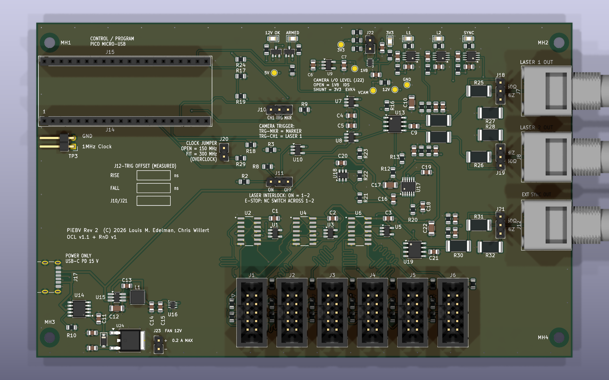
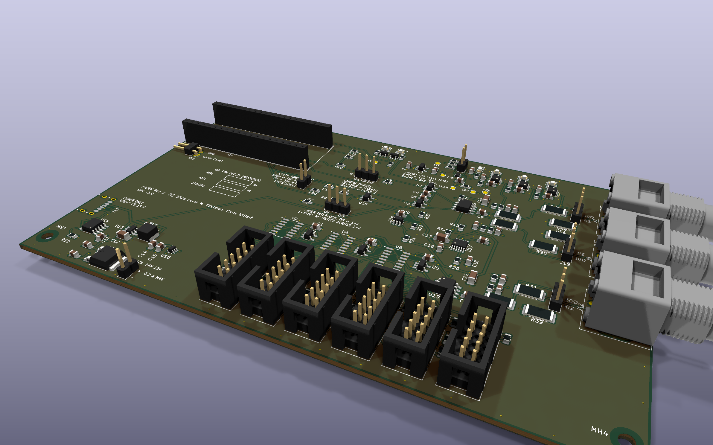
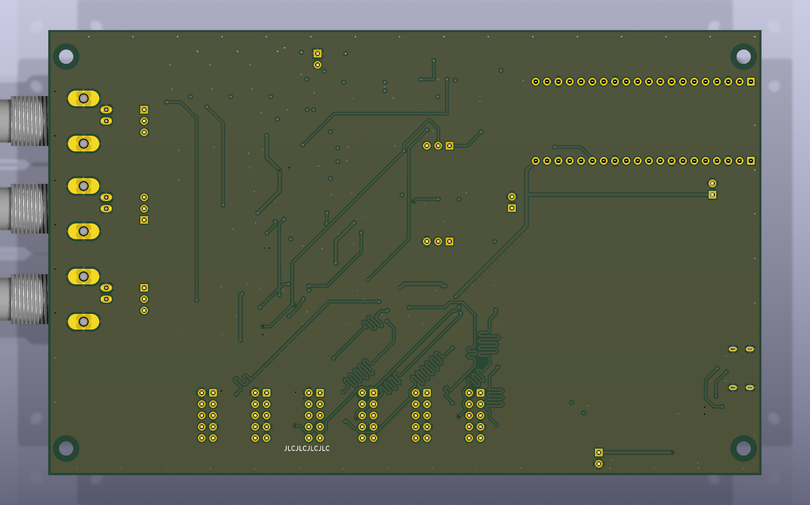
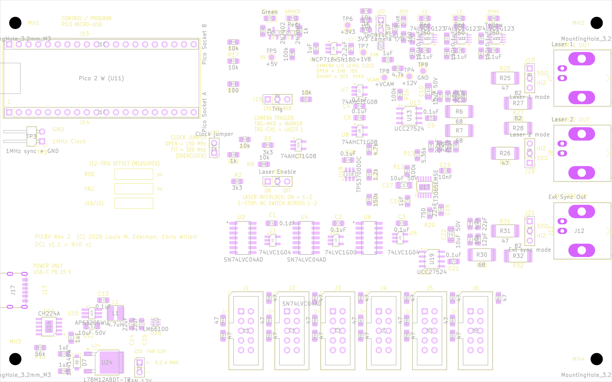
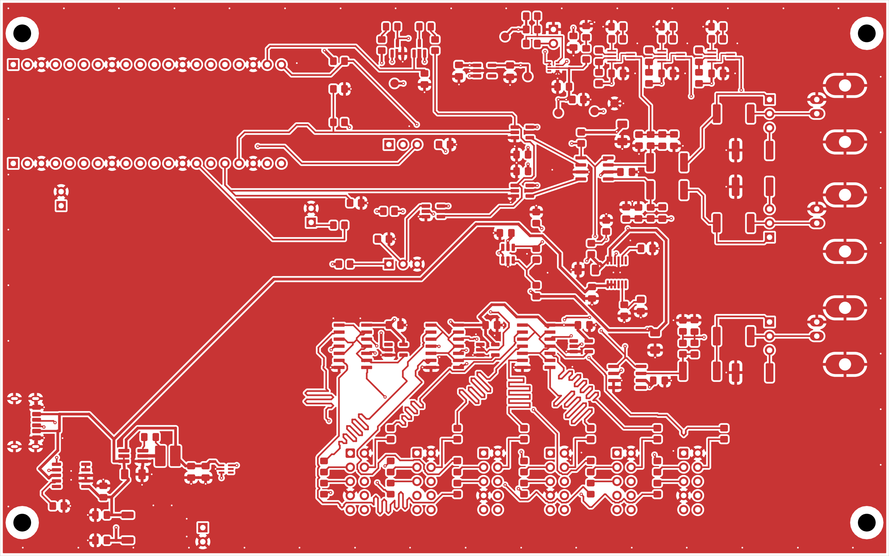
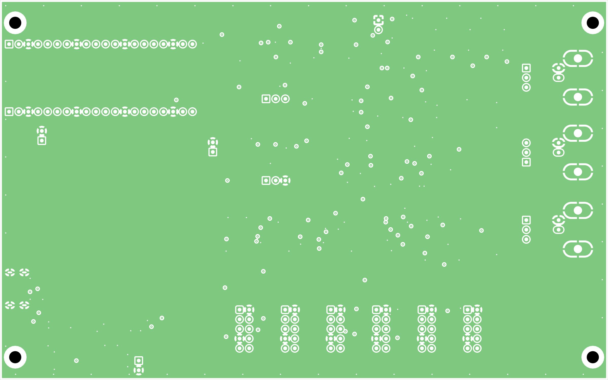
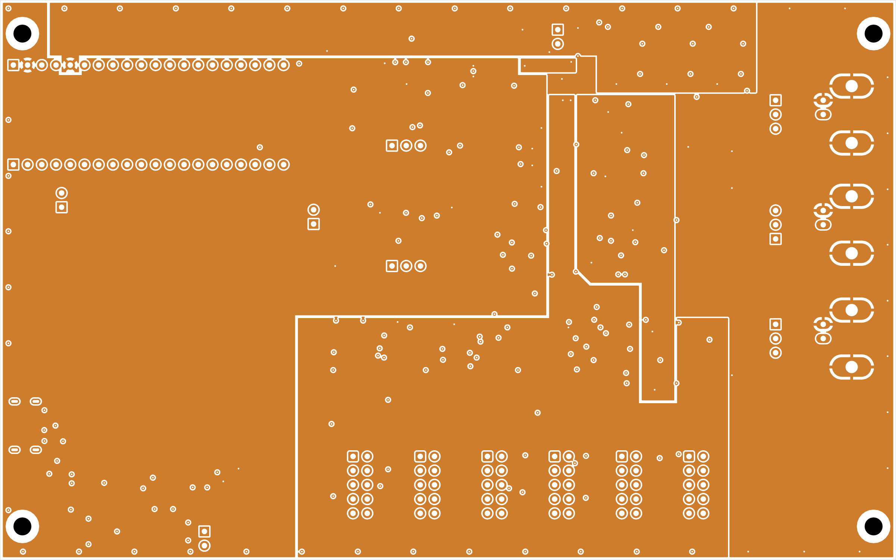
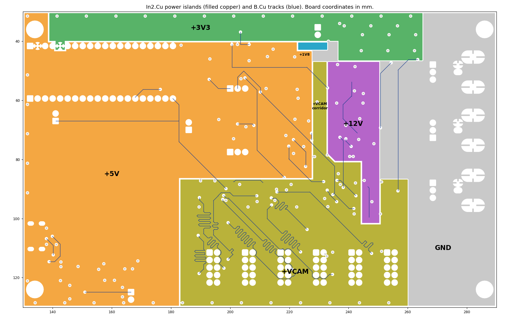
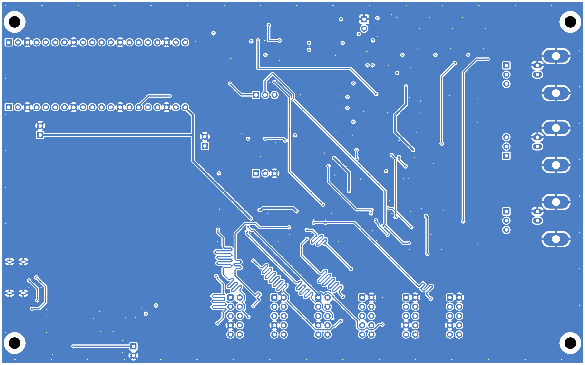

# PiEBV hardware reference (Pico 2 W, 4-layer board)

This page is the bench reference for the PiEBV board: the parts, the pins, the limits, the jumpers and the LEDs. The board has a socketed Raspberry Pi Pico 2 W on 4 copper layers. To *use* the board, see the [README](README.md). The reasons, the analysis and the history are in the [design notes](docs/DESIGN_NOTES.md).

**Board revision 2** (2026-11-12). **Status:** KiCad's design-rule check (DRC) and electrical-rule check (ERC) give 0 errors. DRC gives one accepted warning on the U14 footprint (see [Footprint variants and KiCad checks](docs/design/LAYOUT.md#footprint-variants-and-kicad-checks)). Not yet built: do the [first-board checks](docs/FIRST_BOARD_CHECKS.md#first-board-checks) on the first boards.

## Contents

In this document:

- [Board views](#board-views) · [How the board works](#how-the-board-works) · [At a glance](#at-a-glance)
- [Socket pin mapping](#socket-pin-mapping--read-this-first) · [Firmware pin map](#firmware-pin-map) · [Limits](#limits)
- [Power](#power) · [Signal chains](#signal-chains) · [Laser interlock](#laser-interlock) · [Status LEDs](#status-leds)
- [Connectors](#connectors) · [Clock jumper (J20)](#clock-jumper-j20-300-mhz-overclock) · [Boot and arming](#boot-and-arming)
- [First-board checks](#first-board-checks) · [Manufacturing notes](#manufacturing-notes) · [Files](#files)

| Other page | Contents |
|---|---|
| [docs/DESIGN_NOTES.md](docs/DESIGN_NOTES.md) | index of the design pages; Rev 2 changes |
| [docs/design/LAYOUT.md](docs/design/LAYOUT.md) | layer images, stackup, EuroCard mechanics, routing, power islands, KiCad checks |
| [docs/design/POWER.md](docs/design/POWER.md) | rail design, power-good gate, fan supply, +VCAM mux, budgets, output rating |
| [docs/design/SIGNALS.md](docs/design/SIGNALS.md) | signal chains, skew, amplitude budget, output mode, J12 timing, camera lines, interlock, LED circuits |
| [docs/design/FIRMWARE_HW.md](docs/design/FIRMWARE_HW.md) | timing limits, combined mode, pixel gate, boot and arming, clock jumper |
| [docs/FIRST_BOARD_CHECKS.md](docs/FIRST_BOARD_CHECKS.md) | the checks for the first boards |
| [docs/MANUFACTURING.md](docs/MANUFACTURING.md) | manufacturing notes and hot-plate assembly |
| [docs/EVK4_HARNESS.md](docs/EVK4_HARNESS.md) | the wire harness for Prophesee EVK4 cameras |
| [fab/jlc/JLC_ORDER.md](fab/jlc/JLC_ORDER.md) | the JLCPCB order checklist |

## Board views

Images of the Rev 2 board, made by `tools/rev2/images.sh` from `PiEBV_Pico.kicad_pcb`.

**Top view (3-D render)**



**3-D render**



**Bottom view (3-D render)**



**Top side: silkscreen, pads and part outlines**



**Layer 1, F.Cu (top): parts, signals, GND fill**



**Layer 2, In1.Cu: GND plane**



**Layer 3, In2.Cu: power islands in a GND fill**



**In2.Cu power islands (colour map) with the B.Cu tracks**



**Layer 4, B.Cu (bottom): signals, GND fill**



The layer functions and the island layout are in [docs/design/LAYOUT.md](docs/design/LAYOUT.md).

## How the board works

```
 USB-C charger ──► J17 ──► power section ──┬─► +5 V  (logic, Pico) ◄── also from the Pico's USB
   (15 V)                                   ├─► +VCAM (camera signals): 1.8 V, or 3.3 V with J22 fitted
                                            ├─► +12 V (laser driver), checked by a voltage window (U18)
                                            │   (+3.3 V comes from the Pico itself)
                                            └─► +12V_FAN (cooling fan header J23), from its own regulator (U24)

 PC ──USB──► Pico 2 W ──┬─ CH1, CH2 ──► interlock ──► 12 V driver ──► output resistors ──► J7, J8
                        │             (ARM, J11)      (U13, on only    and mode jumpers      Laser 1, 2
                        │                              if 12 V is OK)  (R6/R7, J18/J19)
                        ├─ marker ────► J10 selector ─┬─► +VCAM buffers ──► camera trigger (J1–J6)
                        │                             └─► 12 V driver (U19) ──► R30, J21 ──► J12
                        │                                                       External Sync Out
                        ├─ 1 MHz sync ───────────────► +VCAM buffers ──► camera sync    (J1–J6)
                        └─ pixel gate ───────────────► +VCAM buffers ──► camera pixel reset
```

- **The Pico makes all the timing.** Its PIO blocks (small timing engines beside the processor) make the two laser pulses, the camera marker and the pixel-reset gate. The 1 MHz sync clock comes from the clock generator. All use one 150 MHz clock (300 MHz with a shunt on the [clock jumper](#clock-jumper-j20-300-mhz-overclock) J20).
- **The laser path** has three gates in series: the firmware's ARM state, the hardware interlock (J11) and a 12 V power-good check (U18) that switches the driver chip on. The driver chip (U13) swings its output to 12 V. Resistors after it bring that down to about 5 V at the laser driver's input. Jumpers J18/J19 match each output to a 50 Ω or a high-impedance load: the wrong setting gives the wrong voltage.
- **The camera path** converts every signal to the camera I/O level `+VCAM`. Each camera cable has its own driver gate and a 47 Ω series resistor (R52–R69). `+VCAM` is 1.8 V (IDS cameras) with J22 open and 3.3 V (Prophesee EVK4) with J22 fitted. The pixel reset comes only from the Pico (`PIXGATE`). The EVK4 has no pixel-reset input.
- **Status LEDs** show 12 V good (D2), ARMED (D3), a pulse at each output (D4–D6) and a 3.3 V camera level (D1).
- **External Sync Out (J12)** copies the camera trigger to a BNC through a third channel built like the laser outputs (U19, R30, J21), with the same 50 Ω / Hi-Z choice and the same ~5 V level.
- **Power** comes from a USB-C charger on J17. The board asks the charger for 15 V. The Pico's own USB can run everything except the laser outputs. A separate regulator (U24) supplies a 12 V cooling fan on J23 from the 15 V input.

### Reading this document

- **Reference designators** (U13, R6, J7 …) are the part labels on the board and in the schematic. Pin numbers are written `U13.7` (U13, pin 7).
- **Net names** (the names of connections in the schematic) are in `code`, e.g. `CH1_DRIVE`.
- **Rail:** a supply voltage shared across the board (+5V, +12V …).
- **Pull-up / pull-down:** a resistor that holds a line high or low when nothing else drives it.
- **Open-drain:** an output that can only pull low; a pull-up provides the high level.
- **VIH / VIL:** the voltage an input needs to read high / low. **VOH / VOL:** what an output delivers when high / low. "Margin" is how far the level an output delivers is beyond what the input needs (e.g. 3.76 V delivered against a VIH of 2.0 V is 1.76 V of margin).
- **Schmitt trigger:** an input with two thresholds (hysteresis), so a slow or noisy edge switches once instead of chattering.
- **LDO, buck:** two kinds of voltage regulator: a linear one (simple, quiet, burns the excess as heat) and a switching one (efficient).
- **Shunt** means the plastic jumper cap. The resistors to ground in the output-mode circuit are called resistors to ground, not shunts.

## At a glance

| | |
|---|---|
| Board | 160 × 100 mm (EuroCard), 4 copper layers, 1.6 mm FR4 |
| Processor | Raspberry Pi Pico 2 W, in sockets (not soldered) |
| Power | **USB-C PD input (J17, 15 V)** for the laser driver and the whole board; the Pico's own USB still powers the logic when J17 is unplugged |
| Rails | **+VCAM** (camera signals: 1.8 V, or 3.3 V with J22 fitted) · 1.8 V (U9, to U20) · 3.3 V (Pico 3V3_OUT: R24, R34, R70, U20, U21–U23) · 5 V (logic, Pico VSYS) · **12 V** (11.8 V, output drivers U13 and U19, from J17 only) · **+12V_FAN** (12 V, fan header J23, from U24, from J17 only) |
| Design rules | 0.2 mm clearance, 0.2 mm track, 0.6/0.3 mm via, 0.5 mm copper-to-edge |
| Parts | 154 placed parts (133 SMD, 21 through-hole), 6 bare test pads, 4 unplated mounting holes (164 footprints) |
| Stackup | symmetric 1.6 mm, JLCPCB standard 4-layer `JLC04161H-7628`; see [Layers and stackup](docs/design/LAYOUT.md#layers-and-stackup) |
| Finish | **lead-free HASL** (`HAL lead-free`) |
| Finest pitch | 0.5 mm (U20, TPS2116, SOT-583-8), pads 0.3 mm wide. No BGA and no leadless part. |

| Layer | Use |
|---|---|
| F.Cu (top) | signals + ground fill |
| In1.Cu | solid ground plane |
| In2.Cu | power islands (+5V, +3V3, +1V8, +VCAM, +12V) in a GND fill |
| B.Cu (bottom) | signals + ground fill |

In1.Cu and In2.Cu carry no tracks. The fabricated board is **160.0 × 100.0 mm**. The stackup table, the finish, the footprints, the enclosure data and the routing data are in [docs/design/LAYOUT.md](docs/design/LAYOUT.md).

- Confirm the stackup numbers against what your fabricator actually presses.
- Only the exposed pads of U14 and U17 need hot air or a hot plate (see [Hot-plate assembly](docs/MANUFACTURING.md#hot-plate-assembly)). All ICs have gull-wing leads, so the board can also be assembled by hand. The tab of U24 (TO-252) is a large pad with a solid connection to the GND pour: it needs more heat.
- Inspect J17 for solder bridges (pad gaps of 0.27–0.38 mm; [first-board check 5](docs/FIRST_BOARD_CHECKS.md#first-board-checks)).

## Socket pin mapping — read this first

The Pico plugs into two 1×20 sockets, **J15** (top row) and **J14** (bottom row), 17.78 mm apart. The sockets are horizontal, top-left on the board, with the module's USB end at the left edge and pad 1 of both sockets at the left. The two rows do **not** number in the same direction:

```
J14 pad n  =  Pico pin n          (pads 1..20 -> pins 1..20)
J15 pad m  =  Pico pin (41 - m)   (pads 1..20 -> pins 40..21)
```

The Pico numbers its pins like a chip: along one row from 1 to 20 (from the USB end), then **back** along the other row from 21 to 40, so pin 40 (VBUS) sits opposite pin 1. Both socket footprints on the board number their pads 1 → 20 in the same direction, so the reversal lands entirely on J15.

**Sanity check for any change here:** the Pico's ground pins pair up to a constant sum (3↔38, 8↔33, 13↔28, 18↔23, each summing to 41), so grounds land on pads 3, 8, 13 and 18 of *both* sockets, directly opposite each other. A mapping that doesn't line the grounds up across the two rows is wrong.

> **Neither ERC nor DRC can catch a mistake here.** The Pico symbol is self-consistent, and U11 (the Pico) deliberately has no PCB footprint, so DRC has nothing to compare. Check every pad against the Pico's pinout by hand after any change.

### Connected socket pins

| Signal | Pico pin | Socket pad | Board net |
|---|---|---|---|
| GP11 | 15 | J14.15 | `PWM_Trig` |
| GP12 | 16 | J14.16 | `_PULSE_OUT_CH2` |
| GP13 | 17 | J14.17 | `_PULSE_OUT_CH1` |
| GP15 | 20 | J14.20 | `PWM_1MHz` |
| GP16 | 21 | J15.20 | `PIXRST_GATE` |
| GP17 | 22 | J15.19 | `ARMED_LED` |
| GP10 | 14 | J14.14 | `CLK_SEL` → R29 (1 kΩ) → J20.1 ([clock jumper](#clock-jumper-j20-300-mhz-overclock)) |
| GND | 3, 8, 13, 18 | J14.3, .8, .13, .18 | `GND` |
| GND | 38, 33 (AGND), 28, 23 | J15.3, .8, .13, .18 | `GND` |
| 3V3_OUT | 36 | J15.5 | `+3V3` |
| VSYS | 39 | J15.2 | `+5V` |
| VBUS | 40 | J15.1 | **not connected** (see [Power](#power)) |

All eight module grounds are connected. Every other socket pad is unconnected and, once the module is seated, out of reach. There is no GPIO breakout header.

**Keep-out:** the module body lies over the two sockets, top-left on the board, with its micro-USB at the left board edge, so the port can be reached through an enclosure wall. Nothing may be placed there. The silkscreen labels the Pico port `CONTROL / PROGRAM — PICO MICRO-USB` (above the Pico, near the left edge) and J17 `POWER ONLY — USB-C PD 15 V` (just right of J17's top, at the bottom of the left edge).

## Firmware pin map

| Constant | GPIO | Board net | Drives |
|---|---|---|---|
| `kPinMarker` | 11 | `PWM_Trig` | J10.3 → (jumper) → U5 → U6 → Trigger1–6, and U19 → J12 (External Sync Out) |
| `kPinCh2` | 12 | `_PULSE_OUT_CH2` | U8 → U13 → J8 (Laser 2); R18 10 k to GND |
| `kPinCh1` | 13 | `_PULSE_OUT_CH1` | U7 → U13 → J7 (Laser 1); R17 10 k to GND; R19 100 Ω → J10.1 |
| `kPinSync` | 15 (J14 pad 20) | `PWM_1MHz` | U1 → U2 → Sync1–6, and TP3. Clock generator, not PIO. |
| `kPinPixGate` | 16 (J15 pad 20) | `PIXRST_GATE` | U3.1 and U3.2 (NAND with both inputs joined: an inverter) → U4 → TDRSTN1–6; R24 10 k to +3V3. Output inverted in the GPIO block. |
| `kPinClockSel` | 10 (J14 pad 14) | `CLK_SEL` | R29 (1 kΩ) → J20.1; a shunt to J20.2 (GND) selects 300 MHz, read once at boot ([clock jumper](#clock-jumper-j20-300-mhz-overclock)). Input with the internal pull-up; no shunt reads as 150 MHz. |
| `kPinArmedLed` | 17 (J15 pad 19) | `ARMED_LED` | Q2 gate (R38 100 kΩ to GND) → D3 ([Status LEDs](#status-leds)). Plain GPIO output, high while ARMED. Status only: it gates nothing. Not connected on a Rev 1 board. |

- **CH1 is the higher GPIO (GP13) and CH2 the lower (GP12).** The order is deliberate; don't "tidy" them into ascending order.
- `src/board.h` repeats this table as a comment. Keep the two in step: when the constants and the schematic once drifted apart, the whole board looked dead.
- PIO state machines (pio0): SM0 CH1, SM1 CH2, SM2 MARKER, SM3 PIXGATE.
- SYNC comes from the RP2350 clock generator (clk_gpout1).
- CH1/CH2 reach their pins only while ARMED; otherwise `src/laser_gate.cpp` holds them LOW.
- The pin choice is explained in [Firmware pin map](docs/design/FIRMWARE_HW.md#firmware-pin-map).

## Limits

### Timing limits

The firmware (`realizeTiming()` in `src/pulse_timing.h`) checks all settings on every command. It uses the **realized** values (after rounding to whole PIO cycles: 6.667 ns, or 3.333 ns with the [clock jumper](#clock-jumper-j20-300-mhz-overclock)). Every reply shows the realized value. The firmware sets **no laser-driver ratings**: pulse width, duty and spacing depend on the attached driver, so set values within your driver's ratings.

| Rule | Limit | Reason |
|---|---|---|
| Pulse pairs stay separate | `DELAY ≤ 1/FREQ − 2 × WIDTH` | CH2 ends at least one WIDTH before the next pair's CH1 starts. WIDTH is at most half the period. |
| Shortest pulse | WIDTH and MARKERWIDTH ≥ 3 cycles (20.000 ns; 10.000 ns at 300 MHz) | 16 ns or less (at 150 MHz) is **rejected**, not rounded up. |
| PIO program | `DELAY ≤ 1/FREQ − WIDTH − 5 cycles`; MARKERWIDTH ≤ 1/FREQ − 5 cycles | Matters only at 3–4-cycle widths, and for periods under 10 cycles. |
| Marker duty | **at most 50 %:** `2 × MARKERWIDTH ≤ 1/FREQ` | The one limit set for the hardware: it keeps R30's average power inside its rating with J12 shorted. |
| Combined mode (`COMBINE 1`) | `DELAY ≥ WIDTH + 1 PIO cycle` (6.667 ns) | At `DELAY = WIDTH` the two pulses merge into one of 2 × WIDTH. COMBINE can only be changed while DISARMED. |
| Pixel-reset gate (`PIXGATE`) | PIXLEAD ≥ 5 cycles; PIXLEAD + DELAY + WIDTH + PIXLAG ≤ 1/FREQ − 3 cycles | PIO program. The first pair after a start has no reset before it. |
| Pulse through U13 / U19 | Use WIDTH ≥ 20 ns (≥ 30 ns for an older die) at the outputs; the same for MARKERWIDTH at J12 | The driver needs an input pulse of 15 ns maximum (current die) or 25 ns (older die). The die on the reel is not known. At 300 MHz a 10 ns WIDTH can be lost or shortened. |
| Camera trigger from CH1 (J10 on 1-2) | `WIDTH` ≥ 500 ns | Prophesee specifies a 500 ns minimum trigger pulse. |

- **`COMBINE 1`** sends both pulses of every pair to **both** laser outputs. Each driver then sees two pulses per period, so check its ratings; the firmware imposes none.
- **Don't use a BNC tee instead.** Joining J7 and J8, or splitting one output to two drivers, gives 3–3.4 V pulses in 50 Ω mode, or 6.9 V where the pulses overlap (above the LDP-V's 5.2 V damage limit).
- **`PIXGATE`** is the only source of the camera pixel reset. With `PIXGATE 0` the pixels are never held in reset. `PIXGATE 1` runs the gate only while the laser pins carry pulses, `PIXGATE 2` always. DISARM, a restart hold-off and a reset all leave the pixels free.
- **SYNC** is fixed at 1 MHz and does not depend on the pulse settings.
- Derivations: [Timing limits](docs/design/FIRMWARE_HW.md#timing-limits), [Combined mode](docs/design/FIRMWARE_HW.md#combined-mode-combine-1), [Pixel-reset gate](docs/design/FIRMWARE_HW.md#pixel-reset-gate-pixgate).

### Board output rating

**No firmware setting can overload the laser outputs.** R6/R7, R30 and R25–R28, R31, R32 are **2 W 2512** resistors, and U17 is a 500 mA regulator with a 400 mA current limit (360 mA minimum). The laser outputs carry any duty the firmware accepts (up to 50 % per output, 67 % with `COMBINE 1`):

| Situation (50 Ω mode, unless the row says Hi-Z) | Current | Dissipation |
|---|---|---|
| Output high into 50 Ω | ~96 mA per output (at most 103 mA), ~200 mA for both, at most ~310 mA for all three | at most 0.71 W in R6/R7 (R30 for J12) while high |
| Output into a shorted BNC, at the highest duty the firmware allows | at most 358 mA while high with both laser outputs shorted (ROH 0 Ω, 12.05 V), just under U17's 360 mA minimum limit | at most 1.45 W (J12 on the marker: at most 1.08 W in R30) |
| Output **stuck** high into a short (a fault; the firmware never holds an output high) | | 1.5–2.16 W in R6/R7: at the 2 W rating, and up to 8 % over it only if ROH is near 0 Ω (D-package ROH has no specified minimum) |
| Hi-Z mode, while high | ~60 mA per output into an open circuit, ~100 mA into a short | R27/R28 (R32) at most 0.31 W; R25/R26 (R31) at most 0.18 W open, 0.32 W into 50 Ω, 0.52 W stuck high into a short |

- **Don't short J12.** J12 follows the camera trigger: its duty is the marker's (at most 50 %), or with J10 on 1-2 the CH1 duty (50 %, 67 % with `COMBINE 1`). The stuck-high case (1.5–2.16 W in R30) needs a firmware or GP11 fault as well as a short.
- Shorts on several outputs at once can exceed U17's limit. U17 then limits, +12V sags below U18's undervoltage threshold and `LASER_PWR_OK` turns all three drivers off. This can repeat while the short lasts.
- Derivation: [Board output rating](docs/design/POWER.md#board-output-rating).

## Power

Two inputs. **J17 (USB-C, power only)** is the main supply. The **Pico's own USB** carries data, and on its own runs everything *except the laser outputs*.

```
J17 USB-C ─ U14 CH224A (asks the charger for 15 V) ─ VBUS_PD (5 V until negotiated, then 15 V)
   ├─ U15 AP63205WU buck ─ +5V_PD ─ U16 LM66100 ideal diode ─┐
   │                                                        ├─ +5V island = Pico VSYS ─ U9 (1.8 V) ─┐
   │               Pico USB VBUS ─ Pico's own Schottky (D1 on the Pico module, not the board's LED D1) ───┘
   ├─ U17 LT3065 (adj., 500 mA, 400 mA limit) ─ +12V (11.8 V) ─ U13 VDD (C9, C10, C17), U19 VDD (C21, C22)
   │    U18 TPS3700 window on +12V (10.6–13.3 V) ─ LASER_PWR_OK ─ U13 and U19 ENA/ENB  (R16 100k pull-up)
   └─ U24 L78M12AB (12 V, 0.5 A part; C37 in, C38 out; D7 from output to input) ─ +12V_FAN ─ J23 pin 1 (cooling fan, 200 mA maximum)

     U9 ─ +1V8 ──────── U20 VIN1 ─┐
                                  U20 TPS2116 ─ +VCAM ─ U1–U6 (camera buffers), D1, R51
Pico 3V3_OUT ─ +3V3 ─┬─ U20 VIN2 ─┘   J22 open: +VCAM = +1V8.  J22 fitted: +VCAM = +3V3.
                     └─ U20 MODE, R34 and R70 (pull-ups of U20 PR1), R24, U21–U23 (activity LED monostables)
```

| Rail | Source | Feeds | Test pad | Nominal value |
|---|---|---|---|---|
| `VBUS_PD` | J17 through U14 (CH224A) | U15, U17, U24 | – | 5 V until the PD contract completes, then 15 V |
| `+5V_PD` | U15 (AP63205WU buck) | U16 | – | 5.00 V ±1 % |
| `+5V` | U16 from +5V_PD, or the Pico's USB | Pico VSYS (J15.2), U7, U8, U10, U9 input, R2/R3, D2 (R36) | TP5 `5V` (201.0, 45.0) | ~5.0 V from J17 |
| `+12V` | U17 (LT3065) from VBUS_PD | U13 and U19 VDD, U18, R16 | TP4 `12V` (237.0, 50.0) | 11.8 V (11.54–12.05 V) |
| `+12V_FAN` | U24 (L78M12AB) from VBUS_PD | J23 pin 1 (cooling fan) | – | 12 V (VBUS_PD at 15 V) |
| `+1V8` | U9 (NCP718xSN180) from +5V | U20 VIN1 | TP7 `1V8` (225.0, 43.75) | 1.8 V (±2 %) |
| `+3V3` | Pico 3V3_OUT (pin 36, J15.5) | U20 VIN2 and MODE, R24, R34, R70, U21–U23, D4–D6 | TP6 `3V3` (220.9, 36.6) | 3.3 V |
| `+VCAM` | U20 (TPS2116), set by J22 | U1–U6 (all camera-facing logic), D1 (R33), R51 | TP8 `VCAM` (230.5, 50.3) | 1.8 V (J22 open) or 3.3 V (J22 fitted) |
| `GND` | | | TP9 `GND` (240.6, 48.6) | meter reference |

Limits and ratings of the rails:

| Rail | Limit or rating |
|---|---|
| `VBUS_PD` | U14 is a PD sink. R10 = 56 kΩ requests 15 V. VHV, VBUS, CC1 and CC2 are rated to 32 V. U14 has no output switch: everything downstream must tolerate 5 V and 15 V. |
| `+5V_PD` | U15 accepts 3.8–32 V in. The rail is ~4.9 V while VBUS_PD is 5 V. |
| `+5V` | U16 is an LM66100 ideal diode. The Pico's USB feeds the rail through the Pico's own Schottky D1: ~4.7 V typical from the Pico's USB alone (74AHCT is specified from 4.5 V). |
| `+12V` | U17: 45 V / 500 mA part, R12/R13 0.1 %. Current limit 400 mA ±10 % (R20 = 750 Ω). Power-good window 10.6–13.3 V (undervoltage 10.6 V rising / 10.4 V falling, overvoltage 13.3 V). |
| `+12V_FAN` | U24: ST L78M12AB, 12 V, 0.5 A part. Specified load: one 12 V, 40 mm fan. Maximum fan current: 200 mA (design limit). No fuse: the current limit and the thermal protection of the regulator are the protection (data-sheet features, not tested on this board). The data sheet gives a short-circuit current of 240 mA typical (at 35 V input) and a short-circuit peak current of 700 mA typical. D7 (1N4148W) is in parallel with U24, from the output to the input: it carries the current back to the input when VBUS_PD falls. On a 5 V charger the fan gets about 3 V and normally does not turn (not guaranteed for every fan). On a 9 V or 12 V charger setting the fan gets about 7 V or 10 V and turns slowly. The fan is always on while VBUS_PD is 15 V: there is no firmware control and no tachometer input. See [Fan supply](docs/design/POWER.md#fan-supply-u24-j23). |
| `+1V8` | U9: fixed 1.8 V, 2.5–24 V in. |
| `+3V3` | Raspberry Pi recommends a load below 300 mA on the Pico's 3V3_OUT pin (pin 36). |
| `+VCAM` | U20 is a power mux for 1.6–5.5 V. At most 58 mA for six EVK4 cameras. |

TP4–TP9 are bare 1.5 mm copper pads on the top side (no part). Each is marked with the rail name. Use TP9 as the meter reference. Operating rules:

- **The laser outputs and J12 need a 15 V USB-PD charger on J17.**
  - Any charger rated **above 27 W** must offer 15 V under the USB-PD rules (in practice any PD charger rated 30 W or more). A smaller charger may not offer 15 V.
  - Without 15 V the outputs stay disabled: U18 holds U13 and U19 off while +12V is outside 10.6–13.3 V.
  - 5 V-only charger: +12V ≈ 4.7 V. 9 V charger: +12V ≈ 8.7 V.
  - On a 12 V charger setting or an overload, U17 cannot regulate and +12V is below ~11 V.
- **Fan header J23.** The board is specified for one 12 V, 40 mm fan. Connect a 2-wire 12 V DC cooling fan: pin 1 (`+` on the silkscreen) is +12V_FAN, pin 2 (`-`) is GND. The maximum fan current is 200 mA. Do not connect a fan to the +12V rail of the laser drivers.
  - J23 is the same 2-pin header type as the jumpers J20 and J22. It has no key.
  - **Do not fit a shunt on J23.** A shunt shorts the fan supply to GND.
  - Connect the fan with the correct polarity (`+` = pin 1).
- **With the Pico's USB alone** the logic and the cameras run, and the lasers are off (no 12 V). A host whose USB sags below ~4.8 V puts the 74AHCT gates just outside their rated range.
- **Pico VBUS (pin 40, J15.1) is deliberately not connected.** Do not tie VBUS to VSYS: with J17 also feeding VSYS it would push current back into the USB host.
- **Never leave R10 off:** an open CFG1 is outside the CH224A table (6k8 = 9 V, 24k = 12 V, 56k = 15 V, 120k = 20 V, 210k = 28 V).
- **Do not fit a CH224K** for U14: its pin 1 is a 3.6 V VDD pin and would be destroyed.
- **If U17 fails short,** +12V follows VBUS_PD to 15 V (~6.3 V into the LDP-V trigger input). The overvoltage side of U18 (13.3 V) then switches the outputs off.
- **Fit the Pico before you connect cameras.** With no Pico, Sync and TDRSTN at the cameras are undefined. The laser outputs, the camera triggers and J12 stay low (R17/R18, R9).
- **Power-up order.** The 1.8 V rail can come up a millisecond or so before the Pico's 3.3 V. TDRSTN is then briefly undefined. That is harmless: the cameras haven't started yet.
- With J22 open, nothing on this board presents 5 V or 3.3 V to J1–J6. With J22 fitted, pins 3, 4 and 5 of J1–J6 are 3.3 V signals.
- Rail design, budgets and the power-good analysis: [docs/design/POWER.md](docs/design/POWER.md). Island layout: [Power islands](docs/design/LAYOUT.md#power-islands-in2cu).

### +VCAM (the camera signal supply)

| J22 | +VCAM | Cameras | D1 (blue, `3V3`) |
|---|---|---|---|
| **open (default)** | 1.8 V, from U9 | IDS uEye EVS (1.8 V sensor pins) | dark |
| shunt fitted | 3.3 V, from the Pico's 3V3_OUT | Prophesee EVK4, with the harness of [docs/EVK4_HARNESS.md](docs/EVK4_HARNESS.md) | lit |

> **3.3 V destroys the 1.8 V pins of an IDS camera.** J22 sets the level of all six camera ports together. **Do not fit J22 with an IDS camera connected.** A wrong J22 setting gives 3.20–3.40 V steady and 4.43 V peak at the 1.8 V pin (simulation).

- Look at D1 before you connect a camera: D1 lit = 3.3 V. D1 is a blue LED on +VCAM through R33 (100 Ω). It is dark at 1.8 V.
- Do not replace D1 with a red, yellow or yellow-green LED (those light at 1.8 V).
- Change J22 with the power off. The mux switches break-before-make, but the cameras see the level change.
- Before you connect an IDS camera, measure +VCAM at TP8 with a meter. It must be 1.8 V with J22 open ([first-board check 7](docs/FIRST_BOARD_CHECKS.md#first-board-checks)).
- A lost shunt gives 1.8 V. No shunt is necessary for IDS cameras.
- **Don't remove the 1.8 V rail** (U9), even though it looks like it powers only a few small chips. Specify the **fixed 1.8 V** part (e.g. NCP718BSN180T1G, as ordered, or NCP718ASN180T1G). A 1.65 V or 1.7 V version eats into the camera's input margin.

The selector is U20 (TPS2116). J22 pin 1 is GND. J22 pin 2 goes through R35 (1 kΩ) to U20 PR1 (net `VCAM_SEL`). R34 and R70 (10 kΩ each, in parallel) pull PR1 up to +3V3. R51 (4.7 kΩ) discharges +VCAM. U20 pins: 1 GND, 2 and 7 VOUT, 3 VIN1, 4 PR1, 5 MODE, 6 VIN2, 8 ST.

**Faults** (found by the [first-board checks](docs/FIRST_BOARD_CHECKS.md#first-board-checks)):

| Fault | +VCAM |
|---|---|
| Solder bridge from PR1 (U20 pin 4) to pin 3 (+1V8) or to pin 5 (+3V3) | stays 1.8 V |
| Pico not fitted (+3V3 is 0 V) | 1.8 V |
| One of R34, R70 open | 1.8 V default stays |
| Both R34 and R70 missing or open | PR1 floats: the level is not defined. Check for this fault. |
| +1V8 absent (U9 failed) while +3V3 is present and PR1 is high | not stated in the data sheet: bench test, [first-board check 7](docs/FIRST_BOARD_CHECKS.md#first-board-checks) |

Mux design, data-sheet values, load budget: [+VCAM](docs/design/POWER.md#vcam-the-camera-signal-supply).

## Signal chains

Each camera signal passes through two inversions, so it arrives the right way up, with one dedicated gate per camera. U1–U6 run on `+VCAM`.

```
Sync     GP15 (clk_gpout1) → U1.2 (74LVC1G04) → SYNC_N → U2 ×6 (SN74LVC04AD) → Sync1..6 → R52–R57 (47 Ω) → Sync1_C..6_C → J1–J6 pin 5     (TP3 taps PWM_1MHz)
Trigger  GP11 → J10.3 → [J10 jumper] → PWM_TRIG_TAP → U5.2 → TRIG_N → U6 ×6 → Trigger1..6 → R58–R63 (47 Ω) → Trigger1_C..6_C → J1–J6 pin 4
                                        PWM_TRIG_TAP → U19.2 → External Sync Out (J12)
Reset    GP16 → PIXRST_GATE → U3.1 and U3.2 (74LVC1G00 NAND, both inputs joined) → PIXRST_N → U4 ×6 → TDRSTN1..6 → R64–R69 (47 Ω) → TDRSTN1_C..6_C → J1–J6 pin 3
Laser 1  GP13 → U7.2 → CH1_GATED → U13.2 (INA) → U13.7 (OUTA) → CH1_DRIVE_RAW → R6 68 Ω 2 W → CH1_DRIVE → output mode (J18, R25, R27) → CH1_OUT → J7.1
Laser 2  GP12 → U8.2 → CH2_GATED → U13.4 (INB) → U13.5 (OUTB) → CH2_DRIVE_RAW → R7 68 Ω 2 W → CH2_DRIVE → output mode (J19, R26, R28) → CH2_OUT → J8.1
Ext sync PWM_TRIG_TAP → U19.2 (INA) → U19.7 (OUTA) → EXT_SYNC_DRIVE_RAW → R30 68 Ω 2 W → EXT_SYNC_DRIVE → output mode (J21, R31, R32) → EXT_SYNC_OUT → J12.1
```

- **Pixel reset:** the Pico is the only source. TDRSTN = `PIXRST_GATE`, active low at the camera (`0 = pixels in reset`). R24 (10 k) pulls `PIXRST_GATE` up to +3V3, so the gate idles high and the cameras run unless the firmware asserts the reset.
- **U7 and U8** are 74AHCT1G08 AND gates on +5 V (the interlock gates). **U13** and **U19** are TI UCC27524 (SOIC-8, D package) drivers on +12V, enabled by `LASER_PWR_OK`.
- **Driver delay:** U13 adds 17 ns typical, 27 ns maximum, the same on both laser channels to within 1–2 ns. The delay between the lasers is preserved. The laser-to-camera timing shifts by that fixed amount.
- Analysis of each chain: [docs/design/SIGNALS.md](docs/design/SIGNALS.md).

### Trigger source (J10)

J10's silkscreen reads **`CH1 / TRG / MKR`** (pins 1/2/3).

| J10 shunt | Camera trigger and J12 | Notes |
|---|---|---|
| **2-3** (TRG to MKR, normal) | the marker: it rises with CH1 and has its own `MARKERWIDTH` | Runs also while DISARMED. |
| **1-2** (TRG to CH1) | every laser CH1 pulse | Only dependable with `WIDTH` ≥ 500 ns. CH1 pulses exist only while ARMED: with the lasers disarmed the cameras get no trigger (use 2-3, or ARM with J11 on 2-3, for camera-only work). |
| none | idle low (R9, 10 k, pulls `PWM_TRIG_TAP` low) | |

- **Never fit a shunt across all three pins:** that ties GP13 (through R19) to GP11.
- J10.1 reaches `_PULSE_OUT_CH1` through **R19 (100 Ω)**. Keep R19: it reduces the effect of the J10 setting on the laser timing. With J10 on 1-2 the laser delay error still depends on the jumper: R19 cuts it by about 65–70 % at the typical corner and by about 37 % at the worst corner ([Trigger source](docs/design/SIGNALS.md#trigger-source-j10)).

### Laser outputs

The target loads are PicoLas LDP-V 10-70 and LDP-V 240-100 drivers. Their trigger inputs are **50 Ω terminated** and need **4.5–5.2 V high, ≤ 0.2 V low**. The LDP-V's absolute maximum on its trigger input is 15 V.

#### Amplitude budget

50 Ω mode (J18/J19 on 1-2), level into a 50 Ω load: VDD × 50 / (50 + R6 + ROH).

| Corner | VDD | R6 (68 Ω ±1 %) | ROH | Into 50 Ω |
|---|---|---|---|---|
| Low | 11.54 V | 68.68 Ω | 8.5 Ω | **4.54 V** (4.534 V with the activity-LED sense divider) |
| Typical | 11.79 V | 68 Ω | 5 Ω | 4.79 V |
| High | 12.05 V | 67.32 Ω | 0 Ω | **5.14 V** |

Every corner passes. R12/R13 must be **0.1 %** parts: with 1 % parts the corners would sit only ~0.7 % inside the window. The die of U13 on the reel is not known, so check that a 20 ns WIDTH reaches J7/J8 at full height on the first board ([first-board check 1](docs/FIRST_BOARD_CHECKS.md#first-board-checks)). The derivation and the minimum pulse width of U13 are in [Amplitude budget](docs/design/SIGNALS.md#amplitude-budget).

#### Output mode

J18 sets the mode for J7, J19 for J8 and J21 for J12 (same circuit with R30/R31/R32).

```
CHn_DRIVE ──┬── R25/R26 47 Ω 2 W ──┬── CHn_OUT ── BNC centre pin
            │                      │
        jumper pin 1          jumper pin 2        jumper pin 3 ── CHn_TERM ── R27/R28 82 Ω 2 W ── GND
```

| Shunt | Mode | Source | Level (low / typical / high corner) |
|---|---|---|---|
| **1-2** | 50 Ω mode, for a 50 Ω terminated load (LDP-V) | ~73 Ω | 4.54 / 4.79 / 5.14 V into 50 Ω (J12: 4.53–5.14 V). **~12 V into an open circuit or a high-impedance load.** |
| **2-3** | Hi-Z mode, for an unterminated load | 47.4 / 48.7 / 49.8 Ω | open circuit 4.55 / 4.79 / 5.08 V; into 10 kΩ 4.53 / 4.76 / 5.05 V; into 50 Ω (wrong mode for an LDP-V) 2.29 / 2.43 / 2.59 V |
| none | not permitted | | ~12 V open circuit, 3.35–3.66 V into 50 Ω. **Always fit a shunt.** |

> **Match the output mode to the load.** In 50 Ω mode an open-circuit or high-impedance load sees ~12 V; use Hi-Z mode for those.
>
> **One driver per output, no BNC tees.** In a transmission-line simulation (typical corners, 50 Ω mode), J7 and J8 joined into one 50 Ω input give 3.4 V per pulse, and 6.9 V where the pulses overlap (DELAY < WIDTH), above the LDP-V's 5.2 V damage limit. One output teed to two drivers gives 3.0 V each. The PiEBV itself survives either (see [Board output rating](#board-output-rating)).
>
> PicoLas's acceptance test applies: a scope with **50 Ω input termination** must read 0 to ~4.9 V.

In Hi-Z mode, a scope's 1 MΩ ∥ 15 pF at the end of the cable gives 1.4–4.1 % overshoot (5.28 V peak at the high corner) in the simulation. The silkscreen reads `LASER n OUT`, with `50Ω` and `HiZ` beside the pin pairs. Analysis: [Output mode](docs/design/SIGNALS.md#output-mode).

### External Sync Out (J12)

J12 gives other equipment a copy of the camera trigger: the marker with J10 on 2-3, every CH1 laser pulse with J10 on 1-2. It is low while `PWM_TRIG_TAP` is low, including with no shunt on J10.

- **Levels:** the same circuit as a laser output (U19 channel A, R30 68 Ω, R31 47 Ω, R32 82 Ω, J21). J21 on 1-2 gives 4.53–5.14 V into 50 Ω. J21 on 2-3 gives 4.55–5.08 V open circuit from a 47–50 Ω source. Ship with J21 on 1-2.
- **Power:** J12 is live only with a 15 V PD charger on J17. On the Pico's USB alone it stays at 0 V.
- **Not gated by the laser interlock.** ARM and J11 act only on the laser pulses (U7/U8). With J10 on 2-3, J12 keeps pulsing while the lasers are disarmed, as the camera triggers do.
- **Timing: measure the offset to the cameras on each board.**
  - J12 minus camera trigger, simulated (min / typ / max): **−8.5 / +10.5 / +26.3 ns** rising, **−9.4 / +9.5 / +24.1 ns** falling. Conditions: 4 mA default drive, J10 on 2-3, J21 on 1-2, J12 into 50 Ω.
  - On one board the offset is fixed: measured once, it holds to about 0.5 ns, plus 1–2 ns over temperature (estimates).
  - The offset depends on J10 and J21, so measure each setting you use ([first-board check 4](docs/FIRST_BOARD_CHECKS.md#first-board-checks)).
  - Write the result in the `J12-TRIG OFFSET (MEASURED)` field on the silkscreen, in the left area of the board, below TP3.
- **Duty and loads.** J12 is high at most 50 % of the time (67 % with J10 on 1-2 and `COMBINE 1`). Don't short it. One load per output, no BNC tee, as for the laser outputs.
- Timing table and layout: [External Sync Out](docs/design/SIGNALS.md#external-sync-out-j12).

## Laser interlock

```
LASER_EN = AND( J11 jumper , EN tap )      -- U10, 74AHCT1G08 on +5 V
J7 output = AND( LASER_EN , CH1 pulse )    -- U7
J8 output = AND( LASER_EN , CH2 pulse )    -- U8
```

| Node | Net | Notes |
|---|---|---|
| J11.1 | `LASER_EN_PU` | R2 3k3 to +5 V |
| J11.2 | `LASER_EN_JMP` | → U10.1, **R8 10k pull-down to GND** |
| J11.3 | `GND` | |
| U10.2 | `LASER_EN_TAP` | R3 3k3 to +5 V (held high: J11 is the only user interlock) |
| U10.4 | `LASER_EN` | → U7.1, U8.1 |

| J11 | Hardware interlock |
|---|---|
| shunt on **1-2** (**ON**) | enabled (the firmware must also be ARMED; see [Boot and arming](#boot-and-arming)) |
| shunt on **2-3** (**OFF**) | disabled |
| no shunt | disabled: R8 holds U10 pin 1 low (**fails safe**; without R8 the interlock would be enabled with the header empty) |

- **E-stop switch: wire it across J11 1-2.** Replace the shunt with a *normally-closed* switch between J11.1 and J11.2. Closed, it acts like the shunt. Pressing it or breaking its cable opens the circuit and R8 pulls U10.1 low, so the stop fails safe. The silkscreen beside J11 reads `LASER INTERLOCK: ON = 1-2` and `E-STOP: NC SWITCH ACROSS 1-2`.
- **Three gates in series.** The firmware's ARM state (DISARMED holds the pulse inputs of U7/U8 LOW), the J11/U10 interlock at U7/U8, and the power-good gate `LASER_PWR_OK` on the ENA/ENB pins of U13 (and of U19, for J12). Any one of them alone forces both BNC centre pins to 0 V, and none can enable a laser that another has disabled.
- **Pico removed, J17 powered:** R17/R18 (10 kΩ) hold `_PULSE_OUT_CH1`/`_PULSE_OUT_CH2` low at the socket (J14.17/.16), so the laser outputs stay at 0 V.
- **J11 does not stop J12 or the camera signals.**
- Margins and rationale: [Laser interlock](docs/design/SIGNALS.md#laser-interlock).

## Status LEDs

Six LEDs on the top side, each with its name on the silkscreen. D2–D6 are in a row 4.8 mm below the top edge (y = 34.8). D1 stands vertical at (235.5, 35.7).

| LED | Silkscreen | Colour | Lit when | Circuit |
|---|---|---|---|---|
| D2 | `12V OK` | green | the +12V rail is in its window (10.6–13.3 V): the USB-C charger gave 15 V and U17 regulates | +5V → R36 (1 kΩ) → D2 → Q1. Q1 (2N7002) conducts while `LASER_PWR_OK` is high. |
| D3 | `ARMED` | red | the firmware is ARMED **and** J11 is closed **and** the +12V rail is good | `LASER_EN` → R37 (1 kΩ) → D3 → Q2 → Q1. Q2 conducts while GP17 (`ARMED_LED`) is high; R38 (100 kΩ) holds its gate low during a reset and with no Pico fitted. |
| D1 | `3V3` | blue | the camera I/O level is 3.3 V (J22 fitted) | `+VCAM` → R33 (100 Ω) → D1. See [+VCAM](#vcam-the-camera-signal-supply). |
| D4 | `L1` | red | a pulse leaves the Laser 1 driver (U13, to J7) | U21 (pulse stretcher) on `CH1_DRIVE_RAW` |
| D5 | `L2` | red | a pulse leaves the Laser 2 driver (U13, to J8) | U22 on `CH2_DRIVE_RAW` |
| D6 | `SYNC` | yellow | a pulse leaves the External Sync Out driver (U19, to J12) | U23 on `EXT_SYNC_DRIVE_RAW` |

- **D3 `ARMED` shows that all three laser gates are open.** D3 dark with the firmware ARMED means that J11 is open or the 12 V rail is not good.
- **The LED is an indicator, not a safety device:** a failed LED is dark with the lasers live.
- **D4–D6 show real pulses at the driver outputs,** after the firmware gate, the J11 interlock and the power-good gate. Each pulse is stretched to about 15 ms. One pulse gives one flash; above about 70 pulses a second the LED is on continuously.
- D6 follows the camera trigger (the marker, or CH1 with J10 on 1-2). It is dark without the USB-C charger because U19 is then disabled.
- **In an enclosure** the LEDs point up from the board. For a view from outside, use a window in the lid or light pipes above the row.
- Circuits and sense dividers: [Status LEDs](docs/design/SIGNALS.md#status-leds).

## Connectors

### J1–J6: cameras

2×5 IDC headers, 2.54 mm, mapped 1:1 onto the 8-pin I/O connector of the **IDS uEye UE-39B0XCP-E** (IDS part 1011378) for pins 1–8:

| Pin | Board | Camera (IDS datasheet, verbatim) |
|---|---|---|
| 1 | NC | Voltage output 1.8 V, max. 50 mA |
| 2 | GND | Ground (GND) |
| 3 | `TDRSTNn`: pixel reset, active low | TDRSTN (sensor), 1.8 V |
| 4 | `Triggern` | Trigger input (sensor), 1.8 V |
| 5 | `Syncn`: 1 MHz | SYNC (sensor), 1.8 V |
| 6 | NC | – |
| 7 | GND | Ground (GND) |
| 8 | NC | USB Power: 5 V, max. 400 mA |
| 9, 10 | NC | (no counterpart) |

Source: IDS UE-39B0XCP-E-GL datasheet, rev 2026-01-09. **All three signals are 1.8 V** (J22 open), driven by U2/U4/U6 on `+VCAM`, each through its 47 Ω series resistor (R52–R69). Delivered levels: VOH ≥ 1.5 V and VOL ≤ 0.2 V at light load over temperature. IDS doesn't publish the camera's own thresholds or input pull, so confirm on the bench.

> **Pins 1, 6 and 8 are unconnected on the board** (so are 9 and 10): bare plated holes with no copper to any net, so the board can never short the camera's own supplies (pin 8 is its USB 5 V and pin 1 its 1.8 V output). The only remaining risk is a harness that joins pin 1 or 8 to a ground wire: build it with only wires 2, 3, 4, 5 and 7. Pin 6 is undocumented; don't assume it is a ground.
>
> **Set every camera as a sync *slave*.** The IMX636's SYNC pin is bidirectional (it drives when the sensor is master), and the board drives pin 5 push-pull. A camera left in master mode would fight U2.

**Prophesee EVK4 (Rev 2).** With J22 fitted the same headers drive EVK4 cameras at 3.3 V through the harness of [docs/EVK4_HARNESS.md](docs/EVK4_HARNESS.md).

- **Do not use IDS and EVK4 cameras together:** J22 sets the level of all six ports.
- Wiring: pin 5 (Sync) to SYNC_IN_P, pin 4 (Trigger) to TRIG_IN_P, pins 7 and 2 (GND) to SYNC_IN_N and TRIG_IN_N.
- The harness has no resistors: the series resistors are on the board (R52–R63).
- Pin 3 (TDRSTN) is not used: the EVK4 has no pixel-reset input.
- The EVK4 inputs are opto-coupled (2.5–5.5 V high; 3.7–4.6 mA for each input in the simulation), which is why they need 3.3 V and not 1.8 V.

**Hand assembly:** solder R52–R69 before the headers J1–J6. The resistors stand in the 2 mm gaps between the header courtyards, and their references are not on the silkscreen ([positions](docs/design/LAYOUT.md#series-resistors-at-the-camera-headers)).

### BNCs (50 Ω)

J7 Laser 1 (out), J8 Laser 2 (out), J12 External Sync Out (out, a copy of the camera trigger; see [External Sync Out](#external-sync-out-j12)). Shells on GND. J7/J8/J12 drive a 50 Ω or a high-impedance load, set per channel by J18/J19/J21 (see [Output mode](#output-mode)).

- Part: Kinghelm KH-BNC50-3511 (50 Ω, right angle; LCSC C2837587), footprint `PiEBV_Local:BNC_Kinghelm_KH-BNC50-3511_Horizontal`: the Amphenol B6252HB-NPP3G-50 pad pattern, which the Kinghelm drawing matches within 0.04 mm (its 3D model is the Amphenol body).
- **Never fit the 75 Ω KH-BNC75-3511.**
- The posts sit in a plastic housing and the shell reaches GND through one lead, so use the panel nuts in an enclosure.
- The housing front is 0.32 mm behind the right board edge. With the panel against the board edge, the nut would pull each BNC forward by that gap and load its solder joints. Fit a 0.3 mm shim washer on each barrel, between the housing front and the panel, before you tighten the nut.

### J17: USB-C power input

HRO TYPE-C-31-M-17, a 6-pin power-only receptacle, at the bottom of the left edge below TP3, with its face flush with the board edge: VBUS, CC1/CC2 to U14, GND and shell to GND. It has no D+/D−/SBU contacts. Use a USB-PD charger that offers 15 V, in practice any PD charger rated 30 W or more. Programming and serial go through the Pico's own USB port.

### Headers

| Ref | Type | Pins |
|---|---|---|
| J10 | 1×3 vertical | 1 `_PULSE_OUT_CH1` (CH1 monitor) · 2 middle → U5 · 3 `PWM_Trig` |
| J11 | 1×3 vertical | 1 pull-up · 2 → U10.1 · 3 GND |
| J18 | 1×3 vertical, Laser 1 output mode (pin 1 at the top) | 1 `CH1_DRIVE` · 2 `CH1_OUT` (J7) · 3 `CH1_TERM` → R27 |
| J19 | 1×3 vertical, Laser 2 output mode (mirrored: pin 1 at the bottom) | 1 `CH2_DRIVE` · 2 `CH2_OUT` (J8) · 3 `CH2_TERM` → R28 |
| J21 | 1×3 vertical, External Sync Out mode (pin 1 at the top) | 1 `EXT_SYNC_DRIVE` · 2 `EXT_SYNC_OUT` (J12) · 3 `EXT_SYNC_TERM` → R32 |
| TP3 | 1×2 right-angle, left edge below the Pico | 1 `PWM_1MHz` · 2 GND |
| J20 | 1×2 vertical, clock jumper, right of the Pico's GPIO end, below the J14 row (pin 1 at the bottom) | 1 `CLK_SEL_JMP` (R29 1 kΩ to GP10) · 2 GND. Shunt = 300 MHz, open = 150 MHz ([clock jumper](#clock-jumper-j20-300-mhz-overclock)) |
| J22 | 1×2 vertical, camera I/O level, top centre (pin 1 at the top) | 1 GND · 2 through R35 (1 kΩ) to `VCAM_SEL` (U20 PR1; R34 and R70, 10 kΩ each, to +3V3). Open = 1.8 V, shunt = 3.3 V ([+VCAM](#vcam-the-camera-signal-supply)) |
| J23 | 1×2 vertical, fan supply, bottom left, right of MH3 and left of J1 (pin 1 at the top). Silkscreen `J23  FAN 12V`, `0.2 A MAX`, `+` and `-` | 1 `+12V_FAN` (`+`) · 2 GND (`-`). For one 2-wire 12 V DC fan of 40 mm, 200 mA maximum ([Power](#power)) |
| TP4–TP9 | bare test pads | +12V, +5V, +3V3, +1V8, +VCAM, GND (positions in the rail table under [Power](#power)) |

The camera trigger leaves the board on J12, and J11 is the only user interlock. TP3 sits at the left edge below the Pico; its pins point at the edge and end 0.96 mm inside it.

**TP3** is a scope point with its own ground pin. J10 carries `CAMERA TRIGGER: TRG-MKR = MARKER / TRG-CH1 = LASER 1` to the right of its `CH1 TRG MKR` pin labels. There is no CH2 monitor header: probe the Laser 2 pulse from the Pico at R18 pin 1 (`_PULSE_OUT_CH2`; R18 is the 10 kΩ pull-down), or the output itself at J8.

The 1 MHz tap (TP3.1) feeds U1, which runs from `+VCAM`: an external signal there needs **VIH ≥ 1.17 V, VIL ≤ 0.63 V** at 1.8 V (2.0 V and 0.8 V at 3.3 V), and the input is 5.5 V-tolerant. But the tap is normally driven by a Pico GPIO, so an external source would fight it. Treat it as a monitor point.

### MH1–MH4

M3, unplated, mechanical only, each with a 3 mm-radius copper keep-out. All four are in the corners, 4 mm in from the 100 mm edges and 6 mm in from the 160 mm edges: centres 152 × 88 mm apart. An M3 washer (7 mm) at MH2 clears the J7 BNC body. Enclosure data: [EuroCard mechanics](docs/design/LAYOUT.md#eurocard-mechanics).

## Clock jumper (J20): 300 MHz overclock

**J20** is a vertical 2-pin header right of the Pico's GPIO end, below the J14 row, with R29 just right of it (silkscreen `CLOCK JUMPER`, `OPEN = 150 MHz`, `FIT = 300 MHz (OVERCLOCK)`). Pin 1 (square pad, the lower pin) is `CLK_SEL_JMP`, which reaches `CLK_SEL` = GP10 (J14 pad 14) through **R29 (1 kΩ)**; pin 2 is GND.

| Clock jumper (GP10 to GND) | clk_sys | Step | Shortest `WIDTH` / `MARKERWIDTH` |
|---|---|---|---|
| Open, no shunt (default, fail-safe) | 150 MHz, the RP2350's rated speed | 6.667 ns | 20.000 ns |
| Shunt fitted | 300 MHz, twice the rated speed | 3.333 ns | 10.000 ns |

- **Read once at boot.** Moving the shunt has no effect until the next reset. A lost shunt gives the rated clock.
- **`STATUS` at 300 MHz** shows `CLK=300000000`, `CLKMODE=OVERCLOCK (jumper fitted)` and `VREG_MV=1300` (core voltage 1.30 V instead of 1.10 V). SYNC stays an exact 1 MHz.
- **No overclock after a watchdog restart.** If the watchdog has fired since the last power-up or RUN reset (`WDT_RESETS` > 0), the firmware keeps 150 MHz with the shunt fitted. To try 300 MHz again, power-cycle both J17 and the Pico's USB.
- **300 MHz is outside the RP2350's specification.** Each chip is different, and the higher voltage makes the chip hotter. The watchdog starts only at the end of `setup()`, about 1.5 s after a reset. A chip that hangs before then shows no serial port and stays hung: remove the shunt and power-cycle. The laser pins stay LOW.
- **Nothing detects a chip that keeps running and makes wrong timing.** J11 and the 12 V power-good gate stay the hardware stops.
- **At 300 MHz use WIDTH ≥ 20 ns (≥ 30 ns for an older die) at the outputs** (see [Timing limits](#timing-limits)).
- **No external pull-up and no capacitor on `CLK_SEL`.** A capacitor would slow the rise so that an open jumper could read as fitted.
- R29 protects GP10 if a program drives it (about 3.3 mA with the shunt fitted).

**Before you rely on 300 MHz with a given Pico** (again for every replacement Pico):

1. Fit the heat sink on the RP2350. Fit the shunt, power-cycle, and check `CLK=300000000` and `CLKMODE=OVERCLOCK …` in `STATUS`.
2. With J11 open (lasers off) and the outputs into 50 Ω scope inputs, repeat the timing points of [first-board check 1](docs/FIRST_BOARD_CHECKS.md#first-board-checks) at the finer step, e.g. `DELAY 13` → 13.333 ns and `WIDTH 10` → 10.000 ns.
3. Soak test: run at the highest `FREQ` and the shortest settings you will use, in the enclosure, at the highest room temperature you expect, for several hours (overnight is better). Use the scope's pulse-width trigger to catch any pulse of the wrong width. Then `STATUS` must show `WDT_RESETS=0` and `HW=OK`.
4. Optional: to make less heat, lower the voltage (`kOverclockVreg` in `src/clock_mode.cpp`) to the lowest value that still passes step 3 with margin. `VREG_MV` in `STATUS` shows the setting.

What the firmware changes at 300 MHz, and why: [Clock jumper](docs/design/FIRMWARE_HW.md#clock-jumper-j20-300-mhz-overclock).

## Boot and arming

| State | Laser pins GP12/GP13 | SYNC, MARKER |
|---|---|---|
| Reset, start-up | LOW (driven LOW right after the chip's peripheral reset) | start when `setup()` applies the defaults |
| DISARMED (after every start) | LOW | run |
| ARMED | pulses, after a restart hold-off of one pulse period (≤ 1 s) | run; MARKER pauses during the hold-off |

- **The firmware starts DISARMED.** GP12/GP13 stay LOW until the host sends `ARM` (over USB, or over the network link if it is set up). SYNC and MARKER keep running while DISARMED.
- **J7/J8 pulse only when all three are true:** firmware ARMED, J11 on 1-2 (hardware interlock), and `LASER_PWR_OK` (12 V rail in its window).
- **`ARM`** (exactly that word, no argument) restarts CH1, CH2 and MARKER together. It replies at once. Changing pulse settings while armed goes through the same restart and hold-off. A host that loops ARM/DISARM can't fire faster than FREQ.
- **`DISARM` can never be refused and acts at once.** The six characters `DISARM` (any case) anywhere in the input disarm immediately and cancel a pending start. Lines may end with CR, LF or CRLF.
- **Watchdog.** A 3 s hardware watchdog restarts the chip if the firmware hangs. It comes back DISARMED, and `STATUS` shows `RESET=WATCHDOG` and a `WDT_RESETS` count.
- **A host that stops reading** delays a queued DISARM by at most about 250 ms in total. Dropped reply bytes are counted in `STATUS` as `TX_DROPPED`.
- **Host scripts** must send `ARM` after every reset, and should check `RESET=` in `STATUS` first (require an operator action after `RESET=WATCHDOG`). Parse `STATUS` by key, not by line count.
- **Losing the USB link does not disarm.** A pulled cable, a sleeping PC or a killed host script leaves an ARMED board pulsing with no serial path for `DISARM`. The hardware stops are J11 (off 1-2) or unplugging J17.

**Remaining hazards the firmware can't remove.** Both need a reset to land during a laser pulse, so the chance per reset is at most the duty.

- *A reset mid-pulse* (watchdog, or the 1200-baud restart that `pio run -t upload` uses) releases the pin instead of driving it LOW. That one pulse can end up to an estimated 70–150 ns later than WIDTH. Measure it (scope GP13 while forcing a watchdog reset). If it matters, fit R17/R18 = 2.2 k.
- *A debugger warm reset (SYSRESETREQ)* can leave a pin HIGH for milliseconds. **Before any SWD session or debugger reset: DISARM and open J11 (or unplug J17).** The one deliberate exception is the watchdog test in [first-board check 1](docs/FIRST_BOARD_CHECKS.md#first-board-checks), done into a 50 Ω scope input with no laser driver connected.

Start-up hooks, hold-off, watchdog test and rationale: [Boot and arming](docs/design/FIRMWARE_HW.md#boot-and-arming).

## First-board checks

The checks for the first boards are on a separate page: [docs/FIRST_BOARD_CHECKS.md](docs/FIRST_BOARD_CHECKS.md).

## Manufacturing notes

The manufacturing notes, the JLCPCB order notes and the hot-plate assembly are on a separate page: [docs/MANUFACTURING.md](docs/MANUFACTURING.md).

## Files

| Path | What |
|---|---|
| `PiEBV_Pico.kicad_sch` | schematic |
| `PiEBV_Pico.kicad_pcb` | board, Rev 2. Copper fingerprint `2c12e2118b08f34c` (note 1 below) |
| `fab/PiEBV_Pico_BOM.csv` | master parts list with the design-constraint NOTE rows (hand-maintained; KiCad's `export_bom` ignores DNP attributes). The JLC BOM in `fab/jlc/` is derived from it. |
| `fab/jlc/PiEBV_Pico_JLC_BOM.csv`, `fab/jlc/PiEBV_Pico_JLC_CPL.csv`, `fab/jlc/JLC_ORDER.md` | JLCPCB full-assembly upload files (all 154 placed parts, LCSC numbers) and the order checklist |
| `fab/gerbers/`, `fab/PiEBV_Pico_Gerbers.zip` | gerbers, Excellon drill files (plated and unplated), drill maps and job file of the Rev 2 board, made by `tools/rev2/fab.sh` (note 2 below) |
| `libs/PiEBV_Local.kicad_sym` | Pico 2 W, UCC27524, LT3065 and TPS3700 symbols |
| `libs/PiEBV_Local.pretty/` | `*_EdgeTrim` footprint variants (see [Footprint variants and KiCad checks](docs/design/LAYOUT.md#footprint-variants-and-kicad-checks)) and the J7/J8/J12 BNC footprint (see [BNCs](#bncs-50-ω)) |
| `src/` | firmware: `board.h` (pin map), `pulse_timing.h` (timing maths and checks), `pio_pulse.*` (PIO programs), `laser_gate.*` (CH1/CH2 gate, start-up hook), `protocol.*` (serial commands), `main.cpp` (arming, hold-off, watchdog) |
| `platformio.ini` | build configuration: platform pinned to an exact commit; `pico2w` (default) and `pico2` builds |
| `tools/timing_check/` | checks `pulse_timing.h` against a cycle-level PIO model (see its README) |
| `tools/signal_sim/` | transmission-line simulation (ngspice, routed geometry) of the trigger, laser and J12 nets: R19 skew, J12 delay and offset, output levels (see its README) |
| `tools/rev2/` | Rev 2 board tools: schematic edit, board build (`build.sh`: parts, camera routing, staircase clean-up, length trim, checks), reference-plane check, fab export, placement file, documentation images (see its README) |
| `docs/EVK4_HARNESS.md`, `docs/img/` | EVK4 camera harness design; board images used in this document and in the design pages |
| `docs/DESIGN_NOTES.md`, `docs/design/` | design notes: index and Rev 2 changes; layout, power, signals and firmware pages |
| `docs/FIRST_BOARD_CHECKS.md` | the checks for the first boards |
| `docs/MANUFACTURING.md` | manufacturing notes, JLCPCB order notes, hot-plate assembly |
| `README.md`, `docs/SAFETY.md`, `docs/SETUP.md`, `docs/CONNECTING.md`, `docs/COMMANDS.md`, `docs/TROUBLESHOOTING.md`, `docs/FIRMWARE_BUILD.md` | user guide (README) and its detail pages |
| `docs/reports/` | earlier review reports: `FABLE_REVIEW.md`, `RESIDUAL_REPORT.md`, `SIMPLIFY_REPORT.md` |

Notes on the table:

1. **Copper fingerprint** (`tools/rev2/stats.py`: SHA-256 of the sorted track and via lines, first 16 digits).
   - Rev 2: `2c12e2118b08f34c`: 1468 segments / 3007.8 mm / 228 vias / 0 duplicates.
   - The Rev 1 EuroCard board (`4381eab`) gives `27ee9924ec2199bf` with this tool: 1015 segments / 2489.2 mm / 173 vias.
   - Rev 1 text quoted `98a60c3b4332d6e9` from a tool `fp.py` that is not in the repository, and 194 vias from before the stitching lattice was removed.
2. **Gerber package.**
   - The files come from the board's stored plot settings. The zip has 14 files (no drill maps).
   - The committed zip has sha256 `6e8f2f57b0d8061f1c65cbb8b8a0669bd953783ddeead730004e731c7208f0f3`.
   - The gerber files contain their creation date, so a new run of `tools/rev2/fab.sh` gives another check sum for the same board. `fab.sh` does not write the board file.
   - Note on Rev 1: the fab package and the placement file in the repository before Rev 2 were exported before the last Rev 1 layout change (C6 moved by 2.2 mm, stitching vias removed) and did not match the Rev 1 board.

KiCad rules (detail in [Footprint variants and KiCad checks](docs/design/LAYOUT.md#footprint-variants-and-kicad-checks)):

- **Do not run "Update Footprint from Library" on U14:** it puts back the library's exposed-pad paste window, which covers both 0.3 mm via holes in the pad, so solder paste would flow into the vias.
- **Take care with "Update PCB from Schematic".** U11 is marked *not on board* and *not in BOM*. The net-name differences make the change list noisy. Review it before accepting it.
- The `*_EdgeTrim` footprints (J17, TP3) are the stock footprints with the off-board silkscreen clipped: **identical part, identical pads, silkscreen only**. Order the standard parts.
- To run the checks again, see the same section (`bash tools/rev2/build.sh`).
