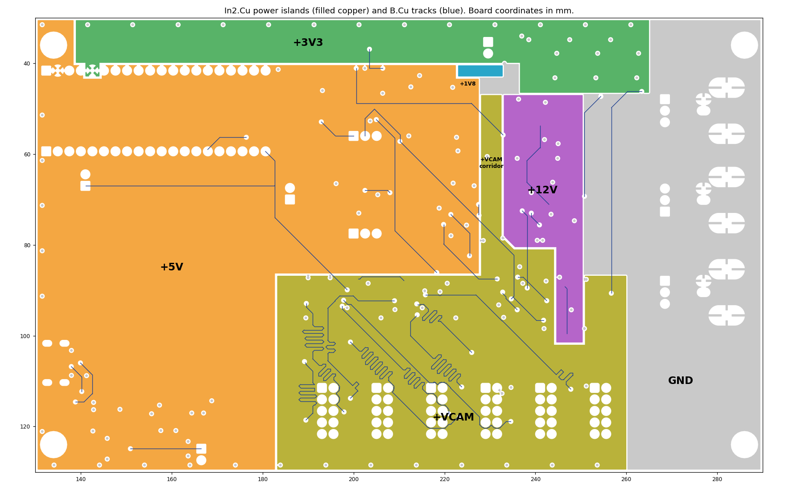

# PiEBV design notes

This page gives the design history and the layout data of the PiEBV board: the changes from
Rev 1 to Rev 2, the EuroCard mechanics, the routing and the power islands. The circuit
description is in the [hardware reference](../Hardware.md).

**Contents:** [Rev 2 changes](#rev-2-changes) · [EuroCard mechanics](#eurocard-mechanics) ·
[Routing](#routing) · [Power islands (In2.Cu)](#power-islands-in2cu)

---

## Rev 2 changes

| Item | Rev 1 | Rev 2 |
|---|---|---|
| Camera I/O level | 1.8 V only (U9) | `+VCAM`: 1.8 V with J22 open (default), 3.3 V with J22 fitted. U20 (TPS2116 power mux) selects the rail: VIN1 = +1V8, VIN2 = +3V3. R34 and R70 (10 kΩ each, in parallel) pull the select pin PR1 up to +3V3 (1.8 V); a shunt on J22 pulls it low through R35 (3.3 V). R51 discharges `+VCAM`. D1 (blue) shows 3.3 V. See [+VCAM](../Hardware.md#vcam-the-camera-signal-supply). |
| Cameras | IDS uEye EVS | IDS uEye EVS (1.8 V), or Prophesee EVK4 (3.3 V) with the harness of [docs/EVK4_HARNESS.md](EVK4_HARNESS.md) |
| Series resistors in the camera lines | none | R52–R69, 47 Ω 1 %, 0805: one in each Sync, Trigger and TDRSTN line, between the buffer output and the camera header pin. They are the source termination of the camera cable. See [+VCAM](../Hardware.md#vcam-the-camera-signal-supply). |
| Status LEDs | none | D2 12 V good, D3 ARMED, D4/D5/D6 output activity of Laser 1 / Laser 2 / External Sync Out. See [Status LEDs](../Hardware.md#status-leds). |
| Firmware pin | – | GP17 = `ARMED_LED` (output, high while ARMED) |
| Third copper layer (In2.Cu) | one +5 V plane | islands: +5V, +3V3, +1V8, +VCAM, +12V, in a GND fill. See [Power islands](#power-islands-in2cu). |
| Test pads | TP3 only | TP4–TP9: +12V, +5V, +3V3, +1V8, +VCAM, GND |
| U9, C6, C7 | beside the camera buffers | in the supply block at the top centre, beside U20 |
| Parts | 84 placed | 149 placed, plus 6 test pads |
| Finest pitch | 0.65 mm | 0.5 mm (U20, SOT-583) |
| Camera line lengths (buffer pad to resistor pad in Rev 2) | group spreads 1.18 / 2.47 / 1.37 mm (Sync / Trigger / TDRSTN, buffer pin to header pin) | `Sync1`–`Sync6` 74.082 mm, `Trigger1`–`Trigger6` 43.584 mm, `TDRSTN1`–`TDRSTN6` 51.472 mm. The spread in each group is 0.000 mm (below 0.001 mm). The stubs from the resistors to the header pins are equal in each group. |
| Routing | – | The Rev 1 camera copper is removed. The camera lines are routed again, from the buffer to the series resistor. See [Routing](#routing). |
| Copyright mark | – | Front silkscreen, lower left: `PiEBV Rev 2  (C) 2026 Louis M. Edelman, Chris Willert` and `GPL-3.0` (1 mm text). The licence of the repository is GPL v3 (`LICENSE`). |

Rev 2 is made from the Rev 1 board by `tools/rev2` (see its README). The laser pulse lanes and the
output block keep their Rev 1 copper. The camera lines do not: `tools/rev2/build.sh` removes the
Rev 1 camera copper and routes these lines again.

---

## EuroCard mechanics

Positions are as seen from the top side, with the board landscape (160 mm wide, 100 mm tall).

- **Long edges (160 mm):** no parts within 2.5 mm, the card-guide border of IEC 60297-3. This
  also suits extruded enclosures whose slots take the 160 mm edges, such as the Hammond
  1455N1601. Zone copper still goes to 0.5 mm from these edges, under solder mask.
- **All external connectors are on the two short (100 mm) edges:**
  - left edge: the Pico 2 W's micro-USB (`CONTROL / PROGRAM`) at the top, its receptacle face
    0.285 mm past the edge (x 129.715; the module and receptacle outlines are on F.Fab), TP3 (1 MHz
    scope header, right-angle) below the Pico, its pins pointing at the left edge and ending 0.96 mm
    inside it (reach it from above), and J17 (USB-C PD power input) at the bottom, face flush with
    the edge;
  - right edge: only the BNCs J7 (Laser 1), J8 (Laser 2) and J12 (External Sync Out), top to
    bottom.
- **Camera headers J1–J6:** one row along the bottom of the board, 12 mm pitch, vertical 2×5 IDC
  with the ribbons going up. They are not on an edge.
- **Cable exits:** in an enclosure closed along the long edges, the camera harnesses and the J11
  E-stop wires must leave through an end panel. Two strips of the short edges have no connector
  (measured between courtyards): on the left edge, 31.8 mm between TP3 and J17 (38.8–70.6 mm below
  the top edge); on the right edge, the lowest 31.7 mm, below J12 (MH4 is in its bottom corner).
  J11 (47.5 mm below the top edge) is level with the left strip: run the E-stop pair straight left
  and mount the normally-closed switch in the left panel there, or pass its cable through a
  grommet. The camera ribbons rise from J1–J6 and go to a slot in either strip: J1 is 58 mm from the
  left edge, J6 31 mm from the right edge. A 10-way ribbon (1.27 mm pitch) is 12.7 mm wide, so the
  slot is one ribbon wide with the ribbons stacked flat; a harness with only the five used wires
  (pins 2, 3, 4, 5 and 7) makes a smaller bundle.
- **MH1–MH4:** M3, unplated, in the corners, 4 mm in from the 100 mm edges and 6 mm in from the
  160 mm edges: centres 152 × 88 mm apart. The output block (BNCs, jumpers, resistors, U7/U8/U13/U19) sits low enough that an M3
  washer (7 mm) at MH2 clears the J7 BNC body. In card guides or the 1455N1601 slots, leave the
  holes empty (no screw, nut, washer or standoff): a 7 mm washer reaches the 2.5 mm guide border.
- **Hammond 1455N1601** (values from the Hammond drawing; confirm them on a sample): 11 board slots
  (2.0 mm wide, 3.5 mm pitch), slot span 100.00 ± 0.51 mm, length 160.00 ± 0.50 mm, so the nominal
  clearance to the board is zero: measure the extrusion before ordering, and dress the long edges
  by no more than 0.2 mm (the plane edges are 0.5 mm in). Use the lowest or the second
  slot: about 41.8 or 38.3 mm above the board top. Below the board, the corner rails reach about
  6.4 mm in from each long edge; only MH1–MH4 are in that strip, and the bottom side has no parts.
  The end-bezel window is 97.1 × 48.7 mm; all the cut-outs below are inside it.
- **End-panel cut-outs** (distances from the top 160 mm edge, y = 30; heights above the board top):

  | Edge | Item | Centre from top edge | Notes |
  |---|---|---|---|
  | left | Pico micro-USB | 20.50 mm | about 13 mm up (on its sockets); face 0.285 mm past the edge |
  | left | TP3 (1 MHz + GND) | 34.46 / 37.00 mm (GND / 1 MHz pin) | pins end 0.96 mm inside the edge; no cut-out needed, reach it from above |
  | left | J17 USB-C | 76.00 mm | flush with the edge |
  | right | J7 / J8 / J12 BNC | 20.445 / 40.130 / 60.450 mm | axis about 6.6 mm up; barrels about 20.6 mm past the edge |

  Size each USB cut-out for the cable plug's overmould, not for the receptacle: J17 is flush and the
  Pico receptacle is only 0.285 mm proud, so a panel of normal thickness otherwise stops the plug
  before it seats (USB-C overmould up to 12.35 × 6.5 mm; measure the micro-USB cable). The right
  panel is seen from outside: mirror the drawing if it is drawn from the inside.

---

## Routing

- **Tracks on F.Cu and B.Cu only.** In1.Cu is a solid GND plane and In2.Cu holds the power islands.
  The Rev 1 board was
  autorouted with KiCadRoutingTools (github.com/drandyhaas/KiCadRoutingTools, commit 8759686,
  v0.23.8): 0.3 mm signals, 0.5 mm power, 0.6 mm buck switch node, 0.3 mm USB-C CC lines, 0.2 mm
  clearance. The Rev 2 build uses the same tool (same commit) for the camera lines only; all
  other copper is locked during that step.
- **Carried copper.** The hand-routed copper of the laser and External Sync Out output block (nets
  `CH1/2_GATED`, `CH1/2_DRIVE_RAW`, `CH1/2_DRIVE`, `CH1/2_OUT`, `CH1/2_TERM`,
  `EXT_SYNC_DRIVE_RAW`, `EXT_SYNC_DRIVE`, `EXT_SYNC_OUT` and `EXT_SYNC_TERM`, with their GND vias) and the exposed-pad thermal vias of U14 and U17 were kept unchanged. So were the hand-routed local paths of the parts that keep their original relative positions: the buck's input (C12 to U15 VIN and GND, 2.35 mm each), its SW node (U15 to L1 3.1 mm, with C13) and BST, and each decoupling capacitor of the camera buffers to its two ICs' supply pins (for example C2 to U3, 4.2 mm, no via). C11 sits beside U14's VHV pin (pin 1), 2.5 mm of track.
- **Laser pulse lanes, equal length.** A script drew `_PULSE_OUT_CH1` and `_PULSE_OUT_CH2`
  (0.3 mm, F.Cu) before routing and locked them. From the GPIO pin to U13's input, both channels are
  **66.16 mm** (CH1: 55.75 mm to U7, then 10.41 mm; CH2: 56.49 mm to U8, then 9.67 mm). The
  shorter lane has a small 45° bump. On the 126 mm board they were 86.32 and 81.74 mm, 4.6 mm
  apart. CH2's lane also has a 22.78 mm branch to R18.1 (its 10 kΩ pull-down), drawn as a balance
  stub: its length trims the CH1-minus-CH2 skew at U7/U8 for the R19/J10 load on CH1, whose
  R19/R17 branch is 7.8 mm. R19.2 continues CH1's pulse as `CH1_J10` (behind 100 Ω) to J10.1.
  Gaps, edge to edge on one layer (tracks and vias; pads where stated; zone fills not counted;
  `tools/eurocard/netgap.py`): the two lanes are at least 2.24 mm apart; lane copper is at least
  21.70 mm from `PWM_1MHz` and `SYNC_N` (the nearest part is the R18 branch); to all other nets it
  is at least 0.45 mm: 0.45 mm to the `CH1_J10` via at (192.9, 52.9) (CH1's own pulse behind
  R19), 0.54 mm to `CLK_SEL` (a 0.9 mm parallel run of the CH2 lane at x 171.5–172.4, y
  64.3–65.2), 0.60 mm to the GND track from U7.3 (the pin next to the lane's pin U7.2), 0.63 mm
  to `LASER_EN` at U8.1, 0.95 mm to a
  `PIXRST_GATE` via, and 1.9 mm or more to every other net. At the pins the pin pitch sets the gap:
  0.22 mm from the U7.2 pad to a `LASER_EN` track, 0.30 mm between the U7/U8 pads, 0.84 mm
  between the J14 socket pads, and 3.91 mm from the CH2 lane to the J14.20 (`PWM_1MHz`) pad.
- **Camera lines, length-matched** (Rev 2). Each camera line has two parts: the routed line from
  the buffer output pad (U2, U6 or U4) to the pad of its series resistor (R52–R69), and a short
  F.Cu stub from the resistor to the header pin. The Rev 1 camera copper does not exist any more.
  Lengths from the buffer pad to the resistor pad, as KiCad's length tool measures (via length
  included):

  | Group | Buffer pad to resistor pad | Spread | Rev 1 spread | Stub, resistor to header pin |
  |---|---|---|---|---|
  | `Sync1..6` | 74.082 mm | 0.000 mm | 1.18 mm | 4.85 mm |
  | `Trigger1..6` | 43.584 mm | 0.000 mm | 2.47 mm | 9.77 mm |
  | `TDRSTN1..6` | 51.472 mm | 0.000 mm | 1.37 mm | 5.09 mm |

  The spread in each group is below 0.001 mm. The stubs are the same for all six headers. These are KiCad's readings:
  KiCad cuts each track at the pad outline. The track ends are at different points in the pads
  (as much as 0.9 mm from the pad centre), so the copper path from pad centre to pad centre can
  differ by about 1 mm (about 6 ps) in a group. KiCad's reading is the reference for the design
  (owner's decision). The router makes the board's standard via (0.6 mm pad, 0.3 mm hole). All
  20 camera vias are 0.6 mm with a 0.3 mm hole, so the board has one via size.
  `tools/rev2/viafix.py` stops the build if a camera via has another size. The match starts at the
  buffer output, not at its input: the input fan-outs (`SYNC_N` from U1.4, `TRIG_N` from U5.4 and
  `PIXRST_N` from U3.4, each to the six gate inputs of its hex buffer U2, U6 or U4) are not matched,
  and their branch lengths differ by 6–11 mm. On the 126 mm board the camera lines were not matched
  (Sync 28–71 mm, Trigger 21–56 mm, TDRSTN 20–41 mm). The build checks that the spread in each
  group is 0.1 mm or less, and that two parts of one camera line are at least 0.3 mm apart
  (`tools/eurocard/meander_check.js`). The item "Rev 2 build of the copper" below gives the
  steps. The gaps between the three groups were not measured again after the new routing.
- **Plane taps.** Each SMD GND and +5V pad that the carried hand copper does not already touch has
  its own short tap track to a via into In1 or In2, placed outward from the part body
  first. Rev 2 adds the taps of the new parts and of the other rails (table under
  [Power islands](#power-islands-in2cu)). The buck's GND link (C12.2 to U15.4) keeps its two hand vias, 1.74 and 1.90 mm from
  C12.2. +5V has only 19.26 mm of surface copper (14 segments); the In2 plane carries it.
- **Reference planes (F9).** F.Cu signals run over In1 GND and B.Cu signals over the In2 islands, both
  0.21 mm away. In Rev 2 every B.Cu camera track is over the +VCAM island,
  and `PWM_1MHz` and `PWM_TRIG_TAP` each cross one island gap (+5V to +VCAM); see
  [Power islands](#power-islands-in2cu). The rest of this item is the Rev 1 analysis (In2 = one +5 V plane, Rev 1 camera copper). On B.Cu: Sync 413.9 mm, Trigger 15.9 mm (Trigger6), TDRSTN 249.8 mm, `PWM_1MHz`
  79.6 mm, `PWM_TRIG_TAP` 70.2 mm, `PIXRST_GATE` 39.2 mm. Their return current flows in the +5 V
  plane; at a layer change it crosses to GND through the B.Cu GND pour over In2 (about 18.9 pF/cm²)
  and the In1–In2 core (about 3.7 pF/cm²). The discrete +5 V-to-GND capacitors are C4 and C5
  (224, 57.8 / 60.8) and C6 (214.5, 78.7). Decision: no extra GND return vias. The review's option
  (`route_planes.py --add-gnd-vias --gnd-via-distance 1.5` in the stitching step) would add 50 GND
  vias beside the signal vias on this routing, with no track change; the finding is low severity
  for these 1.8 V LVC lines (edges about 1–3 ns), so the verified copper is kept. Add the option
  if EMI measurements call for it, then run the build checks again.
- **R9 / J10 area.** `PIXRST_GATE` on B.Cu, from its via at (205, 52.4) to its via at (218.3, 86.1),
  runs 45°, vertical at x 209.1, 45° (`simplify.py`). The router's 1.8 mm 45° jog between two
  verticals (x 208.2 and x 210) is removed. The length is the same (39.21 mm on B.Cu) and the vias
  do not change. The vertical is 0.65 mm from the `PWM_TRIG_TAP` via at (210.2, 57.2) and from the
  `LASER_EN_TAP` via at (208.0, 68.5), and 1.13 mm from the +5V tap via at (210.68, 67.05) (was
  0.23 mm). The other shapes there are necessary. `PWM_TRIG_TAP` leaves J10.2 up and over the
  `PIXRST_GATE` via, then comes down to its via at R9.1. The two nets must cross, and they can
  cross only above the CH1 pulse lane (F.Cu, y 53.8), where `PIXRST_GATE` is still on F.Cu. Its
  via (210.2, 57.2) is R9.1's only connection (R9 is a front SMD part), so it is not a plane jump
  on the J10-to-U5 path. `CH1_J10` needs its via to cross the lane (no via in the R19.2 pad), and
  `PWM_Trig` leaves J10.3 with one 45° run.
- **Totals (Rev 2):** 1453 track segments, 2966.9 mm of track (F.Cu 2066.5 mm, B.Cu 900.5 mm), 221 vias
  (`tools/rev2/stats.py`). No two segments are identical. Rev 1: 1015 segments, 2489 mm, 173 vias.
- **Rev 2 build of the copper** (`tools/rev2/build.sh`). The steps, in order:
  1. `pcb_edit.py` removes the Rev 1 camera copper. It places R52–R69 with their stubs. It draws
     `Trigger3` itself (F.Cu, four teeth, 45.8 mm as drawn): the resistor of this line is about
     12 mm from its buffer pin, and the router cannot make the line longer.
  2. `uuidfix.py` gives the board file a fixed item order. pcbnew writes random item IDs, and the
     router result depends on the item order.
  3. KiCadRoutingTools (commit 8759686, the tool of the Rev 1 EuroCard build) routes the other 17
     camera lines from the buffer to the resistor. All other copper is locked. The lines are
     length-matched in each group. The router makes 0.6 mm vias with a 0.3 mm hole (via cost
     225). The net order was searched again for these vias (about 230 router trials in total).
  4. A check confirms that the router changed no other copper (91 other nets).
  5. `jogs.py` merges 59 router staircases on 13 nets: two steps in one direction become one
     step, so the track length is the same. The choice for each staircase is in
     `jog_choices.json`; `jogfit.py` fits that file to a new routing.
  6. `tidy.py` makes 2 hand edits: a kink on `+5V_PD`, and `+12V` at U19.
  7. `viafix.py` moves a camera track end that is within 0.2 mm of its via to the via centre
     (0 ends on this routing). It stops the build if a camera via is not 0.6 mm with a 0.3 mm
     hole. Then `trim.py` makes the lines of each group equal by KiCad's own length reading
     (three passes). It moves meander caps. A line with no meander gets one square bump.
     `Trigger3` is trimmed with the other lines (final length 43.584 mm).
  8. `spokes.py` adds 5 small pour cut-outs at header GND pins where a camera track leaves only
     one thermal spoke on F.Cu or B.Cu. These pins keep their full connection to the In1 GND
     plane.
  9. `uuidfix.py` runs again. Then the checks run: the DRC gate, the length check (limit 0.1 mm
     spread in each group), the meander check (0.3 mm) and the plane check.

  The build is repeatable: two runs gave the same router output.
- **Known residuals** (none is a DRC error):
  - Twelve staircases on camera lines stay as the router made them (`"skip"` in
    `jog_choices.json`: seven on `Sync2`, three on `Sync5`, two on `TDRSTN3`). `jogs.py` draws
    16 more staircases the other way (`"B"`). A merge at these
    places makes a DRC violation.
  - The segment density and the number of short segments were not measured again after the new
    camera routing.
  - Two GND vias carried from Rev 1 have their ring 0.20 mm from their own pad: U13.3 via
    (236.0, 60.935) and U19.3 via (241.9, 98.435) (hole edge 0.35 mm from the pad). The tap vias
    of the Rev 1 build are at least 0.25 mm from their pad; that 0.25 mm is the rule of the Rev 1
    tool `taps.py`, not a DRC rule. No DRC rule applies
    here: the board's clearance rules (netclass `Default` clearance 0.20 mm, `min_hole_clearance`
    0.20 mm) are checked only between different nets, and KiCad 10 checks no clearance between a
    via and a pad of the same net (test on a copy: the U13.3 via moved until its hole touched the
    pad, DRC still clean). Both vias are tented on both sides (board setup `tenting front / back`,
    no per-via override), so no via copper is open to solder next to the pad.

---

## Power islands (In2.Cu)

In2.Cu is the power layer. Rev 1 had one +5 V plane. Rev 2 has one island for each rail, in a GND
fill. Parts connect to their island through a via beside the pad on the top layer (a tap), or
directly if the pad is a through-hole pad. The outlines are in `tools/rev2/pcb_edit.py` (section 4).

| Island | Where | Copper area | Taps | Parts on it |
|---|---|---|---|---|
| +5V | the left and centre of the board: Pico, bottom left (U16), the logic between the Pico and the output drivers | 6443 mm² | 13 vias, J15.2 | Pico VSYS, U16, U7, U8, U10, U9 (input), C4–C6, R2, R3, R36, TP5 |
| +3V3 | a band along the top edge from J15.5 to x = 265, wider under U21–U23. The tab at the J15.5 socket pad is 3.1 mm wide (x 141.0–144.1). | 1345 mm² | 7 vias, J15.5 | R24, R34, R70, U20 (VIN2, MODE), C24, U21–U23, TP6 |
| +1V8 | from the U9 output tap via, below U20, to a second via east of U20 | 24 mm² | 2 vias | U9 output, C7 and TP7 at the first via; U20 (VIN1) at the second via. +1V8 reaches U20 through the island, not through a top-layer track. |
| +VCAM | under U1–U6 and all camera lines down to J1–J6, with a 4.5 mm corridor up to U20 | 3134 mm² | 5 vias | U20 (VOUT), C23, R51, U1–U6, C1–C3, D1, TP8 |
| +12V | under U13 and U17, with a lobe down to C22 / U19 | 683 mm² | 7 vias | U13, U19, U17 output, C9, C10, C17, C21, C22, R12, R16, TP4 |
| GND | the rest of the layer (mainly the right side, under the output block) | 2974 mm² | – | – |

The areas and the tap counts are from `tools/rev2/plane_check.py` (`tools/rev2/work/final/plane.txt`
after a build).

- **Gaps.** Two islands are 0.5 mm apart. The GND fill stays 0.25 mm from the islands.
- **Fed by tracks, not by the plane:** the +12V supply of U18, C20 and R21 (the power-good
  window). Their two +12V vias, at (225.5, 82.4) and (221.4, 73.3), pass through the +5V island
  with clearance; `plane_check.py` lists them. With these two the board has 9 +12V vias.
- **Reference planes of B.Cu tracks** (`tools/rev2/plane_check.py`). B.Cu tracks have In2.Cu
  0.21 mm above them. Every B.Cu camera track (Sync, Trigger, TDRSTN)
  is over the +VCAM island: no camera line crosses a gap.
  `PWM_1MHz` crosses one gap at (195.0, 86.3) and `PWM_TRIG_TAP` one at (227.6, 74.6), both from
  +5V to +VCAM. `PIXRST_GATE` and `PWM_Trig` stay over +5V. `CH2_SENSE` runs over GND fill
  only. `SYNC_SENSE` crosses two island gaps, at (256.7, 86.8) and (260.0, 46.5). It carries the
  External Sync pulse to U23; the monostable input is not timing-critical. The other B.Cu
  tracks that change island carry DC or LED signals (`LASER_PWR_OK`, the D2 cathode link,
  `+12V`). The plane check tests the zone outlines. DRC (0 unconnected items) covers the fill
  connections.
- **Effect of a gap crossing** (`rev2_sim.py`, case 5). Over the gap the track impedance goes
  from 54 Ω to about 79 Ω (0.3 mm track) or from 41 Ω to 69 Ω (0.5 mm track) for about 1 mm,
  because the B.Cu GND fill beside the track and the In1 plane carry the return current there.
  The simulation gives a delay change of 2 ps or less and a waveform change of 11 mV or less at
  the receiver; with no GND fill beside the track the bound is 3 ps and 20 mV.
- **Mounting holes.** The 3 mm-radius copper keep-out around each M3 hole applies to all islands
  and to the GND fill.
