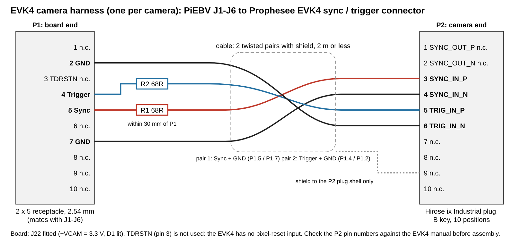

# EVK4 camera harness

This document specifies the wire harness that connects one camera port of the PiEBV Rev 2 board
(J1–J6) to one Prophesee EVK4 HD camera. One harness is necessary for each camera.

**Status:** design only. No harness is built or tested. The items in
[Open items](#open-items) must be closed before you build it.

## Conditions on the board

| Item | Setting | Why |
|---|---|---|
| J22 (camera I/O level) | **Shunt fitted** | The camera buffers U1–U6 then run from 3.3 V. With J22 open they run from 1.8 V, which is too low for the EVK4 inputs. |
| D1 (blue, `3V3`) | Lit | It shows that the camera lines are at 3.3 V. |
| Camera types | EVK4 only on all six ports | J22 sets the level of all six ports. Do not connect an IDS camera while J22 is fitted: its 1.8 V pins would get 3.3 V. |
| `PIXGATE` | Not used | The EVK4 has no pixel-reset input. The `TDRSTN` line (pin 3) stays open in the harness. |

## Signals

| Board J1–J6 pin | Board signal | Harness | EVK4 pin | EVK4 signal |
|---|---|---|---|---|
| 5 | `Syncn`, 1 MHz | R1 (68 Ω) in series, pair 1 | 3 | SYNC_IN_P |
| 7 | GND | pair 1 | 4 | SYNC_IN_N |
| 4 | `Triggern` | R2 (68 Ω) in series, pair 2 | 5 | TRIG_IN_P |
| 2 | GND | pair 2 | 6 | TRIG_IN_N |
| 3 | `TDRSTNn` | not connected | – | (no pixel-reset input) |
| 1, 6, 8, 9, 10 | not connected on the board | not connected | 1, 2 | SYNC_OUT_P / SYNC_OUT_N: not connected |
| – | – | – | 7–10 | not connected |

The EVK4 inputs are opto-coupled. Each input is a pair of pins (P and N) with no connection to the
camera ground, so each signal has its own return wire. The harness makes no connection between the
board ground and the camera ground.

## Electrical data

The EVK4 data below is from the Prophesee EVK4 HD camera manual (v1.1 and v1.2) as a web search
reported it. The manual could not be opened from the machine that made this design
(see [Open items](#open-items)).

| Parameter | EVK4 (manual) | PiEBV Rev 2 at J1–J6, J22 fitted |
|---|---|---|
| Input high level, Sync In / Trigger In | 2.5 V to 5.5 V, 3.3 V typical | 2.78–3.04 V at the camera with R1/R2 = 68 Ω (simulation, 0.5 m and 2 m) |
| Input low level | 0 V to 2 V | below 0.1 V |
| Input current when high | 2.7 mA; 5.4 mA at 3.3 V | 3.6–4.4 mA with R1/R2 = 68 Ω |
| Sync clock | 1 MHz pulse train (camera in slave mode) | 1 MHz, 50 % duty |

The simulation is `tools/signal_sim/rev2_sim.py`, case 2 and case 3
(`tools/signal_sim/results_rev2.md`). The EVK4 input is modelled as a 296 Ω resistor in series with
an LED. This model is an estimate that fits the two currents in the manual.

### Why the series resistors

The cable is a transmission line of about 100 Ω. At 3.3 V the output resistance of the board's
buffers (SN74LVC04A) is 15–50 Ω, which is less than the cable impedance. Without a series resistor
the edge overshoots at the camera end: the simulation gives a peak of up to 5.7 V (the EVK4 limit is
5.5 V), −3.0 V after a falling edge, and a fall back to 2.2 V after a rising edge (below the 2.5 V
high level). With 68 Ω in each signal wire at the board end the peak is 3.5 V or less, the level
after a falling edge is −0.5 V or more, and the lowest level after a rising edge is 2.58 V.

The resistors must be at the **board end** (within about 30 mm of P1). A resistor at the camera
end does not stop the overshoot.

## Parts

| Ref | Part | Quantity for each harness | Notes |
|---|---|---|---|
| P1 | 2 × 5 receptacle, 2.54 mm pitch, crimp or solder contacts | 1 | It must go into the shrouded box header J1–J6 (LCSC C5665). If the housing has no polarising key, mark pin 1 on it. Pin 1 of J1–J6 has the square pad and the triangle mark on the header. |
| P2 | Hirose ix Industrial plug, key B, 10 positions: `IX30G-B-10S-CV(7.0)` or `IX31G-B-10S-CV(7.0)` | 1 | Part numbers as given in the EVK4 manual for the mating plug (camera receptacle: `IX80G-B-10P`). `(7.0)` is the cable diameter that the plug accepts. Read the Hirose data sheet for the difference between IX30G and IX31G (termination type) before you order. |
| R1, R2 | 68 Ω, 5 % or better, 0.125 W or more | 2 | Axial or SMD part in line with the signal wire, under heat-shrink sleeving. Dissipation is less than 2 mW. |
| W1 | Cable with 2 twisted pairs and an overall shield, AWG 26–28, outer diameter 7 mm or less | 2 m or less | One pair for each signal with its return. Longer cables were not simulated. |
| – | Heat-shrink sleeving | as necessary | Over R1, R2 and over the cable end at P1. |

## Assembly

1. Cut the cable to length (2 m or less). Remove 40 mm of the jacket at the P1 end and the length
   that the Hirose assembly instruction gives at the P2 end.
2. P1 end: cut the shield back to the jacket and insulate it. Do not connect it to P1.
3. P1 end: solder R1 in line with the signal wire of pair 1 and R2 in line with the signal wire
   of pair 2. Keep each resistor within 30 mm of P1. Put heat-shrink sleeving on each resistor.
4. P1 end: terminate the four wires: pair 1 signal (through R1) to pin 5, pair 1 return to pin 7,
   pair 2 signal (through R2) to pin 4, pair 2 return to pin 2. Leave pins 1, 3, 6, 8, 9 and 10
   empty.
5. P2 end: terminate pair 1 signal to pin 3, pair 1 return to pin 4, pair 2 signal to pin 5 and
   pair 2 return to pin 6. Clamp the shield in the plug shell as the Hirose instruction shows.
   Leave pins 1, 2 and 7–10 empty.
6. Put a label on the harness: `EVK4 / 3V3 / J22 FITTED`.

## Test before you connect a camera

Do these checks with a multimeter, with the harness disconnected at both ends.

| Check | Result |
|---|---|
| P1.5 to P2.3 | 68 Ω ± 5 % (plus less than 1 Ω of wire) |
| P1.4 to P2.5 | 68 Ω ± 5 % |
| P1.7 to P2.4, P1.2 to P2.6 | less than 1 Ω |
| P1.2 to P1.7 | open circuit (the two returns join only on the board) |
| Each of P2.3, P2.4, P2.5, P2.6 to the P2 shell | open circuit |
| P1.1, P1.3, P1.6, P1.8, P1.9, P1.10 to all other pins | open circuit |

Then connect the harness to the board only, fit J22, and measure at P2 with the board powered:
P2.3 to P2.4 must show a 1 MHz square wave of 0 V to about 3.3 V, and P2.5 to P2.6 the marker
pulse. Connect the camera after that.

## Camera settings

- Set each EVK4 to sync **slave** mode. The board is the source of the 1 MHz clock.
- The Metavision documentation says that the Trigger In circuit of the EVK4 inverts the signal: a
  falling edge at the input gives an event of polarity 1 and a rising edge gives an event of
  polarity 0. The leading (rising) edge of the board's marker pulse is thus the polarity 0 event.
- Prophesee specifies a minimum trigger pulse of 500 ns. Set `MARKERWIDTH` to 500 ns or more.

## Open items

1. **Pin numbers of the EVK4 connector.** Pins 1–6 and "7–9 not used" are from web-search
   summaries of the EVK4 HD manual. Pin 10 was not reported. Compare the full pin table in your
   copy of the manual with the table above before you build a harness.
2. **Plug part number.** Confirm the mating plug and its termination type in the manual and in
   the Hirose ix Industrial data sheet.
3. **Input model.** The 296 Ω + LED model is an estimate. On the first harness, measure the level
   between P2.3 and P2.4 with the camera connected: it must be 2.5 V or more when high. If it is
   lower, decrease R1/R2 (47 Ω gives about 0.1 V more).
4. **Cable length.** 0.5 m and 2 m were simulated. For a longer cable, do the simulation again
   (`lengths_m` in `tools/signal_sim/devices.json`).
